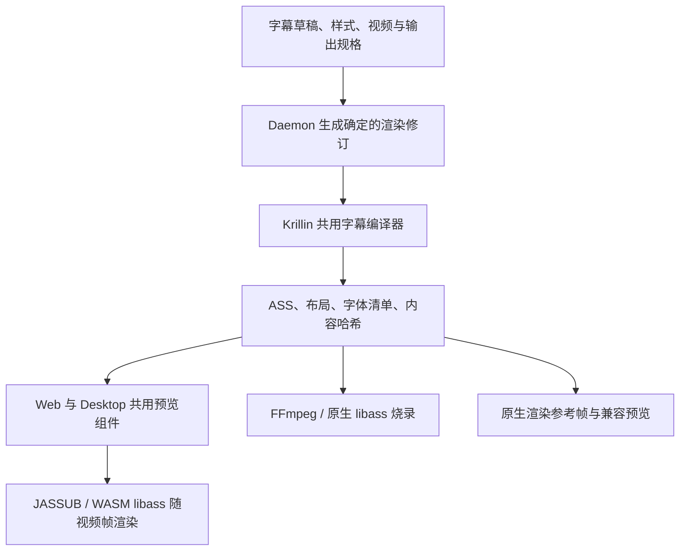

OpenCreator 字幕预览与烧录一致性改造方案

本文记录实施方案。2026-10-20 已完成共用字幕编译器、浏览器 libass 预览、完整时间线、随包字体校验与回退、横竖屏布局和全屏接入；具体实现、验收数据和剩余差异见[实施与验收报告](subtitle-preview-burnin-validation.md)。以下保留方案设计，协议示例应以实际代码为准。

**1. 完成标准与范围**

在同一项目版本、字幕草稿、样式和输出规格下，字幕的文字、原译文顺序、字体、字号比例、换行、位置、描边、阴影和显示时间应一致。普通预览与深度编辑使用同一组件；Web 与 Desktop 使用同一 Web 实现和 Daemon 服务。

这里的一致性分为三层：

| 层次 | 标准 |
| --- | --- |
| 数据一致 | 相同渲染修订必须引用相同 ASS 字节、字体文件和布局；通过 SHA256 验证 |
| 排版一致 | 行数、断行、双语角色、锚点、画布和视频内容区域一致 |
| 视觉一致 | 在统一尺寸和时间点对比字形、位置、描边、阴影；编码和色彩转换误差单独测量 |

成片压缩后的 RGB 像素会受 YUV 转换、色度采样、缩放和播放器色彩管理影响，因此不把“压缩后每个像素相等”作为承诺。编码误差不能解释行数、位置、缺字、字体或时间差异。

本轮覆盖静态单语和双语字幕、现有字体/样式、现有横竖屏、横转竖标题、播放/暂停/拖动/倍速/全屏。已有字幕作为测试输入，不触发重新转录、翻译或 LLM 调用。复杂字幕动画可使用共享时间线架构承接，首轮不扩展编辑功能。

**2. 已确认的现状**

| 位置 | 现状及影响 |
| --- | --- |
| `VideoTranslationResultWorkspace.tsx` | 只有深度编辑分支调用样式预览；普通预览采用网页文字叠加 |
| `dashboard.css` | 普通预览固定 13px、白字、黑底、距底部 50px，没有对应烧录样式 |
| `VideoTranslationWorkspace.tsx` | 当前实时预览合并活跃字幕、压平空白、删除部分字符，并截取 128 个字符 |
| `VideoTranslationStylePreview.tsx` | 每次输入变化等待 200ms，再发起图片请求；切换过程中旧图被撤销 |
| `subtitle-preview.ts` | 每次请求临时构造一条一秒 SRT，启动 CLI 和 FFmpeg，生成透明 PNG |
| `srt_embed.go` | 实际烧录还会进行文本处理、换行、多语言字体选择；不能在浏览器另写一套近似逻辑 |
| `style.go` | ASS 使用 384×288 脚本坐标；这是现有样式的坐标约定，不能直接判定为错误或直接替换 |
| `buildVerticalFilter` | 横转竖使用 720×1280 画布、固定视频偏移和 drawtext 标题，与 CSS 预览布局不同 |
| Desktop 协议处理 | 已支持 WASM MIME 和 Worker 来源；当前 HTML CSP 的 `script-src 'self'` 还需验证 WASM 编译许可 |

前一轮的四组后端同尺寸预览/烧录字形对比已通过。它们证明后端图片能力可以复用，尚不能证明完整页面、不同画幅或原生/WASM 渲染一致。

**3. 总体链路**

统一输入包含字幕时间线、语言角色、样式、源视频元数据和输出布局。Daemon 调用唯一的字幕编译器生成渲染包，浏览器与烧录共同消费该渲染包。



浏览器采用 JASSUB，但只在技术验证通过后锁定具体版本。它提供 libass 的 WebAssembly 封装、Worker 和 Canvas 渲染。仅引入该库不会自动保证一致；版本、字体、输入、缩放和时间仍需共同约束。

ASS 编译器继续放在 Go 侧，提取并改造现有 SRT→ASS 能力。Daemon 负责调度、缓存和产物访问。浏览器接收编译结果，不再根据原文自行换行、猜双语角色或重新映射样式。

**4. 共享输入和渲染包**

以下为建议的协议轮廓，具体接口名在实施时确定：

```ts
type SubtitleRenderInput = {
  schemaVersion: 1;
  clientRevision: number;
  resultVersion: number;
  variant: 'horizontal' | 'vertical';
  cues: Array<{
    id: string;
    startMs: number;
    endMs: number;
    targetText: string;
    sourceText?: string;
    // 原译文不共用时间段时，适配层保留独立角色事件。
  }>;
  bilingual: boolean;
  targetPosition: 'top' | 'bottom';
  style: SubtitleStyle;
  layout: VideoCompositionLayout;
};

type SubtitleRenderBundle = {
  schemaVersion: 1;
  clientRevision: number;
  contentHash: string;
  compilerVersion: string;
  assSha256: string;
  assUrl: string;
  layout: VideoCompositionLayout;
  fonts: Array<{
    id: string;
    family: string;
    sha256: string;
    url: string;
  }>;
  rendererProfileId: string;
  diagnostics: Array<{ cueId?: string; code: string }>;
};
```

`contentHash` 包含确定的字幕事件、样式、布局、字体清单版本和编译版本。播放位置、编辑器焦点和预览面板大小不进入内容哈希，也不生成新修订。

预览准备使用结构化 POST，例如 `/creator/subtitle-render/prepare`，替代把整份字幕塞入 GET 查询串。它通过现有 Runtime 鉴权，只编译草稿，不自动保存字幕、不创建生成任务。字体和 ASS 使用受控资源 ID、同源 URL，不开放任意本地路径访问。

每次响应携带 `clientRevision`。用户快速修改后，旧响应不得覆盖新输入；切换项目、版本或横竖屏也必须失效旧响应。退出页面时取消请求、销毁 Worker 和 Canvas、释放对象 URL。

点击生成成片时，先冻结当前字幕和样式修订并保存；后端核对该修订的内容哈希。命中时直接消费相同 ASS 产物，未命中时通过同一编译器重建并验证哈希。字幕、样式或布局变化后必须产生新渲染包，禁止沿用旧 ASS。

**5. 字幕编译与内容保真**

建议新增独立的 `compile-subtitles` CLI 能力，将编译与编码分开。原有 render 命令也调用同一个编译入口，或接收由系统生成并验证过的 ASS 产物；不能在最终烧录前再走另一套转换。

编译器输入应明确目标语言、源语言及各自事件，不靠“第几行”“是否包含中文”决定语义角色。现有普通 SRT、双语 SRT 和竖屏混合时间线由兼容适配层转成统一事件。原文与译文时间段不同、重叠事件、原文为空、单语切换都需要明确处理。

内容处理约束：

- 完整保留当前修订中的文字、标点和有意换行；移除预览专有的 128 字符截断。
- 文本到 ASS 采用统一、可测试的纯文本转义，保证字面花括号、反斜线等能正常显示，且不会成为意外覆盖标签；不通过删除原字符规避问题。
- 现有标点清理与换行逻辑逐项核对。为兼容而保留的规则只在共用编译器执行；新路径不能额外修改用户已经编辑好的内容。
- 重叠字幕保留独立事件及层级，不把多个活跃 cue 拼接成一段文字。
- ASS 时间量化规则确定且只执行一次；毫秒输入到 ASS 精度的误差单独记录，不能在前后端反复换算。
- 根据文本脚本和实际字形覆盖选择随包字体，生成明确的字体切换和所需字体清单。

自动换行也必须是共用策略。现有 CJK/Unicode 显式换行和 libass 的自然换行均需在两端验证。发现原生与 WASM 自动换行不同，先定位版本与字体问题，不能允许预览与烧录分别补丁。

对于此前强调的电视字幕，一种语言占一行，双语各占一行。单行超宽应标记到对应 cue，并通过字号/安全区调整或既有分句编辑解决。不能用预览端截字来隐藏超宽，也不能只在烧录时自动增加一行。该策略作为明确的渲染配置随修订保存，既有项目按其原策略读取。

**6. 画布、坐标与横转竖**

布局同时记录以下信息：

| 字段 | 用途 |
| --- | --- |
| 输出画布宽高 | 成片的真实坐标空间，例如 1920×1080 或 720×1280 |
| 源视频显示信息 | 编码尺寸、旋转、像素宽高比与显示宽高比 |
| 视频目标矩形 | 缩放/裁切后视频在输出画布上的 x、y、宽、高 |
| 字幕与标题区域 | 对齐、边距、安全区、层级 |
| ASS 脚本坐标 | 与现有字号和边距配套的脚本尺寸 |
| 帧率和时间基准 | 预览取帧与导出 PTS 对齐 |

浏览器与 FFmpeg 使用同一布局计算结果。浏览器仅将输出画布等比例缩放到可用区域；容器留黑不参与字幕位置计算。4:3、1:1、超宽屏都采用实际画幅，不能按 horizontal 标签统一替换成 16:9。

首期保留现有 384×288 ASS 坐标及样式值，显式记录其与输出画布的关系，并校准 libass 的 frame size、storage size、像素宽高比及描边缩放设置。直接把 PlayRes 改为视频宽高而不迁移字号和边距，会改变所有旧项目外观，应避免混在本次改造中。

横转竖先以现有输出布局为兼容基线。例如当前 1920×1080 横片转换到 720×1280 后，视频为 720×405，顶部偏移由现有规则决定；预览必须读取相同矩形。标题改为统一 ASS 事件，使用明确位置、字体和层级；FFmpeg 不再另行 drawtext 同一标题，浏览器也不再另写 CSS 标题。

视频缩放/补边后在最终画布上统一合成标题和字幕，目标是一次视频编码。旧的中间竖屏文件缓存必须纳入布局哈希，解决仅凭文件存在就复用旧标题/布局的情况。已有竖屏输入保留其既有输出策略。

**7. 字体和渲染器一致性**

当前已有 9 个样式字体和 23 个回退字体；桌面字体约 31.42 MiB，Web WOFF2 约 11.87 MiB。接入时不要求每个项目启动都加载全部字体。

对字幕渲染，优先让原生和 WASM 使用同一套 TTF/OTF 字节，并用 SHA256 约束；现有 WOFF2 可以继续服务普通网页文字。字体通过受控的按需资源接口提供，首帧所需字形对应字体先加载，后续按脚本与样式缓存。禁止悄悄回退到用户系统或在线字体导致结果随机器变化。

已有 `system` 预设继续按现有适配行为映射到随包字体，避免在预览端解释为操作系统字体。字体切换、粗细、特殊字符及多语言混排需要明确验证。

建立渲染器构建记录，包含 JASSUB、libass、FreeType、HarfBuzz、FriBidi、关键构建选项和字体清单。现有 FFmpeg 二进制所含的原生库版本必须实际核查。不能因为两边都叫 libass 就认定一致；若基准测试发现差异，再对齐对应库和构建设置。

首轮技术验证至少包括拉丁文、中文、阿拉伯文、印地文以及 Thai 等无空格脚本，验证换行、RTL、连字、组合字符、粗体、描边和阴影。跨平台原生二进制也要纳入构建记录。

**8. 实时预览、同步与性能**

普通预览、深度编辑和样式设置预览接入同一组件，例如 `SubtitleCompositionPreview`。实际播放时向渲染器装载完整 ASS 时间线，逐帧选择字幕；React 编辑器列表和当前 cue 高亮可以低频更新，不承担每帧绘制。

- 优先使用 `requestVideoFrameCallback` 的 `mediaTime`；降级采用视频时间配合可见状态下的绘制调度，不使用墙上时钟推算进度。
- 播放、暂停、跳转、倍速、倒退和视频源切换都要重绘；暂停状态下修改文字或样式也要立即重绘当前帧。
- 字幕边界按照统一事件区间处理，兼容 ASS 时间精度。VFR 视频以实际帧时间验证。
- 全屏操作作用于包含视频和字幕 Canvas 的共同容器。对浏览器原生 video 全屏不能带入 DOM 叠层的平台，需采用支持的共同容器方案或明确提供已烧录预览，不能静默丢字幕。
- ResizeObserver 更新整个画布的显示缩放；预览尺寸变化不重新分句、不改字号配置、不重新编译内容。
- 字幕切换不发送后端请求，不创建 FFmpeg 进程。编译仅发生在内容、样式、布局变化时。
- 编辑输入可合并短时间内的更新，但播放切句无防抖等待。旧修订完成后不得覆盖新修订，视频播放也不被重新加载。
- 热缓存按内容哈希、字体哈希和渲染器配置管理。Worker 生命周期与预览会话绑定，不为每条字幕创建实例；低内存情况下主动释放闲置缓存。

先采用单线程 Worker，避免把跨域隔离头作为接入前提。多线程是否需要由测量决定，避免影响现有 YouTube/其他嵌入内容。字体、Worker 和 WASM 全部本地随包，断网可用。

拟定性能目标如下，属于验收目标而非已测结果：

| 场景 | 首轮目标 |
| --- | --- |
| 已就绪后的切句 | 无网络和进程启动；对齐实际视频帧，偏差不超过一个输出帧 |
| 热状态暂停修改样式 | 停止连续输入后 P95 在 200ms 内完成新修订显示 |
| 热状态拖动到任意位置 | 目标视频帧可用后 P95 在 100ms 内更新字幕 |
| 本地冷启动 | 从视频元数据可用到字幕可显示，选定基准机 P95 在 2s 内；同时报告字体准备时间 |
| 连续播放 | 在基准机上不因字幕渲染造成持续掉帧；记录相对关闭字幕时的丢帧、CPU、内存增量 |

固定基准机、浏览器/桌面版本、分辨率、字幕数量、冷/热缓存状态，并报告中位数/P95。没有实测不宣称达标。4K 使用输出尺寸进行精确排版；预览栅格缩小策略单独校准，不能为提速改变换行和描边比例。

**9. 原生参考帧与兼容路径**

保留并改造现有图片接口，让它消费同一渲染包和指定时间点，按真实输出尺寸渲染，再整体缩小。它用于固定帧校验和不支持 WASM/Worker 的环境。

需要确认成片细节时，可生成当前时间点的原生完整合成参考帧，包含视频画面、标题、字幕和相同缩放。该能力只渲染局部帧，不重新翻译或编码整段视频。

兼容路径采用缓存与预取，能力不足时清楚显示准备状态；不能用固定 CSS 字幕替代后宣称是最终样式。普通用户无需理解 WASM、ASS 或具体内核版本，产品界面只表达预览是否就绪及可操作的重试。

**10. 现有代码改造位置**

| 模块 | 改造内容 |
| --- | --- |
| `packages/protocol/src/creator.ts` | 新增渲染输入、修订、布局和字体资源契约 |
| `apps/daemon/src/creator/krillin/subtitle-preview.ts` | 从逐句 PNG 调度扩展为渲染包准备、缓存和原生参考帧 |
| `apps/daemon/src/creator/krillin/adapter.ts` | 保留统一样式映射，输出确定的样式与布局输入 |
| `apps/daemon/src/creator/krillin/cli-runner.ts` | 支持独立编译、冻结修订和同一 ASS 烧录 |
| `runtime/krillinai/internal/service/srt_embed.go` | 提取共用编译器，统一内容、角色、换行和字体回退 |
| `runtime/krillinai/internal/service/render_stage.go` | 消费共享 ASS，统一输出画布和视频变换 |
| `apps/web/.../VideoTranslationResultWorkspace.tsx` | 普通/深度预览共享组件，按完整时间线播放与同步 |
| `apps/web/.../VideoTranslationWorkspace.tsx` | 移除预览专有截字/拼接，绑定真实草稿修订与输出布局 |
| `apps/web/.../VideoTranslationStylePreview.tsx` | 复用同一渲染器显示样式示例；原生图片保留作兼容路径 |
| `apps/web` 构建与字体资源 | Worker/WASM 本地打包，提供同一字体字节和哈希 |
| `apps/desktop/src/main/protocol-handler.ts` | 按实际需要增加 `wasm-unsafe-eval` 许可并验证 Worker、资源读取；保持最小权限 |

Desktop 已有 `.wasm → application/wasm` 映射，不重复实现。新增组件仅负责预览与画布，不复制 Creator 协作面板、任务状态或业务逻辑。

**11. 实施顺序与每步交付**

| 阶段 | 工作与可审查结果 | 进入下一步的条件 |
| --- | --- | --- |
| A：技术验证 | 对同一 ASS/同一字体进行 JASSUB 与当前 FFmpeg 固定帧对比；记录库版本；验证桌面协议、CSP、Worker、本地字体 | 换行、字形和几何可对齐，明确版本差异修复路径；实际桌面可以加载 |
| B：共用渲染包 | 提取 Go 编译器、统一角色和完整文本，增加 Daemon 准备接口、哈希缓存和修订校验 | 预览和烧录消费相同 ASS；旧 SRT 和混合时间线回归通过 |
| C：替换播放预览 | 普通预览、深度编辑、样式示例共享组件；接入帧同步、修改重绘、全屏和资源释放 | 不再每句请求 PNG；连续播放/拖动/倍速和草稿更新通过 |
| D：统一合成布局 | 修正实际画幅、横转竖视频矩形、标题、布局缓存及单次编码 | 横竖屏和标题的预览/成片抽帧通过，旧项目不发生无意样式漂移 |
| E：交付验收 | 运行相关集成测试、构建、Web/Desktop 同尺寸对比，以及实际打包 App 验证；提供对比图片与性能报告 | 各项通过后再声明整个功能完成 |

阶段 A 的价值是提前暴露原生/WASM 差异，不等前端全面替换后才发现某种文字或阴影无法对齐。阶段 B/C/D 合并完成才构成本次完整改造，不能仅更换 CSS 便宣称实现所见即所得。

**12. 验收样本与比较方法**

| 维度 | 覆盖样本 |
| --- | --- |
| 视频 | 16:9、4:3、1:1、9:16、超宽屏、1080p、4K、带旋转/非方形像素元数据的样本 |
| 时间 | 23.976/25/29.97/30/60fps 中有代表性的帧率及 VFR；字幕开始/结束边界、跳转、倍速、暂停 |
| 字幕 | 单语、双语上下顺序、手动换行、128 字符以上、空原文、重叠事件、竖屏历史混合时间线 |
| 文字 | 中日韩、带变音符拉丁文、西里尔文、阿拉伯/希伯来 RTL、印地/孟加拉、泰/缅等字形系统；组合附加符和标点 |
| 样式 | 三种字体家族与各粗细、字号、主副颜色、不同描边宽度、阴影方向/透明度/模糊、竖屏标题 |
| 交互 | 普通/深度预览、切换结果版本、横竖屏、修改/取消、保存/导出、面板缩放、全屏、退出重进 |
| 环境 | Web 与实际打包 Desktop；相同内容区域尺寸、相同字体和字幕数据；验证支持的平台与浏览器 |

多语言测试采用现有或手写短字幕样本，按实际字形系统组织，另对支持语言清单做字体覆盖检查；不为验证渲染重新运行 123 语言翻译，也不把少数样本通过等同于全部语言验证。

比较分两步：先在相同输出尺寸、时间点、背景和色彩条件下比较 WASM 与原生字幕层；再比较实际浏览器预览和导出视频抽帧，确保视频矩形、标题、字幕及缓存修订也一致。先过字幕层只能证明渲染器，不能替代最终产品验收。

语义和几何必须一致：行数、换行、文本、字体选择和层级相同；在 1080p 基准上，锚点/边界框误差目标不超过 1 像素，其他分辨率按同一显示尺度归一化。视频叠帧先对齐实际 PTS，避免把解码取帧误差当成字幕错误。

字形比较采用透明层、固定背景和字幕区域掩码，报告边界框、覆盖区域、边缘差异与通道误差；不采用整帧平均误差掩盖小面积文字问题。原生/WASM 边缘差异和有损编码误差分开给出对比图，阈值在技术验证阶段依据高质量基线固定，不能每次放宽直到测试通过。时间偏差不超过一个输出帧，并单列 ASS 时间量化误差。

最终报告交付：每个代表样本的预览图、导出帧、差异叠图；功能结果；冷/热启动、拖动、修改延迟；CPU/内存/掉帧；运行环境、字体和渲染器版本。所有数字仅报告实际测量结果。

本次涉及 Runtime/协议与 Desktop 资源加载，属于 P2。先做针对性单元/集成验证；发布完整功能前，按项目规则从当前源码构建 Web 并验证真实打包 App、嵌入 Web 资源哈希和同尺寸界面。若整包构建仍被已知的生产依赖清单问题阻断，应如实记录未验证范围，不能把 Web 通过当作 Desktop 通过。

**13. 旧项目与交付边界**

旧字幕、已有成片和用户保存的样式继续可读。新渲染包保存独立 schema/编译版本，旧项目打开时通过兼容适配生成；只有用户执行生成才产生新的成片。切换草稿预览与历史成片时，界面明确对应修订，已经烧录的视频不重复叠加字幕。

已有 384×288 样式、竖屏标题和混合时间线分别保留回归样本，防止修复一致性的同时改变历史样式。若技术验证需要更新底层字体/排版库，必须先说明并验证外观变化，再决定项目版本迁移。

推荐落地顺序为：先完成同一 ASS、同一字体的技术验证，再依次完成共享编译、实时预览、合成布局和真实成片验收。整个改造沿现有 Daemon/Krillin 渲染能力实施，无需重新调用翻译模型。

参考：

- JASSUB 项目与浏览器能力要求：https://github.com/ThaUnknown/jassub
- libass 项目与 ASS 说明：https://github.com/libass/libass
