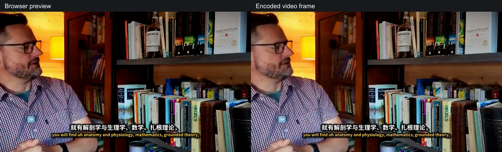

OpenCreator 字幕预览与烧录：实施与验收

日期：2026-10-20。验收环境：macOS / Apple Silicon，Chromium 与实际打包的 Electron App。本次全部使用本地字幕、字体、视频和渲染程序，没有转录、翻译或模型 API 调用。

**实现结果**

普通预览、深度编辑和样式示例已共用 `SubtitleCompositionPreview`。Daemon 调用 Go 的 `compile-subtitles` 生成 ASS，最终烧录调用同一编译器。浏览器使用固定版本 JASSUB 2.5.23，Worker 与两套 WASM 都随 Web 构建打包；播放不启动 FFmpeg，也不逐句请求 PNG。

- 全量时间线保留标点、手动换行、原译文角色和重叠事件，移除了预览的 128 字符截断。
- Web 与 Daemon 共用旧字幕适配器，按显式目标时间线处理竖屏混合字幕，不用中文/英文特征猜语言角色。编辑后的结构化角色保存在 `renderCues`，烧录优先读取该输入。
- 字体通过受鉴权的清单 ID 读取，两端校验 SHA256，浏览器禁用在线/系统字体查询。共用编译器检查实际 TTF 字形覆盖，显式生成备用字体标签。
- 保留现有 ASS 384×288 样式坐标，避免旧项目字号和位置整体漂移。横转竖统一为 720×1280、视频顶部 250px，视频高度统一取偶数；标题也改由 ASS 渲染。新渲染路径只编码一次。
- Canvas 按输出分辨率渲染，再整体缩放到预览容器。播放使用视频帧的 `mediaTime`，暂停、跳转和倍速会同步；全屏包含视频和字幕层。
- 编译缓存包含 CLI 哈希、字体清单、完整输入和规范化样式；字体按哈希缓存，过期响应不能替换新字幕，离开页面会销毁 Worker。

实际接口为 `POST /creator/subtitle-render/prepare` 和 `GET /creator/subtitle-render/fonts/:id`。渲染包包含 ASS、内容哈希、输出尺寸和字体清单；修订竞争通过前端序号处理。最终生成读取已保存的任务输入并确定性重编译；本轮没有把预览内容哈希作为生成任务的强制提交条件。

**实际视频对比**

使用之前 `u_hAm644gBM` 视频的本地原视频，从 119.92 秒开始截取 6 秒，读取既有 `real-segmented.bilingual.srt`，没有重新翻译。预览与实际烧录产生的 ASS 字节相同。以下左侧是浏览器预览，右侧是编码成片抽帧：

两端文字、行数、字体、位置与语言顺序一致。该样例在变化区域的原生参考帧/WASM 平均通道误差为 6.19/255；真实画面还涉及视频像素格式转换，不能用这一数字替代排版判定。原始数据见[真实片段结果](assets/subtitle-preview/real-clip-results.json)。

**9 组固定背景对比**

每组先由 Daemon/Go 编译，再通过实际 CLI 烧录并核对其 ASS；同时装载真正的 React 预览组件截图。比较统一尺寸和时间点的原生未压缩参考帧与浏览器截图。误差为字幕变化区域 RGB 每通道绝对误差均值，范围 0–255；边界阈值是相对背景 RGB 总差大于 40。

| 样例 | 尺寸 | ASS 相同 | 边界最大差 | 平均通道误差 |
| --- | --- | --- | ---: | ---: |
| 中英双语、手动换行 | 640×360 | 是 | 0px | 1.24 |
| 衬线字体、模糊阴影 | 1280×720 | 是 | 5px | 3.13 |
| 圆体、完整长字幕 | 1024×768 | 是 | 0px | 0.19 |
| 阿拉伯语与英文 | 960×540 | 是 | 0px | 3.32 |
| 印地语与英文 | 960×540 | 是 | 0px | 2.09 |
| 泰语竖屏 | 540×960 | 是 | 0px | 2.55 |
| 日文与韩文 | 720×1280 | 是 | 0px | 0.17 |
| 横转竖、双标题 | 720×1280 | 是 | 0px | 1.57 |
| 字面 ASS 字符、重叠事件 | 640×360 | 是 | 1px | 3.50 |

圆体测试发现其 TTF 缺少部分简体汉字。原生渲染曾用系统字体补字，而隔离的 WASM 会缺字。加入字形覆盖检测和显式随包字体回退后，该组误差从 38.83 降至 0.19，缺字消失，行数和边界一致。这是本轮实际发现并修复的差异。

9 组均验证播放时间变化不会重新准备字幕。原生参考/WASM 的主要排版边界在 1px 内；模糊阴影低强度外沿存在约 5px 的阈值边界差异。当前原生 FFmpeg 6.0 使用 libass 0.17.0；并未消除原生与 WASM 的全部栅格化差异。成片 H.264 的 YUV420 编码也会改变字边和颜色，9 组编码帧/WASM 的平均通道误差为 5.59–10.78。

[完整矩阵数据](assets/subtitle-preview/matrix-results.json)包含字体数量、边界、编译时间、截图等待时间和编码时间。CLI 编译约 40–557ms；含中文分词冷启动的样例约 0.5 秒。从内存夹具装载至截图约 0.59–0.74 秒，**其中包含固定 300ms 呈现稳定等待**，不代表完整网络加载时间，也不是整体产品性能评分。

复现矩阵：先准备本机 Creator Runtime 并运行 Web 开发服务，再执行 `node --import tsx scripts/verify-subtitle-render-parity.ts`。可用 `OPENCREATOR_SUBTITLE_TEST_ORIGIN` 指定开发服务地址。脚本只访问本机服务，产物输出到 `.runtime/subtitle-parity/matrix`。

**验证范围**

- Go 定向回归：共享编译、SRT 适配、长文本、标点和换行、角色顺序、重叠、纯文本转义、字体覆盖、显示尺寸、横竖屏与 CLI 渲染测试通过。
- Web：67 项相关单元测试通过；普通预览→深度编辑、播放、拖动、倍速、全屏和样式/画幅切换的 2 项真实页面 E2E 通过。
- Daemon：38 项相关角色/命令/结果测试、6 项字幕编辑服务测试、9 项接口与真实 CLI 渲染集成测试通过；Web、Daemon 和 Desktop 相关类型检查通过。
- Desktop：9 项协议测试通过；从当前 Web 源码构建的 macOS App 打包与资源哈希校验通过，实际 App 内 Worker、WASM、字体接口和 CSP 加载 E2E 通过。打包时补齐原来缺少的 `franc-all`、`opencc-js` 生产依赖，版本与工作区实际解析版本一致。
- 用真实生成的 720×576、SAR=16:15 视频验证 Chromium 的显示尺寸为 768×576；旋转 90° 后为 576×768，与后端显示尺寸算法一致。

未进行 Windows/Linux 实机验证、123 种语言逐一渲染、HDR/广色域与所有浏览器组合测试。当前不承诺编码成片和浏览器每个 RGB 像素完全相同。既有自动换行策略仍保留，本轮没有增加新的电视字幕单行校验模式。

本轮未提交或推送 Git，之前的 spaCy 打包改动已保留。
