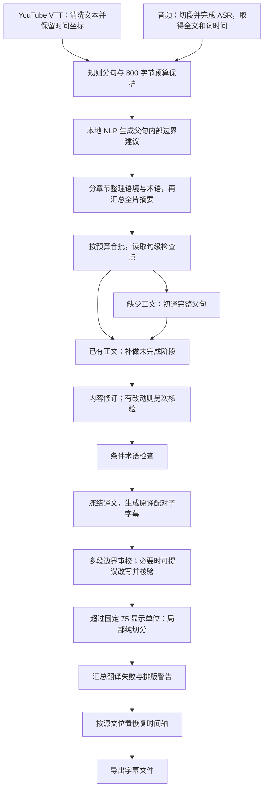

# KrillinAI 当前翻译流程：逐步实现说明

> 本文保留本轮源文拆句改造之前的流程快照。2026-10-22 已将音频和平台 VTT 的 NLP 结果改为实际翻译单元，最新拆句顺序、降级及验收结果见 [源文意群拆分实现](video-translation-source-units-20261022.md)。本文下述“当前”“完整父句”“NLP 仅作提示”均指改造前状态；后续翻译与校准步骤仍可作为实现参考。

整理日期：2026-10-22。范围为 OpenCreator 当前工作区的 `runtime/krillinai`，包括已有的未提交修改；基准 HEAD 为 `8b4bd9db4ecb87b20ba5dbf14b71dce7612c085e`。本文描述源码中的实际行为，不代表线上或已打包客户端已经运行这些代码。

本次只梳理音频与 YouTube VTT 两个入口及其共同翻译核心，不修改业务代码，不重新调用模型测试。原始 SRT 导入、视频下载调度、配音和视频合成不在展开范围内。

## 一、先明确当前启用的流程

当前默认是 `translationFlowDefault = "legacy"`，同时启用 `translationRevisionDefault = "revised"`。也就是：使用现有完整父句翻译链路，默认追加内容修订。代码中另有 `segmented` 实验链路，本文不把它混入默认流程。

实际主线如下。图中“条件术语检查”通常会被已经完成的内容修订覆盖而跳过。



默认值位置：[流程开关](../../runtime/krillinai/internal/service/translation_segmented.go#L18)、[修订开关](../../runtime/krillinai/internal/service/translation_revision.go#L14)、[Translator 初始化](../../runtime/krillinai/internal/service/translate.go#L38)。共同调度入口是 [translatePairedSentences](../../runtime/krillinai/internal/service/paired_translation.go#L237)。

## 二、五个容易混淆的单位

| 名称 | 当前代码里的含义 |
| --- | --- |
| 音频段 | 默认约 5 分钟的 ASR 输入单元，不是一个句子。 |
| 父句／翻译单元 | 规则分句和预算保护后的源文，拥有稳定 `sentence_id`；可能是完整句，也可能是长句截出的语义段。 |
| 翻译批次 | 一次一起处理的多个父句；VTT 默认最多 10 个，音频最多 12 个，还会受请求预算限制。 |
| 语境章节 | 按文本预算形成的分析组，用于摘要和术语抽取，不是从视频中识别的真实章节。 |
| 字幕条／子配对 | 父句经过排版后得到的一对 `source/target`，最后附上时间，成为一条字幕。 |

“一句”“一批”“一条字幕”不是同一件事。初译请求处理父句；用户最终看到的是子配对。

## 三、步骤 1：决定源文从哪里来

入口是 [GenerateSubtitles](../../runtime/krillinai/internal/pipeline/subtitle.go#L41)。

- YouTube 且选择自动来源时，OpenCreator 外层先尝试平台字幕；只有 `platform_caption_failed`、`platform_caption_invalid` 这类字幕获取或有效性错误，才切换到音频识别。
- 明确选平台字幕，就不自动改用音频；明确选音频识别，则直接进入音频路径。
- 访问、鉴权或模型翻译错误，不会统一解释为“平台字幕不行”，继而盲目重做 ASR。
- `source-only` 模式取得原字幕后跳过翻译。

外层来源计划见 [execution-plan.ts](../../apps/daemon/src/creator/krillin/execution-plan.ts)。视频文件下载属于媒体准备，不能计作翻译模型的一环；配音与合成发生在字幕生成之后。

## 四、步骤 2A：VTT 转成可翻译文本和时间坐标

实现入口：[processYouTubeSubtitle](../../runtime/krillinai/internal/service/youtube_subtitle.go#L515)。

**有词级行内时间戳时：**

1. 检测 `<HH:MM:SS.mmm>` 格式，抽取词和起止时间。
2. 清除样式、HTML、声音提示和纯标点，按相邻 cue 的文本与时间关系去重。
3. 先用句末标点与缩写保护规则组装原文字幕，交给共同批量入口。

这里有一个实现边界：`cleanVttText` 会删除全部方括号内容，以及包含音乐关键词的圆括号内容。这是格式规则，无法证明被删内容在每个视频里都没有语义。

**只有 cue 块级时间时：**先转临时 SRT，清理正文，然后走同一个批量入口。

[BatchTranslateSrtBlocks](../../runtime/krillinai/internal/service/paired_translation.go#L674) 会验证每条时间，并建立“源文字符位置 → 原时间区间”的对应表，随后把各 cue 文本重新连接为全文，再统一分句。原 cue 被当作时间证据，不被直接当作完整语义句。

若词级文本能与全文完整匹配，则使用词时间；匹配失败会保留全部正文，退回原 cue 时间区间，而不是丢弃匹配不上的文字。

**模型调用：**这一步没有翻译 LLM 调用。

## 五、步骤 2B：音频转成可翻译文本和词时间

主要实现：[audio2subtitle.go](../../runtime/krillinai/internal/service/audio2subtitle.go)、[split_audio.go](../../runtime/krillinai/internal/service/split_audio.go)、[transcription_checkpoint.go](../../runtime/krillinai/internal/service/transcription_checkpoint.go)。

1. 按配置切音频，代码默认每段约 5 分钟，在预计切点前后约 8 秒内寻找较安静的位置；很短的尾段可并入前段。
2. FFmpeg 输出音频段，调用配置的 ASR 服务，取得 `Text` 及带起止时间的 `Words`。
3. 转录并发默认 1，单段识别最多尝试默认 3 次；明确不可重试的错误会提前结束。
4. 按音频内容哈希、语言与识别配置指纹保存转录检查点，续跑可复用已有识别结果。

这里的执行顺序很关键：[startTranslateWorker](../../runtime/krillinai/internal/service/audio2subtitle.go#L863) 会**等待全部音频段转录完成**，按段排序后才开始正文翻译。多段音频会先统一准备全片的分句、NLP 和语境术语计划，再映射回各段。

音频段之间顺序翻译；一个音频段内部可以并发多个翻译批次。跨音频段共享全片语境与术语，但相邻两句的正文上下文来自当前段，并不自动跨段携带。

**模型调用：**ASR 是识别调用；后续正文翻译 LLM 从下面的共同流程开始。

## 六、步骤 3：先形成父句，并保护请求预算

实现：[prepareTranslationSentences](../../runtime/krillinai/internal/service/subtitle_sentence_semantic.go#L25)、[subtitle_sentences.go](../../runtime/krillinai/internal/service/subtitle_sentences.go)。

输入是整理后的源文，输出是拥有稳定 ID 的父句列表。

1. 用 Unicode UAX29 句界和语言规则分句，保护缩写、姓名、日期、单位等结构。
2. 对超长原句增加 **800 UTF-8 字节**的单元预算，优先在从句标点、连接词、词边界切开；规则不能完成时，退回通用安全切分。
3. 如果一个原句因此被切开、原句不超过 3200 字节，且切口缺少标点或连接词支持，会额外请求一次模型建议原文切口。失败则保留本地结果。

所以实际顺序是“规则与预算先形成父句”，随后才是 NLP。当前不能保证每个父单元天然就是一句完整语义句，也没有按 75 显示单位先把正文切碎。

**模型调用：**多数父句为 0 次；上述特殊预算切口最多追加 1 次逻辑调用，可命中缓存。

Prompt：[subtitle_sentence_split_prompt.txt](../../runtime/krillinai/internal/service/subtitle_sentence_split_prompt.txt)。

## 七、步骤 4：NLP 给父句内部提供边界建议

实现：[prepareTranslationNLPHints](../../runtime/krillinai/internal/service/subtitle_nlp.go#L102)、[subtitle_nlp.py](../../runtime/krillinai/internal/service/subtitle_nlp.py)。

本地 Python + spaCy 大致依次使用句法模型句界、逗号两侧从句和连接词寻找切口，返回连续源文片段。它借鉴了 VideoLingo 的句法拆分思路。

这里的结果是父句内部的 `nlp_segments_hint`，**不会展开为新的独立翻译 ID**。模型仍拿完整父句翻译，避免共享修饰成分或目标语言语序被提前割裂。

若某个建议片段超过 **20 个 NLP token**，会额外请求一次模型细化该片段。这里的 token 是 spaCy 计数，不是 LLM 计费 token，也不是字幕字符数。

缺 Python、spaCy、语言模型、parser，或结果不能完整覆盖原文时，放弃 NLP 建议并继续翻译。运行时不自动下载缺少的语言模型，本地进程有 90 秒超时。缓存写入失败、用户取消等错误仍可能向上传播。

**模型调用：**NLP 本身为 0；较长的 NLP 片段可能各追加 1 次细化调用。

Prompt：[subtitle_nlp_split_prompt.txt](../../runtime/krillinai/internal/service/subtitle_nlp_split_prompt.txt)。

## 八、步骤 5：整理章节语境、术语和全片摘要

实现：[prepareTranslationSemanticPlan](../../runtime/krillinai/internal/service/translation_semantic_context.go#L266)。

这一步发生在父句和 NLP 准备之后，不是先于所有分句的全片术语扫描。

- 每个分析章节按约 6500 字节的输入 JSON、最多 64 个父句组装。
- 每章请求模型一次，返回摘要，以及最多 12 条术语；术语含原词、建议译法、含义和适用 `sentence_ids`。
- 每章摘要限制为 600 UTF-8 字节。多个章节再分层请求模型汇总摘要，每组合并输入约不超过 10000 字节。
- 程序验证术语是否真的在相应源句出现，去掉没有证据或作用域冲突的条目；这不能证明模型给出的术语译法正确。
- 后续每个批次只取得相关章节、全片摘要及适用于该批句子的术语，不重复发送整片正文或所有术语。

章节分析目前串行准备。普通服务失败或无效输出会保留可用章节信息、固定降级计划后继续；鉴权、额度等永久服务错误，以及取消、关键检查点保存错误，仍会传播。

**模型调用：**每章通常 1 次；多章另有分层摘要调用，均可复用缓存。

Prompt：[translation_semantic_context_prompt.txt](../../runtime/krillinai/internal/service/translation_semantic_context_prompt.txt)；摘要汇总 Prompt 在 `translation_semantic_context.go` 内。

## 九、步骤 6：组批、加邻句上下文、读取恢复状态

实现：[buildPairedTranslationBatchesWithNLP](../../runtime/krillinai/internal/service/paired_translation.go#L143)、[translationBatchContext](../../runtime/krillinai/internal/service/translation_content.go#L30)、[openTranslationCheckpoint](../../runtime/krillinai/internal/service/translation_checkpoint.go#L36)。

每批最多 VTT 10 个父句、音频 12 个父句，同时受约 16000 请求字节和 6500 输出 token 预算约束。组批时输出量使用文本字节数经验估算，不是模型 tokenizer 的精确计数。

批次正文以外，会带前 2、后 2 个父句作为参考。前文只取靠近批次的末端、后文只取开头，每个参考片段最多 384 字节。批次内各父句本身也互为上下文。

额外语境过大时先压缩摘要，单父句仍放不下时可以去除额外语境，优先让正文能提交。

之后才读取句级正文检查点：

- 已有有效完整译文：补做尚未完成或版本过期的修订、排版等步骤。
- 没有可复用译文：进入初译。
- 上次沿用原文的失败项：续跑时仍要重新翻译。
- 独立、明确无语义的犹豫音：本地标记省略，消费原文位置，但不生成空字幕。

默认翻译并发是 3，不过实现为“最多 3 批成组执行，整组完成再开下一组”。发生普通 429 限流后，后续组降为串行；这不是一个持续补位的 worker pool。

**模型调用：**组批和读检查点本身不调用模型。

## 十、步骤 7：初译只生成完整译文

实现：[translateContentBatch](../../runtime/krillinai/internal/service/translation_content.go#L86)。

输入包含源语言、目标语言、当前父句 ID 和全文、邻句上下文及相关语境术语。主要返回结构为：

```json
{"sentences":[{"sentence_id":"14","target_text":"完整的单行译文"}]}
```

Prompt 要求自然口语、保留事实、专名、数字、否定、条件与因果等信息；明确要求**忽略字幕长度和分段**。这一步不会返回时间或子字幕切口。

程序的硬检查主要是 JSON 可解析、ID 正确且不重复、字段不冲突、译文非空且含可用文字、没有换行。自然度、忠实度、术语选择不能靠这些结构检查证明；原译相同或数字写法不同也不会直接被当作结构失败。

成功父句立即保存，只重试失败 ID。正文最多 3 轮内容尝试：前两轮批量，最后一轮对剩余失败父句逐个请求整句译文。临时服务故障可能提前结束本轮；永久服务错误会直接上抛。

仍失败的父句会保留原文作为目标文本，写入 `TranslationFallbackReason`，其他句子继续。回退项不再进入术语和排版审校，不会被标成已经翻译成功。最后如果全片正文均失败，则任务报错；部分失败则允许带警告导出。

Prompt：[translation_content_prompt.txt](../../runtime/krillinai/internal/service/translation_content_prompt.txt)。硬检查：[translation_validation.go](../../runtime/krillinai/internal/service/translation_validation.go)。回退：[translation_semantic_review.go](../../runtime/krillinai/internal/service/translation_semantic_review.go#L19)。

## 十一、步骤 8：默认对正文做内容修订，有改动再核验

实现：[reviseContentBatch](../../runtime/krillinai/internal/service/translation_revision.go#L33)。

所有没有完成当前版本修订的有效父句都会进入本步骤，不只处理长句或程序发现明显错误的句子。

1. 发送源文、当前译文、邻句、语境术语和程序生成的 `quality_hints`。
2. 模型返回需要修改的 `corrections`，可以改写整句表达；本阶段忽略字幕长度。
3. 没有改动的父句直接记为已完成修订。
4. 有改动的候选，另发一次 `translation_revision_verify`，核对含义、事实、数字、否定、条件等。
5. 只有核验接受的候选才覆盖旧译文；其他候选最多再试一轮，最终失败则保留修订前译文。

“独立核验”指另一次模型请求，通常仍使用同一个配置模型，并非另一个独立模型或人工复核。

最多 2 轮修订，每轮有修改时可再加 1 次核验，即最多 2 + 2 次逻辑调用。普通无效结果不会丢弃已经取得的译文；永久服务错误、取消和保存错误仍可能中断任务。

成功或无需修改的父句写入 `RevisionVersion` 与 `SemanticReviewed=true`。

Prompt：[translation_revision_prompt.txt](../../runtime/krillinai/internal/service/translation_revision_prompt.txt)；核验 Prompt 在 `translation_revision.go` 内。

## 十二、步骤 9：条件术语检查，通常不再重复执行

实现：[completeSemanticBatch](../../runtime/krillinai/internal/service/translation_semantic_review.go#L52)。

只有同时满足以下条件的父句才请求 `translation_term_review`：尚未 `SemanticReviewed`，并且存在有源文证据的适用术语。

由于上一步正常完成后会设置 `SemanticReviewed=true`，默认流程中这轮通常跳过。因此不能把它算作每句必定多出的一次审校。

模型可返回完整修正译文。程序检查 ID、术语作用域、结构、合理长度等，然后应用修正、重置排版。**此分支没有再走内容修订那种独立原文语义核验。**普通失败保留已有译文，永久服务错误仍可能传播。

Prompt：[translation_semantic_review_prompt.txt](../../runtime/krillinai/internal/service/translation_semantic_review_prompt.txt)。

## 十三、步骤 10：冻结译文，做双语配对排版

实现：[completeSemanticBatch 后半段](../../runtime/krillinai/internal/service/translation_semantic_review.go#L150)、[translatePairedBatch](../../runtime/krillinai/internal/service/translation_recovery.go#L197)、[parsePairedTranslation](../../runtime/krillinai/internal/service/paired_translation.go#L459)。

先尝试本地复用现有配对。短的单段句、没有多段 NLP 建议且通过布局检查时，可以不请求排版模型；需要拆分时才合批请求。

排版输入是完整源文、已冻结译文、NLP 或程序边界建议和软长度目标。**这里显式去掉术语、摘要、前后邻句**，不把完整语境反复传入。

模型返回：

```json
{"sentences":[{"sentence_id":"14","segments":[
  {"source":"连续源文片段一","target":"对应的连续译文片段一"},
  {"source":"连续源文片段二","target":"对应的连续译文片段二"}
]}]}
```

本阶段禁止重新翻译。程序检查原译片段数量一致、两侧非空、单行、连续完整覆盖全文、字素和词等边界安全，并与冻结译文核对。允许切口两边的空白规范化，不允许改动片段内部空格或文字。

之后本地动态规划只在模型给出的相邻配对上尝试合并，权衡条数、超长、短尾和结构风险；它不能创造新的语义切口。配置长度是软目标，稍长但边界更自然的布局可能被接受。

排版最多 3 轮，但已经有完整可用候选时可能提前降级；只处理未通过父句。失败时保留完整译文或已有布局，后续尝试局部切分，仍可带排版警告继续。

Prompt：[paired_translation_prompt.txt](../../runtime/krillinai/internal/service/paired_translation_prompt.txt)。本地合并策略：[subtitle_paired_layout.go](../../runtime/krillinai/internal/service/subtitle_paired_layout.go)。

## 十四、步骤 11：审查多段边界，特定情况下仍可改正文

实现：[reviewPairedLayouts](../../runtime/krillinai/internal/service/subtitle_layout_review.go#L14)。

只处理存在多个子配对且尚未 `LayoutReviewed` 的父句。输入完整父源文、全文译文、全部配对、NLP 建议和目标长度，要求逐句返回是否对齐、边界是否自然及原因。只返回空 `corrections` 不能证明完成审校。

优先只移动边界。但如果模型认为原译语序导致无法合理对齐，可以返回 `rewrite=true`，重新表达整个父句译文。因此，当前正文在初译或内容修订后，并未永久锁定。

- 不改文字：通过覆盖和结构检查后应用边界修正。
- 改文字：额外核验原文语义和新切口，均通过才接受；通常最多再加 2 次请求。
- 失败或核验拒绝：保留旧译文和旧配对，维持待审状态。

普通单段无需模型边界审校，可在本地记为已审。程序的局部中文补语规则只明确拦截“当作／视为／看作／称为”这类尾标记，没有覆盖所有中文动宾、补语或修饰结构。

Prompt：[subtitle_layout_review_prompt.txt](../../runtime/krillinai/internal/service/subtitle_layout_review_prompt.txt)。改写与边界核验实现位于 [subtitle_length_split.go](../../runtime/krillinai/internal/service/subtitle_length_split.go) 中，当前边界审校仍调用这些函数。

## 十五、步骤 12：最终超长项使用局部英文 Prompt 纯切分

实现：[splitLongPairedSubtitles](../../runtime/krillinai/internal/service/subtitle_length_split.go#L93)。这是最近调整的步骤。

逐个检查子配对，**原文或译文任一侧超过固定 75 显示单位**才处理。输入仅包含：

```json
{
  "source":"当前源文片段",
  "target":"已经翻译好的当前译文片段",
  "source_display_units":110,
  "target_display_units":64,
  "max_display_units":75,
  "previous_issue":"如有，上次失败的具体原因"
}
```

英文 Prompt 要求只插入切口、保留全部文字与标点顺序、不翻译、不改写，两侧必须有对应内容。不附加术语、全文语境、邻句或 NLP。

最多 3 轮，只把剩余超长子配对再次发给模型；已经切短成功的片段保留。程序检查连续完整覆盖、字素和词名保护、明确的补语尾标记等，无法全面判断自然语言切口质量。

失败则保留已有译文与已成功切短部分，剩余超长标为 `LayoutFallback`，继续生成字幕。这个固定 75 因而是修复触发阈值，不是“最终文件绝不超长”的保证。

还有一个实际顺序问题：此步骤在边界审校**之后**，新切口会设为 `LayoutReviewed=false`，但本轮不会回头再跑一次边界审校。因此，“发挥出／Notion 的全部潜力”这种不自然切口，可能满足文字覆盖检查却仍被保留。这能解释程序为何没有拦住这类边界，不能代替对某次模型原始响应的复盘。

Prompt 全文：[subtitle_length_split_prompt.txt](../../runtime/krillinai/internal/service/subtitle_length_split_prompt.txt)。

## 十六、步骤 13：恢复时间轴，导出各类字幕

**VTT：**根据每个子配对的源文去空白字符位置映射到词时间；无词级匹配时，使用原 cue 区间并在区间内插值。原译两行共享同一时间，不让 LLM 生成时间，也不按中文长度另分一套时间。

如果某个父句切出的内部子条没有正时长，VTT 路径允许合回完整父句导出。这个时间轴降级发生在超长切分之后，可能重新产生长字幕；源码允许这种情况，但不代表此前具体案例一定触发了这个分支。

**音频：**[pairedAudioTiming](../../runtime/krillinai/internal/service/subtitle_timing.go#L11) 先匹配 ASR 词时间。全文和词列表标点等不一致时退回现有 `TimestampGenerator`，再做时间规范化。若仍无法生成有效时间，则会报错，不能统一假定有文本就一定能导出。

时间规范化避免不允许的重叠；非正时长可延至 300ms，这不等于每条字幕都强制至少 300ms。词内部插值也不是重新进行声学强制对齐。

之后生成原文、目标语言、双语等字幕文件。短原文、竖屏等派生产物可另做程序切分，属于展示产物处理，不是再次翻译正文。音频路径最后合并各音频段结果。

实现：[VTT 时间映射和回并](../../runtime/krillinai/internal/service/paired_translation.go#L616)、[generateSrtWithTimestamps](../../runtime/krillinai/internal/service/audio2subtitle.go#L1587)、[srt_timeline.go](../../runtime/krillinai/internal/service/srt_timeline.go)。

## 十七、长度与预算参数汇总

以下为源码默认值或固定值，不代表某个运行中任务一定没有覆盖配置。

| 参数 | 当前值／默认值 | 含义 |
| --- | --- | --- |
| 单个父句预算 | 800 UTF-8 字节 | 为请求与恢复控制单元大小；不是显示长度。 |
| NLP 长片段参考 | 20 NLP token | 触发建议细化；不是硬字幕上限。 |
| `max_sentence_length` | 默认 50 显示单位 | 原译单行软排版目标，任务可以配置。 |
| 最终局部切分阈值 | 固定 75 显示单位 | 任一侧超出触发；失败仍允许保留。 |
| VTT 批次 | 默认最多 10 个父句 | 同时受实际请求预算限制。 |
| 音频批次 | 最多 12 个父句 | 不是 12 条最终字幕。 |
| 翻译并发 | 默认 3 批 | 按组等待，限流后后续串行。 |
| 邻句上下文 | 批次前 2、后 2 | 每个参考片段最多 384 字节。 |
| 请求预算 | 约 16000 字节 | 含 Prompt 与输入，不是 16000 token。 |
| 常规输出预算 | 6500 token | 部分请求在输出修复时可调整；不是全文上限。 |
| 语境章节 | 约 6500 JSON 字节／最多 64 父句 | 每章摘要最多 600 字节、术语最多 12 条。 |
| ASR 音频段 | 默认约 5 分钟 | 独立于父句和翻译批次。 |

显示长度由 [subtitleTargetLength](../../runtime/krillinai/internal/service/subtitle_text.go#L24) 按字素簇计算：宽字符、全角字符通常计 2，普通字母、空格通常计 1。因此 50 显示单位大致只相当于 25 个汉字；75 显示单位大致相当于 37 个汉字加少量半角字符，不能直接理解为 75 个汉字。

## 十八、为什么“最多三次”不是整个流程只请求三次

当前存在不同层次的调用与重试，分别计数：

| 阶段 | 正常调用与分支 |
| --- | --- |
| 预算切口细化 | 特殊长句最多额外 1 次。 |
| NLP | 本地不耗 LLM token；长片段细化可额外请求。 |
| 语境／术语准备 | 每章 1 次，加多章摘要汇总。 |
| 初译 | 正常 1 次；内容最多 3 轮，最后逐失败父句请求。 |
| 内容修订 | 正常 1 次；有改动加核验，最多 2 轮候选及对应核验。 |
| 条件术语检查 | 通常跳过；需要时 1 次逻辑请求。 |
| 双语排版 | 简单句可跳过；需要时最多 3 轮。 |
| 边界审校 | 多段未审句需要；改写再增加语义与边界核验。 |
| 最终局部切分 | 只处理超长配对，最多 3 轮；一轮可能请求多个配对。 |

例如，假设只有一章、一批、修订确实改了内容且需要多段排版，没有任何失败，也可能出现：语境 1 + 初译 1 + 修订 1 + 修订核验 1 + 排版 1 + 边界审校 1，共 6 次逻辑请求。章节请求会由后续批次共享，不能再机械地按每批重复计算。

除此以外还有服务重试：

- [requestTranslation](../../runtime/krillinai/internal/service/translation_recovery.go#L139) 对网络错误、5xx 和普通 429 做有限重试，默认最多 3 次，退避约 1 秒、2 秒；401、403、402 和额度耗尽等不作为普通临时错误反复请求。
- 默认流程的语境、修订、部分审校走 `semanticJSON`，通常直接调用客户端，不套用上述同一层网络重试；不能把所有阶段说成同一套重试策略。
- OpenAI 兼容客户端主模型服务失败时，还可能尝试备用模型，使用同一任务载荷。备用是服务故障回退，不是分别生成后择优。

因此一次逻辑调用不一定只对应一次外部 HTTP 请求，也不存在“每个父句全流程绝对最多 3 请求”的约束。这里未把 SDK 或代理的内部行为推算成一个未经验证的 HTTP 总上限。

## 十九、恢复和“成功”的实际含义

正文按父句单独保存 JSON，原子落盘，后面的成功句不会因为前面的失败句而全部丢失。恢复所用身份包括源文、语言、模型、endpoint、正文 Prompt、犹豫音策略和语境计划等；这些变化可能导致旧正文不可复用。

软排版目标和批次大小不进入正文内容指纹，所以修改它们可以复用已有译文再排版。修订、NLP、排版各有版本或缓存状态。读取正文检查点之前仍需准备或读取分句、NLP 和语境计划缓存，并不是点继续就完全跳过前处理。

翻译状态由 [finishTranslationResult](../../runtime/krillinai/internal/service/translation_fallback.go#L50) 在共同核心返回配对前汇总，时间轴处理和字幕文件输出仍在其后；音频调用方还会汇总各段状态。因此，翻译核心完成不等于文件导出已经成功。

具体规则是：

- 全部正文失败：返回错误，保留检查点。
- 部分正文失败：相应位置沿用原文并给出翻译警告，其余继续导出。音频按整片汇总，不把一个音频段的全失败直接等同于整片全失败。
- 已译但超长：保留译文，按 `LayoutFallback` 计排版待调整项。
- 仅 `LayoutReviewed=false` 本身不会自动计入排版待调整数量；“待审”与界面警告不是完全同一状态。
- 永久模型服务错误、用户取消、关键保存错误、无法恢复的时间轴错误等仍可能中断；并非所有后续质量步骤都无条件软降级。

因此，“任务产出了字幕”和“每一句都成功翻译、自然拆分”是两个不同层面的状态。分析成功率时应同时看失败句清单与排版状态，不能只看任务是否显示完成。

## 二十、后续逐段分析时应抓住的事实

1. 当前顺序是规则与预算分句 → NLP 建议 → 语境术语，并非先抽全文术语、再由 NLP 形成完整翻译句。
2. 初译不拆字幕，后续单独排版；这样能保留整句表达，但增加后处理模型调用。
3. 默认会审阅所有未完成修订的有效父句，修订不是只针对检测到的错误。
4. 译文仍可能在条件术语检查和边界审校阶段改变；前者没有单独的原文语义复核，后者改写要另行核验。
5. 配置长度是软目标，固定 75 是另一个切分触发值；预算字节、NLP token、显示单位不能混为一谈。
6. 最后纯切分新增的切口，本轮没有再交模型审查自然度；本地规则不能完整替代语法判断。
7. 时间轴阶段可能把已切短片段合回长句，故长度问题不一定只来自拆句 Prompt。
8. 失败恢复已经细化到父句，但前置语境准备、成组并发等待和服务重试仍会影响等待时间与 token 消耗。

这些是当前实现可直接核对的行为，是否保留、简化或调整，应在后续分析中分别讨论，不能把已有审校状态当作质量已经得到证明。
