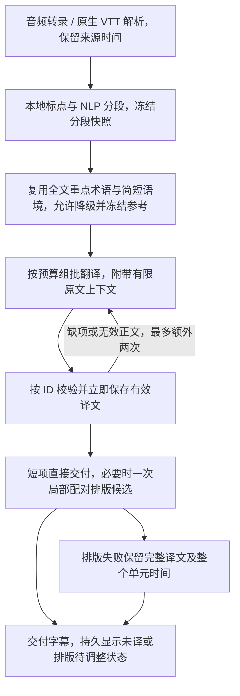

# 音频与 VTT 翻译流程实施记录

> 状态更新（2026-10-22）：下文记录的音频/VTT 新策略因字幕成品质量回退已撤回，不再是当前默认流程。原始测量和验收局限保留供追溯，现状见[撤回与修复记录](video-translation-legacy-repair-20261022.md)。

日期：2026-10-22。依据：[已确认的方案复审](video-translation-design-review-20261022.md)。状态：首版代码、定向回归、Runtime/Daemon 构建及原生 VTT 实测已完成，尚未提交、推送或部署。

目标保持为先取得有效译文并保存，再提高质量。本轮调整音频与 VTT 的默认翻译策略，原始 SRT 保留原策略；没有新增用户步骤、自动全量评分或必经润色。

## 1. 实际执行流程

内容重试回边受每个单元三次总预算限制。网络退避仍使用既有统一请求封装，传输次数与内容次数分别处理；一次排版候选也可能发生有上限的临时传输重试。

| 环节 | 本次行为 |
| --- | --- |
| VTT 来源 | 去除全片按词文本去重，只根据相邻 cue、时间及滚动结构去重，保留真实再次出现的词 |
| 语义单位 | NLP 处理预算切分前的来源；普通有句末标点的句子尽量完整，无标点或超长来源允许采用 NLP 意群 |
| 保护性切分 | 与显示长度独立；本轮预算保护上限为 2,738 UTF-8 字节，超出时按已有本地边界降级，不宣称是完整语法句 |
| 分句模型调用 | 不再因超过短词数阈值就逐段调用模型细化；首版不新增模型分句前置步骤 |
| 术语和主题 | 复用已有全文章节、术语作用域和简短主题；普通不可用情况允许降级，恢复使用本次冻结计划，包括空计划 |
| 批次与上下文 | 复用现有输入/输出预算组批和上限，不强制改成三句；批次外保留前二、后二的有限原文片段 |
| 正文请求 | 只要求来源 ID 与完整译文，不同时强制输出排版；无歧义的 `text` 兼容为 `target_text`，冲突只使对应单元无效 |
| 内容失败 | 成功项立即原子保存，只重试缺失或无效项；首次加两次纠错，次数跨恢复保存 |
| 服务问题 | 鉴权、额度错误立即停止，不逐句循环；一般服务请求失败保留成果并撤回本次内容次数预留；取消及时退出并保守保留已预留次数 |
| 排版 | 短项无额外请求，必要项最多一次局部候选；仅返回 `segments` 时用已冻结的完整译文校验，不要求重复回显正文 |
| 排版失败 | 允许本地安全修复边界；仍失败就保留整个翻译单元及来源时间，不按字数比例制造双语切口，不重译正文 |
| 质量提升 | 复用现有编辑/修订能力，不新增自动流畅度检测、全量终审或必经质量校准 |

显示长度仍沿用原配置口径：宽字符计 2，常见英数字符计 1。预算字节数、语义单位与字幕显示目标分别处理，没有通过提高用户的显示长度设置掩盖失败。

## 2. 保存、恢复与结果状态

复用既有单句原子检查点，音频/VTT 使用独立的内容版本指纹。显示长度和样式不进入内容指纹；改变来源、语言、模型、端点或有关算法/提示版本时重新匹配。

Daemon 为相同音频/VTT 任务匹配最近失败、中断或取消阶段，复用其实际工作目录，连续多次继续时保持最初目录所有者。相同条件下最近一次已经成功的任务不会被误带回更早的失败目录。凭据和无关编辑状态不进入恢复身份；原始 SRT 不启用这项新的目录匹配。

音频集成还发现旧代码只保存转录结果、恢复时却不读取。已增加按音频 SHA256、来源语言及公开 ASR 配置匹配的原子转录快照，凭据轮换不使其失效。只复用有正文且词时间有效的结果，坏缓存重新识别；缓存写入失败会警告，当前有效转录仍可继续。分段与转录稳定后，后续内容检查点才有稳定来源。

最终未译项继续通过 `translation_failures` 返回；排版降级通过独立 warning 返回。Daemon 将实际状态、未译数量/位置及提示写入字幕产物 metadata，工作台从持久产物展示“部分完成”或“排版待调整”。手工编辑后的提示说明这是自动生成时的未译记录，避免断言用户修改后的字幕仍未译。

三次内容生成预算耗尽后，普通“继续任务”不会自动重置预算。已有未译项会明确保留原文并要求检查或手工修正；本轮没有新增用于重置已耗尽预算的独立按钮，也不承诺点击继续一定会重新翻译这些项。全部无有效译文仍作为失败处理。

## 3. 真实视频验证与发现

输入：[用户提供的视频](https://www.youtube.com/watch?v=os0V5ADLVjM)。实际入口是 URL → yt-dlp 下载原生 VTT → NLP → 全文参考 → 模型翻译 → SRT，未用旧的共同词级 SRT 输入代替原生入口。

测试使用固定模型 `deepseek-v4-pro`、temperature 0.2、reasoning_effort none。显示目标实际为 **75**：后续质量对照核查了落盘配置、真实请求及全部 269 个检查点，确认均使用 75。此前记录成 50 有误，原因是测试脚本的配置替换没有匹配带缩进的配置行；此处已更正。该受控配置不代表用户当前应用配置，也不是语义质量盲测。认证信息只在测试进程内使用，没有写入本次测试产物。

### 3.1 真实冷运行

| 指标 | 实测 |
| --- | --- |
| 退出状态 | 0，生成字幕 |
| 总耗时 | 220.222 秒 |
| 实际模型请求 | 61 次：6 次章节参考、1 次摘要汇总、27 次正文、27 次局部排版 |
| 模型报告 token 总量 | 89,477 |
| 首个正文请求开始 | 约第 87.839 秒 |
| 翻译单元 | 269 个，全部正文首次取得有效译文 |
| 未译/原文回填 | 0 个 |

真实运行暴露了一个读取错误：排版提示只要求片段，模型因此只返回 `segments`，读取端却要求再次回显完整 `target_text`，导致 77 个需要排版的单元被误拒绝。已修复为用已保存的冻结译文进行覆盖和一致性校验，并补回归。

### 3.2 修复后的原响应重放与继续

为验证读取修复，使用上述运行记录的 27 份原始排版响应离线重放，没有重新请求付费模型生成正文或排版。这与“修复后的代码再次完整付费冷跑”不同。

- 77 个排版单元中，63 个直接接受，7 个经本地安全边界修复后接受，剩余 7 个保留完整译文与单元时间，明确提示排版待调整。
- 最终生成 387 条字幕，来源 4,843 词、忽略空白后 19,397 字符，来源覆盖完整；此前丢失的 `notion`、`one` 已恢复。
- 目标字幕逐项覆盖已保存的译文正文，原文/译文/双语条数、时间及配对一致，均非空、时间为正且无重叠。
- 首条 `00:00:00,160 --> 00:00:05,400`，末条 `00:25:04,799 --> 00:25:10,250`。
- 排版待调整单元 ID：58、62、117、191、209、211、228。它们属于排版降级，不计为未译，也不宣称满足全部显示长度目标。
- 随后再次继续同一任务，退出 0，耗时 5.452 秒，新增模型请求 0 次。

产物位于相邻工作区 `benchmarks/os0V5ADLVjM-media-20261022`，包括 `metrics.json`、`audit.json`、`replay-metrics.json`、原始响应记录及 `output/target_language_srt.srt`、`output/bilingual_srt.srt`。这不是项目内附带的固定测试数据，独立检出本项目时不一定存在。

旧对照与本轮入口和运行阶段不同，因此不将两组耗时/token 直接换算成严格同条件的节省比例，也不据此宣称质量超过 VideoLingo。首批正文前约 88 秒的等待和剩余 7 个排版降级仍是后续可改进项。

后续[既有成品质量对照](../../../benchmarks/os0V5ADLVjM-quality-20261022/REPORT.md)核对到：上述 7 个是翻译单元的排版失败标记，并非最终超出某个宽度的 cue 数量。新版最终中文字幕有 61 条超过 50 显示单位、5 条超过 75，英文有 81 条超过 75；超长软目标与排版降级需要分别统计。该质量对照复用 VideoLingo、旧版 KrillinAI 和本次新版产物，没有重新翻译。

## 4. 自动化验证

| 范围 | 结果与边界 |
| --- | --- |
| Runtime service 定向测试 | 52 个顶层测试通过，2 个依赖外部条件的用例跳过；覆盖字段兼容、局部失败、内容次数、取消/服务错误、NLP/语境降级、排版失败和恢复，不是完整 service 套件 |
| Runtime pipeline | 68 个顶层测试通过，包含原 SRT 恢复回归、VTT 新策略和新增音频协议集成 |
| Runtime CLI / cmd / types | 分别 26、5、6 个顶层测试通过 |
| 音频协议集成 | 真实 FFmpeg 准备音频、真实 HTTP multipart ASR 协议、词时间映射与 SRT 导出；两次执行 ASR 仅一次、正文翻译仅一次；ASR 返回是受控夹具，不验证真实语音识别准确度 |
| Daemon 四个相关测试文件 | 68 例通过、1 例平台用例跳过；覆盖协议、阶段目录恢复、CLI 集成和 adapter 依赖 |
| Web 产物与控制测试 | 78 例通过，覆盖持久结果提示及已有工作台控制 |
| 类型与构建 | Runtime CLI 构建、Daemon 生产构建与测试类型检查、Web 类型检查通过 |

最终测试日志位于本机 `/tmp/opencreator-media-service-20261022.jsonl`、`/tmp/opencreator-media-final-go-20261022.jsonl` 以及 `/tmp/opencreator-media-final-{daemon,web}-*.log`。外部条件跳过的 service 用例为 `TestTranslationNLPRealSpacy`、`TestProcessYouTubeSubtitleProductionVttRegression`；本轮另有上述实际原生 VTT 入口运行。

## 5. 交付边界

本轮证明了此视频原生 VTT 的可交付性、来源/译文覆盖及无额外模型调用的检查点复用；不能据单片硬校验推断总体成功率或自然度、忠实度全面提升。尚未做跨素材盲测、其他语言质量评测、真实 ASR 识别质量、GUI 全流程、配音或合成验收，也未构建 Desktop 安装包。

“无可靠时间时交付译文文本”的设计底线没有在本轮增加独立文本产物和工作台下载流程。当前有效音频/VTT 使用可验证的来源时间，坏来源可能在字幕生成阶段失败；已有正文检查点会保留，但不能宣称该文本交付界面已经完成。

相关实现入口：[音频翻译与转录](../../runtime/krillinai/internal/service/audio2subtitle.go)、[VTT 解析与翻译](../../runtime/krillinai/internal/service/youtube_subtitle.go)、[内容引擎](../../runtime/krillinai/internal/service/translation_content.go)、[转录检查点](../../runtime/krillinai/internal/service/transcription_checkpoint.go)、[工作台恢复目录](../../apps/daemon/src/creator/krillin/translation-resume.ts)、[持久结果读取](../../apps/daemon/src/creator/krillin/cli-runner.ts)、[工作台提示](../../apps/web/src/features/dashboard/VideoTranslationWorkspace.tsx)。本次专用媒体策略 `translation_media.go` 已删除，音频/VTT 已恢复旧版共用翻译链路。
