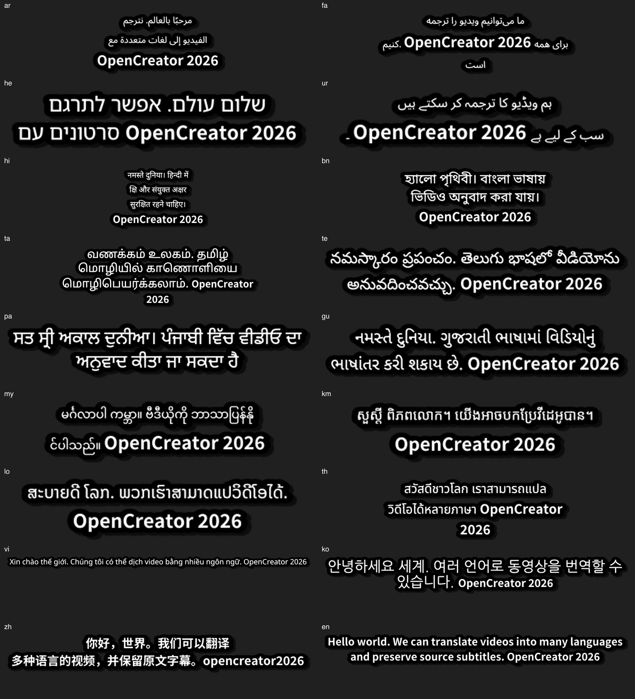

# KrillinAI 多语言扩展：实施与验收记录

日期：2026-10-16。平台：macOS arm64。本记录区分代码能力、结构与渲染验证、模型声明以及自然语言质量；没有调用付费识别或翻译服务。

## 已实现的范围

- 源语言默认推荐由 14 项扩为 52 项；源选择器支持中文、英文、原生名和代码检索，还可检索目录中的其他语音语言。统一目录共 124 项，保留原 101 个目标值，拼音等文本专用值不会进入音频源语言检索。
- TS 与 Go 从 `assets/creator-languages` 生成同一语言表。旧任务继续保留产品代码；中文简繁、菲律宾语、爪哇语和希伯来语别名在后端入口正确适配。未识别的历史值继续展示。
- WhisperKit、whisper.cpp、faster-whisper 按实际已知模型使用 v2/v3 或英文专用能力集合。v2 为 99 个声学语言、v3 为 100 个，中文简繁在产品目录分别列项；完整清单不代表质量已验收。
- 模型不支持时，在下载识别模型与调用 ASR 前阻止；原文 SRT、已导入目标字幕、平台字幕成功路径不被无关 ASR 限制拦截。YouTube 回退转录时重新检查。
- 官方服务按任务所选模型核对时间戳；自定义兼容接口、FunASR、Aliyun、Volcengine 的语言覆盖保留“未知”，允许沿原有配置执行并提示核实。Aliyun 的语言由 AppKey 服务绑定，不声称能通过参数任意切换语言。faster-whisper 的现有不可安装状态不变。
- 转录产物元数据记录 provider、真实 model、executionModel 兼容名、产品语言、请求代码和能力版本。whisper.cpp 的 tiny/medium 真实模型与 `large-v2` 文件别名分开记录。
- 保留已有翻译、原译配对与时间映射主体，不增加常规 LLM 请求。修复后端全文与词文本不一致、源字幕空格及复杂文字的渲染切分；韩语保留词间空格，组合字素和 ASS 换行控制保持完整。
- 新增 14 个内置回退字体族，覆盖 LGC/越南语、阿拉伯/波斯/乌尔都、希伯来、天城文、孟加拉、旁遮普、古吉拉特、泰米尔、泰卢固、泰语、缅甸、高棉、老挝和韩文。TTF + WOFF2 总增量约 4.87 MiB（5,104,804 字节）。保留原 9 个主样式及用户选项，字体 manifest v2 与旧 v1 读取兼容；Web、Runtime 和包校验同步更新。
- Web/Desktop 共用现有 Workspace、CreatorCollaborationPanel、Daemon 与 Runtime，没有增加模板独立协作面板。

## 已执行的验证

| 层级 | 范围 | 结果 |
| --- | --- | --- |
| 目录与协议 | 代码、别名、52 推荐源、检索、能力 complete/partial/unknown、实际模型 | 8 项通过；生成一致性检查通过 |
| Daemon | 语言/时间戳检查、SRT/平台/音频路径、下载前拒绝、官方所选模型、兼容执行名 | 最终增量 3 文件 64 项通过；此前相关 7 文件 83 项通过、1 项既有集成跳过 |
| Web | Workspace、共享 Panel adapter、issue catalog | 3 文件 99 项通过 |
| 类型检查 | Daemon、Web、Desktop | 通过 |
| Go | types、service、pipeline、Whisper 各客户端与相关云适配器的定向检查 | 有匹配用例的相关包通过；无匹配用例不统计为云服务集成验收 |
| 字体 | TTF/WOFF2 字形、元数据、塑形表、9 主样式、14 回退族、哈希、许可证、52 原生名 | 通过；韩文为完整 Hangul 字体，并非 Latin 子集 |
| Browser/Desktop Bridge | 相同数据和内容视口下语言数量、检索、选择保留、选项与尺寸；桌面/390px 视口 | 2 项通过 |
| 实际 CLI 预览 | 18 文字样例 × 横/竖屏 × 单/双语 | 72/72；FFmpeg 日志无缺字或回退失败，已查看接触表 |
| 实际 CLI 正式输出 | ar、hi、th、ko × 横/竖屏双语，各 1 秒 | 8/8 MP4；ffprobe 确认尺寸与音视频轨道，无缺字日志 |
| 实际 ASR | 本机 WhisperKit large-v2；hi、vi、th 的 macOS 合成语音 | 3/3 生成有效带时间字幕，约 12.13/4.10/6.45 秒；不能替代自然语音质量验收 |
| 构建 | 当前工作树 Krillin CLI/server、Web、Desktop 目录包 | CLI/server 已重建；最终包及实际 App 检查见下方记录 |

Go 定向命令：

```sh
cd runtime/krillinai
go test ./internal/types ./internal/service ./internal/pipeline ./pkg/whisper ./pkg/whisperkit ./pkg/whispercpp ./pkg/fasterwhisper ./pkg/funasr ./pkg/aliyun ./pkg/volcengine ./pkg/util \
  -run 'Language|Unicode|Wrap|Vertical|OriginCue|OriginSubtitle|Transcription|PairedTranslation|ShortSubtitle|Multilingual|Font|Render|Ass' -count=1
```

字体资产校验同时涵盖输出 SHA-256、版本、固定来源和 OFL 许可证；上游网络下载失败不影响已内置资产使用。生成脚本可在隔离 Python 环境重建资源，支持复用已准备字体。



接触表便于观察缺字、连接字形及混排，不代表母语人工校对通过。完整本地证据在 `.tmp/multilingual-validation/`：`render-results.json`、`video-results.json`、`asr-results.json` 与各用例 CLI/FFmpeg 日志。该临时目录不纳入产品资源。

## 首批 52 项语言矩阵

所有行的目录、推荐项和原生名内置字形覆盖已检查。下表“配对/时间轴”是桩模型结构测试，“渲染”是指定文本，不是实际识别或翻译；“未专项执行”不表示模型不支持。

| 产品代码 | 语言 | Whisper large-v2 | 配对/时间轴 | 实际预览渲染 | 实际 ASR | 自然样片与人工语义 |
| --- | --- | --- | --- | --- | --- | --- |
| `zh_cn` | 简体中文 | 声明支持 | 未专项执行 | 通过 | 未执行 | 待验收 |
| `zh_tw` | 繁体中文 | 声明支持 | 未专项执行 | 未专项执行 | 未执行 | 待验收 |
| `en` | 英语 | 声明支持 | 未专项执行 | 通过 | 未执行 | 待验收 |
| `ja` | 日语 | 声明支持 | 未专项执行 | 未专项执行 | 未执行 | 待验收 |
| `ko` | 韩语 | 声明支持 | 未专项执行 | 通过 | 未执行 | 待验收 |
| `es` | 西班牙语 | 声明支持 | 未专项执行 | 未专项执行 | 未执行 | 待验收 |
| `fr` | 法语 | 声明支持 | 未专项执行 | 未专项执行 | 未执行 | 待验收 |
| `de` | 德语 | 声明支持 | 未专项执行 | 未专项执行 | 未执行 | 待验收 |
| `it` | 意大利语 | 声明支持 | 未专项执行 | 未专项执行 | 未执行 | 待验收 |
| `pt` | 葡萄牙语 | 声明支持 | 未专项执行 | 未专项执行 | 未执行 | 待验收 |
| `ru` | 俄语 | 声明支持 | 未专项执行 | 未专项执行 | 未执行 | 待验收 |
| `ar` | 阿拉伯语 | 声明支持 | 通过 | 通过 | 未执行 | 待验收 |
| `hi` | 印地语 | 声明支持 | 通过 | 通过 | 合成语音通过 | 待验收 |
| `id` | 印度尼西亚语 | 声明支持 | 未专项执行 | 未专项执行 | 未执行 | 待验收 |
| `ms` | 马来语 | 声明支持 | 未专项执行 | 未专项执行 | 未执行 | 待验收 |
| `th` | 泰语 | 声明支持 | 未专项执行 | 通过 | 合成语音通过 | 待验收 |
| `vi` | 越南语 | 声明支持 | 通过 | 通过 | 合成语音通过 | 待验收 |
| `fil` | 菲律宾语 | 声明支持 | 通过 | 未专项执行 | 未执行 | 待验收 |
| `tr` | 土耳其语 | 声明支持 | 未专项执行 | 未专项执行 | 未执行 | 待验收 |
| `pl` | 波兰语 | 声明支持 | 通过 | 未专项执行 | 未执行 | 待验收 |
| `nl` | 荷兰语 | 声明支持 | 未专项执行 | 未专项执行 | 未执行 | 待验收 |
| `uk` | 乌克兰语 | 声明支持 | 通过 | 未专项执行 | 未执行 | 待验收 |
| `bn` | 孟加拉语 | 声明支持 | 通过 | 通过 | 未执行 | 待验收 |
| `he` | 希伯来语 | 声明支持 | 通过 | 通过 | 未执行 | 待验收 |
| `fa` | 波斯语 | 声明支持 | 通过 | 通过 | 未执行 | 待验收 |
| `sv` | 瑞典语 | 声明支持 | 未专项执行 | 未专项执行 | 未执行 | 待验收 |
| `fi` | 芬兰语 | 声明支持 | 未专项执行 | 未专项执行 | 未执行 | 待验收 |
| `da` | 丹麦语 | 声明支持 | 未专项执行 | 未专项执行 | 未执行 | 待验收 |
| `no` | 挪威语 | 声明支持 | 未专项执行 | 未专项执行 | 未执行 | 待验收 |
| `el` | 希腊语 | 声明支持 | 未专项执行 | 未专项执行 | 未执行 | 待验收 |
| `hu` | 匈牙利语 | 声明支持 | 未专项执行 | 未专项执行 | 未执行 | 待验收 |
| `sr` | 塞尔维亚语 | 声明支持 | 未专项执行 | 未专项执行 | 未执行 | 待验收 |
| `hr` | 克罗地亚语 | 声明支持 | 未专项执行 | 未专项执行 | 未执行 | 待验收 |
| `cs` | 捷克语 | 声明支持 | 未专项执行 | 未专项执行 | 未执行 | 待验收 |
| `sw` | 斯瓦希里语 | 声明支持 | 未专项执行 | 未专项执行 | 未执行 | 待验收 |
| `ro` | 罗马尼亚语 | 声明支持 | 未专项执行 | 未专项执行 | 未执行 | 待验收 |
| `sk` | 斯洛伐克语 | 声明支持 | 未专项执行 | 未专项执行 | 未执行 | 待验收 |
| `sl` | 斯洛文尼亚语 | 声明支持 | 未专项执行 | 未专项执行 | 未执行 | 待验收 |
| `bg` | 保加利亚语 | 声明支持 | 未专项执行 | 未专项执行 | 未执行 | 待验收 |
| `lv` | 拉脱维亚语 | 声明支持 | 未专项执行 | 未专项执行 | 未执行 | 待验收 |
| `lt` | 立陶宛语 | 声明支持 | 未专项执行 | 未专项执行 | 未执行 | 待验收 |
| `et` | 爱沙尼亚语 | 声明支持 | 未专项执行 | 未专项执行 | 未执行 | 待验收 |
| `pa` | 旁遮普语 | 声明支持 | 通过 | 通过 | 未执行 | 待验收 |
| `ta` | 泰米尔语 | 声明支持 | 通过 | 通过 | 未执行 | 待验收 |
| `ur` | 乌尔都语 | 声明支持 | 通过 | 通过 | 未执行 | 待验收 |
| `mr` | 马拉地语 | 声明支持 | 通过 | 未专项执行 | 未执行 | 待验收 |
| `te` | 泰卢固语 | 声明支持 | 通过 | 通过 | 未执行 | 待验收 |
| `km` | 高棉语 | 声明支持 | 通过 | 通过 | 未执行 | 待验收 |
| `lo` | 老挝语 | 声明支持 | 通过 | 通过 | 未执行 | 待验收 |
| `ne` | 尼泊尔语 | 声明支持 | 未专项执行 | 未专项执行 | 未执行 | 待验收 |
| `gu` | 古吉拉特语 | 声明支持 | 未专项执行 | 通过 | 未执行 | 待验收 |
| `my` | 缅甸语 | 声明支持 | 未专项执行 | 通过 | 未执行 | 待验收 |

## 已知边界与剩余验收

1. 尚未拿到有权使用、带人工核对稿的 52 项自然语音样片；未完成真实 ASR → 实际翻译模型 → 最终视频的逐语言质量验收。没有为任何语言给出已验收的识别率或翻译准确率。
2. 合成印地语样例存在拼写识别误差。泰语原文单独输出能保留组合字素，但 ASR token 并非自然词，按 token 数分 cue 仍可能在自然词中间断开；高棉、老挝、缅甸等也需要母语样片核对。Unicode 字素安全不等于词典分词或语义断句。
3. 词内/cue 内新时间边界仍按现有插值方法估算，不属于音素级强制对齐；没有增加语言专用识别/分词模型。
4. 云服务缺少可信语言清单时保持未知，不宣称任意 OpenAI 兼容、FunASR、Aliyun 或 Volcengine 配置支持全部语言；本次也没有实际调用这些云 ASR。
5. 音频自动识别语言、混合源语言、多说话人和新增目标 TTS 音色不在首轮交付范围。2026-10-17 已补充原文字幕导入的本地语言识别，见下方增量记录。
6. 实际包验证限 macOS arm64；Windows、其他架构尚未实际打包验收。没有创建 Git 提交、推送、tag 或 Release。

自然样片验收继续按方案准备 30–60 秒素材，逐项记录实际模型、识别稿、数字/专名/否定、译文含义、覆盖、同步和横竖屏效果。使用按语言固定的 WER/CER 方法与人工语义判断；完成后再更新表中最后一列。

## 最终 Desktop 包记录

最终目录包：`apps/desktop/release/mac-arm64/OpenCreator.app`，构建来源为当前未提交工作树；不是发布包。`pnpm desktop:package` 会从当前源码重建 Web、Daemon 与 Runtime，并核对包内资源及 Web 文件列表/哈希。

实际包定向验证已覆盖语言 52/124 选项、中文/原生名检索、检索保留选择、阿拉伯语状态保存、页面重载、退出 App 后重启恢复、内置阿拉伯字体加载，以及内嵌 Runtime/默认项目连接。

额外运行的既有综合用例“实际 Desktop 包创建并重启恢复 Creator Job，且使用内嵌 Runtime”在进入后续流程前被硬编码 yt-dlp 版本断言阻断：预期 `2026.08.29.232711`，当前准备的资源为 `2026.10.10.233141`。该用例不能计为通过；本次未修改无关版本断言，相关语言任务恢复由上述定向场景实际验证。该失败不证明综合用例后续其他流程已完成验收。

最后一次目录包构建：`2026-10-16T13:20:17.026Z`；Git 基线 `314ffd8a699da5cccde8f407c326a32c683854a3`，`dirty=true`，平台 `darwin/arm64`。Web 资源 `437` 个文件，构建哈希 `d9f56b2d3fcca96869907f7a6aed9e1338da1b29efbbfd21287fbb72540edd74`；Runtime 字体资源 `41` 项，Web 字体 `23` 项。包校验通过，包含字体/许可证及资源哈希、Web 资产一致性、Electron fuses 和隐私检查。

最终 CLI SHA-256：`9bdb0cebe221ac7d1b9678c78e88046bdd1ae1ce82e031578173eb8e6555fa32`。目录包资源仅用于本机验证；未进行签名公证或发布。

最后一次包的实际 App 定向结果：2/2 通过（8.4 秒），包括上述视频翻译多语言检索/持久化/退出重启恢复/字体加载，以及内嵌 Runtime 与默认项目连接。原始结果：`/tmp/opencreator-language-packaged-latest.txt`。

## 2026-10-17：导入原文字幕自动识别语言

原文 SRT 导入此前沿用页面默认英语，未读取正文判断语言。本次前端默认请求 `language: auto`，Daemon 在解析字幕后使用本地 `franc-all` 识别，并将结果保存到任务状态、产物元数据及结果快照；中文使用 OpenCC 辅助区分简繁，不修改原文。明确指定语言的 API 调用仍保留指定值，目标字幕导入仍使用目标语言。

识别会检查开头、中间和结尾样本。正文少于 40 个字母、样本结果冲突或候选语言过于接近时，保持待确认，页面提示手动选择，并在前端、API 工作流及用户/Agent 命令入口阻止未知源语言的翻译。手动修改后可继续；更换原文文件会重新识别，目标语言保持不变。旧任务不会被自动重写，重新导入即可触发。

已用此前 52 份译文 SRT 离线复测：47 份识别与预期一致，5 份待人工选择（克罗地亚语、印度尼西亚语、马来语、挪威语、塞尔维亚语），本批没有自动填入错误语言。这是固定样本验证，不代表任意内容的识别准确率。逐文件结果、条数和 SHA-256 见 [本地识别结果](./assets/video-translation-languages/subtitle-language-detection-20261017.json)。

验证结果：

- Daemon：语言检测单元测试 10 项、Creator API 集成测试 21 项、命令分发测试 17 项、视频翻译工作流测试 29 项通过。
- Web：Workspace 控制测试 44 项通过，包含识别结果同步、手动修改、更换文件、重建页面恢复和待确认拦截。
- Daemon 源码与测试类型检查、Web 类型检查通过；相关文件 `git diff --check` 通过。
- 开发服务 `http://127.0.0.1:19861/` 健康检查通过。实际 API 导入印地语 121 条字幕后，浏览器点击“继续”，源语言显示 हिन्दी，目标保持简体中文。浏览器自动化的文件选择接口返回 `Not allowed`，故实际文件通过同一导入 API 提交；文件选择到导入请求的前端流程由上述组件测试覆盖。

本次识别和验证未调用 GPT、ASR 或翻译模型，未调整翻译并发，未运行实际 Desktop 打包或更新已安装 App。上方 2026-10-16 的包记录不包含此次增量修复。

## 2026-10-17：字幕文件翻译进度修复

导入原文 SRT 原来直接报告 40%，翻译时仍保留视频准备回调，实际完成通知会被映射回 `preparing_source` 的 20%。同时，完成通知只在一组并发请求全部结束后发出，较慢的请求会挡住其他已完成请求的进度展示。

本次独立字幕流程使用读取 1–3%、翻译 5–95%、生成与整理文件 96–98% 的区间。翻译进度按通过本地检查的句子数计算，任一请求完成后立即更新；输出顺序和原有并发设置保持不变。CLI 与 Daemon 同时传递标准 `completed`、`total` 字段（包括 `completed: 0`），原有百分比协议仍兼容。只有 Daemon 校验并收集输出文件后才报告 100%。

共享协作面板通过视频翻译 Adapter 显示“已完成 X/Y 句”、运行时间、最近收到状态时间和等待说明。等待模型响应期间不会按时间虚增百分比；没有新增独立 Panel 或轮询翻译模型的请求。

已执行验证：

- Go 的导入字幕、独立字幕时间轴与进度、平台与音频进度映射、慢请求与输出顺序、失败窗口、并发及取消、CLI JSON 进度定向测试通过。
- 新增慢请求场景验证：首个请求必须等收到后续请求的完成进度才能返回，确保进度不会等整个并发窗口结束；相关并发测试通过 `go test -race`。
- Daemon CLI 协议与 runner：39 项通过，1 项 Windows 环境用例在 macOS 跳过；包含零完成数、非法计数过滤、标准字段透传与最终 100%。
- Web Adapter 与共享 Panel：53 项通过；等待 30 秒仍保持实际百分比，同时更新运行时间。
- Daemon 源码及测试、Web 类型检查通过；相关文件 whitespace 检查通过。
- 已重建开发用 Krillin CLI/server 和 Runtime 资源。CLI SHA-256：`400620788d629e2418f815481f14da2d6933f3cea31698c7cf91dc28ecff2f99`。确认没有活动任务后重新加载开发 Daemon，健康检查通过。

以上验证使用本地模拟模型响应，没有额外调用真实翻译模型；没有执行 Desktop App 打包或更新已安装 App。本次只改变进度报告与展示，原来任务的完成记录保留原值。


## 2026-10-17：视频翻译全流程进度

视频流程此前从旧的整体百分比推断当前阶段，平台字幕的翻译完成句数未传出，音频识别与翻译交叠时会被误认为单一阶段。配音只输出整数百分比，竖屏转换与最终 FFmpeg 编码则等待命令退出后才返回结果。

本次增加服务内部的详细进度回调，由 Pipeline 映射阶段区间，再经 CLI/Daemon 的标准 `phase`、`percent`、`message`、`completed`、`total` 字段传到共享协作面板。视频字幕阶段从 1–2% 开始；平台字幕解析后进入 15–85% 的翻译区间，补齐原视频为 88–95%，整理文件为 98%。音频准备与转录翻译使用各自区间，重试和迟到事件不会让阶段百分比倒退，最终 100% 仍由 Daemon 收集并校验产物后发出。

具体可见信息：

- 下载：通过 yt-dlp 的机器可读进度实时显示下载量、可用时的总大小、速度和预计剩余时间。总量未知时不虚构下载比例，输出日志中的 URL、文件路径不会直接作为进度文案。
- 识别与翻译：同时显示已分段数、已识别片段数、已翻译片段数、可用时的当前片段识别百分比，以及当前翻译片段的完成句数。任一有效翻译请求完成后立即报告，结果和检查点仍按原文顺序提交。
- 平台字幕：显示实际完成句数；只提取原文时不显示翻译阶段。
- 配音：显示规划、已生成 X/Y 段、时间轴对齐、音频拼接和视频音轨合并。这里只细化报告，没有改动配音分段或请求并发。
- 成片：竖屏转换与最终字幕合成从 FFmpeg 的 `out_time_us` 读取真实处理时长，结合可获取的媒体总时长计算区间进度。额外时长探测可取消且最长 5 秒，失败时仍继续实际合成。
- 面板：继续使用 `CreatorCollaborationPanel` 和视频翻译 Adapter，显示详细状态、运行时长、最近状态时间。等待不会按时间虚增百分比；没有另建 Panel、SSE 或翻译请求。

已执行验证：

- Go Pipeline、Service、Dubbing 与 CLI 定向测试通过，覆盖导入字幕、平台字幕和音频进度、零完成量、晚到事件、慢请求、输出顺序、媒体下载重试与取消、配音阶段以及渲染参数。
- 相关音频/翻译并发、媒体进度与 Pipeline 场景通过 `go test -race`。模拟慢请求必须收到后续请求的完成通知才能继续，确认音频字幕的进度不再等待整组请求结束。
- 使用模拟下载器验证：下载进度必须在子进程结束前到达；未知总量保持既有百分比。未访问视频平台或真实模型。
- 使用当前 Runtime 的 FFmpeg/ffprobe，在本地生成两秒视频并实际合成字幕；输出视频非空，收到实际处理时长，整理产物前没有报告 100%。最终本地媒体定向检查 3/3 通过。
- Daemon CLI 协议与 runner：39 项通过，1 项 Windows 环境用例在 macOS 跳过，包含配音片段数的标准字段透传。
- Web Adapter 与共享 Panel：66 项通过，覆盖识别/翻译交叠、下载量/速度/余时、配音数量、合成时长、本地化，以及等待 30 秒百分比保持不变。
- Daemon 源码及测试、Web 类型检查通过。相关修改 whitespace 检查通过。
- 已构建 CLI/server 并准备开发 Runtime。CLI SHA-256：`a2dffece3e59d99f437fa7bd8b9b3b3a273b6c972b84a9d93e0b80d3073daac8`。确认没有运行任务后重载受管 Daemon，`http://127.0.0.1:19861/.opencreator/runtime/healthz` 返回 200 / `ok: true`；Vite 保持运行。

本次未调用真实 GPT/ASR/TTS 服务，未调整应用并发配置，未执行 Desktop App 打包或更新已安装 App。没有逐一实测各外部视频平台与识别供应商；识别引擎不提供片段内进度时，只能显示片段完成量及运行/等待状态。上方旧包记录不包含此次增量修改。

## 2026-10-17：扩展默认源语言目录与文字覆盖

默认源语言目录由 52 项扩展到 123 项，原有 52 项常用语言仍排在前面，中文、原生名及语言代码搜索继续保留。此前其余候选可通过搜索找到，本次统一默认展示，并补齐扩展语言的字体与识别映射。目标目录仍为 124 项，其中包含仅用于输出的拼音；拼音不会出现在源语言目录。

字幕文本翻译沿用现有语言代码、原译配对、断句与时间轴逻辑，未引入新的语义拆分规则。导入原文字幕时仍使用本地语言检测，修复了 Nynorsk（`nn`）被归为普通挪威语（`no`）的问题；Bokmål（`nb`）继续规范化为 `no`。短文本、歧义或混合语言仍需手动确认。

音频识别继续按实际模型校验：Whisper v2 覆盖 100 个产品语言选项（99 个声学语言，简繁中文分别计项），v3 覆盖 101 个产品选项（增加粤语）。WhisperKit 当前固定使用 v2。123 项源语言目录不代表当前识别模型支持全部 123 项；明确不支持的音频组合仍会被预检拦截，未知供应商覆盖范围仍提示确认，已有字幕的翻译路径不受 ASR 清单限制。

新增阿姆哈拉文、爪哇文、马拉雅拉姆文、卡纳达文、奥里亚文、格鲁吉亚文、亚美尼亚文、僧伽罗文和藏文的完整字体，共增加 9 个回退字体族，合计 23 个。原有 9 个主字体和 14 个回退字体文件哈希均未变化。新增 TTF 与 WOFF2 共 2,360,488 字节，包含固定上游版本、校验和及 OFL 许可证。浏览器选择框、字幕编辑及预览共享回退列表，视频合成按 Unicode 文字选择相应内置字体。

本次已执行验证：

- Web Workspace 与 CSS 定向测试 76 项、Protocol 语言目录与模型能力测试 9 项、Daemon 本地字幕检测及识别能力测试 15 项通过。覆盖扩展默认选项、搜索保留选择、僧伽罗语导入、新挪威语识别与任务恢复。
- Go 定向测试通过，覆盖新增 9 类文字的配对、文本与时间轴保留，以及字体切换、组合字素和 ASS 换行。
- 字体资源测试 2 项通过，包含全部 123 个源语言原生名的字形覆盖、字体塑形表、资源哈希与许可证检查。
- 浏览器定向测试 2 项通过，在 1280×800 和 390×844 内容区域分别验证 Browser/Desktop Bridge 的 123/124 项目录、搜索、布局与新增 9 个 Web 字体的实际加载。此检查使用 Bridge 测试上下文，没有启动实际 Electron App。
- 当前源码构建的 CLI 串行渲染新增 9 类文字的横屏及竖屏双语预览，共 18/18 项通过。PNG 尺寸与非透明像素检查通过，日志未记录缺字警告；已查看横屏汇总图确认文字可见。这不代替母语者的塑形和语言质量验收。另有原有预览与实际视频烧录的定向集成测试 6 项通过。
- Web 构建、Web 与 Daemon 源码类型检查、Daemon 测试类型检查通过；修改 whitespace 检查通过。
- 已重建开发 CLI/server 与 Runtime 资源。CLI SHA-256：`dbce70c069816c37655456f63e18fb56dfc6c7a3f251d18baefacd981cacb7ce`。确认没有活动任务后，仅重载当前 Vite 管理的 Daemon。健康检查返回 200 / `ok: true`，通过开发 API 实际生成 960×540 僧伽罗文双语预览。

渲染结果、像素统计和哈希见[验证数据](./assets/video-translation-languages/source-language-expansion-20261017.json)，横屏样本见[渲染汇总图](./assets/video-translation-languages/source-language-expansion-render-20261017.png)。开发服务为 `http://127.0.0.1:19861/`，刷新页面即可使用。

本次未调用真实 GPT、ASR 或 TTS，未调整翻译并发配置，未执行 Desktop App 打包或更新已安装 App。没有完成全部 123 项语言的真实语音识别、实际模型翻译或母语人工质量验收；上方旧 App 包记录不包含本次扩展。

## 2026-10-17：KrillinAI 翻译执行链专项检查

本次按用户补充要求，检查 KrillinAI 自身的翻译处理能力。上一轮目录、字体和 Whisper 覆盖检查不能单独证明翻译流程兼容。当前代码中，123 项源语言均有对应的运行时元数据和语言名称，能够进入 LLM 翻译主流程；没有仅允许 52 项源语言的翻译引擎分支。但这仍是应用接入范围，真实翻译质量取决于实际选择的 LLM，不能据此宣称全部语种质量已达标。

执行链检查结果：

| 环节 | 实际实现及结论 |
| --- | --- |
| 语言参数 | Daemon 模板接受字符串，Adapter 规范化后传给 CLI `--origin-lang` / `--target-lang`；Go 的 `GetStandardLanguageName` 从共享目录生成的完整映射取名。新增源语言不会自动落回英语或“未知”。 |
| 原文 SRT | `GenerateSubtitles` → `TranslateSubtitleBlocks` → `BatchTranslateSrtBlocks` → `translatePairedSentences`。字幕导入跳过 ASR，按源语言和目标语言构造 LLM 提示词。 |
| 平台 VTT | 块级及词级字幕经过清理、正文与时间提取后，共用 `BatchTranslateSrtBlocks` 翻译；词级时间可传入配对时间轴处理。 |
| 音频识别后的翻译 | `splitTextAndTranslateV2` → `translatePairedSentences`；识别稿使用相同的结构化翻译、原译分段和检查点保存逻辑。识别服务的语言限制发生在上游。 |
| 实际模型调用 | `Translator` 使用配置的 LLM，经 `pkg/openai` 的 HTTP 客户端发出结构化字幕请求，不依靠 Whisper 完成翻译。源语言名称、原文、上下文和目标语言均传入提示词。 |
| 分句、配对和输出 | 使用 Unicode 句界、词界、字素簇、显示长度与原译覆盖检查；SRT、VTT 和识别稿使用共享配对逻辑。时间定位按原文字符位置和可用的词级时间计算。 |

检查中复现并修复一个真实的多语言分段漏洞：原来的完整性检查比较去掉全部空白后的文本，因此会接受 `nicht so` → `nichtso`、`apart` → `a part`，阿拉伯语、泰米尔语及泰语短语空格也可能被改坏。现在逐段匹配原始文本，只允许分段边界空白变化，原文及完整译文的段内空格均须保留。错误响应触发已有纠错重试，并补充提示词说明；没有改变分段长度、请求并发或全局配置。

本次验证：

- 123 项源语言分别经过导入 SRT、平台块级 VTT 和音频识别稿后的翻译阶段，共 369 个场景通过，目标均为简体中文。SRT/VTT 使用真实 Service 构造、HTTP LLM 客户端、分句、结构化回包解析、原译配对、时间轴和原文/译文/双语文件写入；音频阶段覆盖翻译检查点与带标点、清理标点两种时间匹配路径。
- 测试输入为“语言原生名 + OpenCreator + 数字 + 标点”的合成路由探针，模型返回固定译文；并非 123 种语言的自然语料或真实模型翻译。测试证明程序兼容这些语言代码和文字、请求及输出链路，没有提供语义准确率。
- Service 定向检查 33 个顶层测试通过（含子测试 242 项），覆盖已有多文字分段、Unicode 句界、缩写跨 cue、字素边界、预算、纠错与新增空格保留场景。Pipeline 定向检查 4 个顶层测试通过（含子测试 375 项）。新增的 369 个场景包含在上述数量中，不重复相加。
- 已从当前源码重建 CLI/server。CLI SHA-256：`6a1e6a8e48547dab54ae07e75846555544a57ddc4e1d7a57df883192dcb0b30d`。额外用实际 CLI 执行新挪威语 SRT → 简体中文，经本地 HTTP 模型替身先返回错误空格、再返回正确结果，确认两次请求后输出正确原文和译文，保留原始时间轴。
- 确认无活动任务后，仅重载当前开发 Daemon；Web 服务继续运行。修改 whitespace 检查通过。

逐语言结果及实际 CLI 复测记录见[KrillinAI 翻译执行链验证数据](./assets/video-translation-languages/krillin-translation-engine-20261017.json)。本轮没有改动 Web 界面、调用真实 GPT/ASR/TTS、调整用户并发配置或打包 Desktop App。

仍需明确的质量边界：`hasTargetLanguageCharacteristics` 只有中、英、日等少量文字特征检查，其余语言默认放行；这不是完整的目标语检测，也不能判断译义是否准确。Unicode 分句及字素安全也不等于各语言的语法和词典分词，本地缩写与意群规则仍主要覆盖英语和中文。要把某个源语言标记为质量已验收，需要使用该语言的自然字幕，经用户实际选定的 LLM 串行翻译，再核对含义、数字、专名、否定、断句和时间同步。
