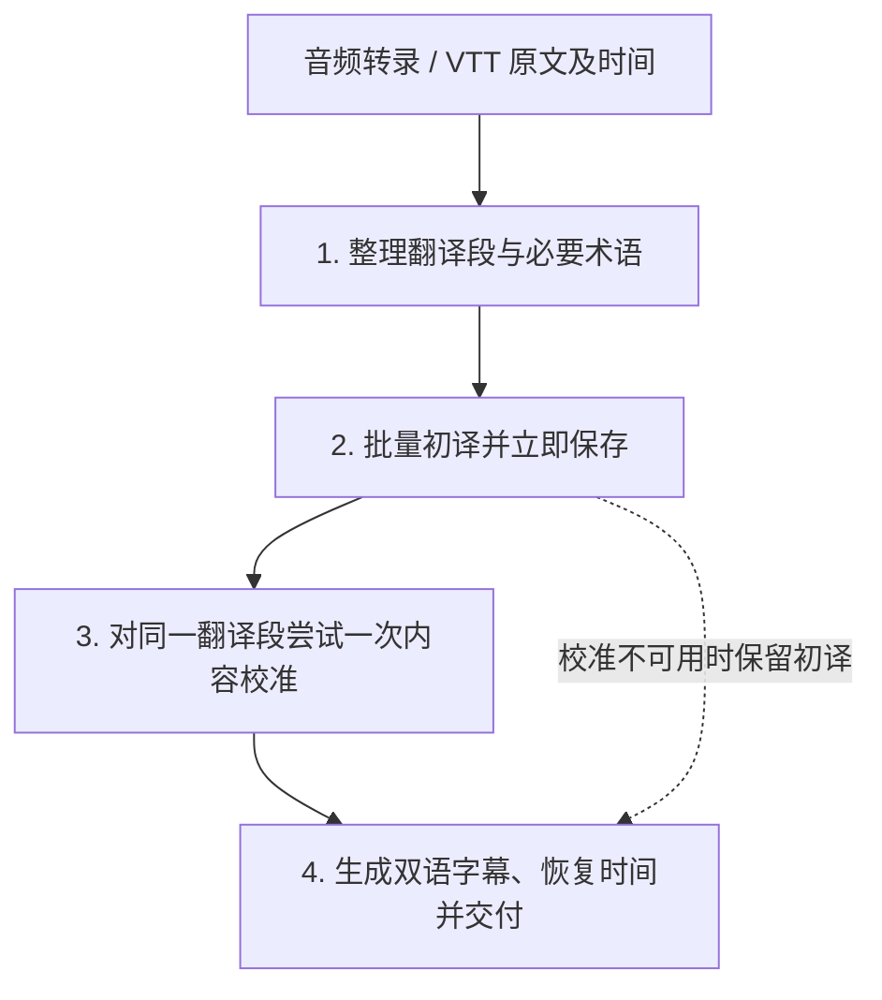

**这是基于两次质量回退重新整理的整体候选方案，尚未实施。目标仍为先取得并保存可用译文，再改善字幕质量；新流程须整体验收后才能成为默认。**

**状态更新：用户后续要求停止大范围流程改造，改为从远端最新 `origin/feat-translate-20261016`（`8b4bd9db`）做小范围修复。本候选方案停止推进，不作为实施依据。干净基线位于相邻工作区 `open-creator-translation-baseline`，原工作区的实验和其他未提交改动予以保留。**

范围为音频转录和平台 VTT 之后的翻译链路，继续共用来源、时间映射与检查点。原始 SRT 导入保持现有范围。

上一轮方案的问题是，把“前置拆分更细”当成可以独立交付的优化，却继续沿用完整父句的修订和冻结对齐规则。此前另一轮则关闭表达修订、将不合格排版整块回退。这两种做法都改变了局部，却没有保持整个链路的约定一致。结构测试通过也被过多用于支持成品质量判断。

详细证据见[本片四版质量审查](../../../benchmarks/os0V5ADLVjM-source-units-quality-20261022/REPORT.md)。本方案不把已出现的各类错误分别新增为修补分支。

**先统一处理对象：翻译用的段和显示用的条目分开。**

| 对象 | 职责与约束 |
| --- | --- |
| 来源 | 规范化原文及原始来源、位置、词时间。不可被翻译和润色改写 |
| 翻译段 | 一个或数个相关从句、连续意群。拥有一份完整初译和一份候选定稿；初译、校准与对齐处理同一段 |
| 字幕条目 | 从翻译段生成的显示结果，拥有对应原文范围和时间。显示长度不反过来定义翻译段 |

请求批次只是把几个翻译段按预算一起提交，不是新的语义对象。复用现有来源坐标、完整译文、初稿和检查点字段，不建设新的通用分组框架、版本依赖图或任务调度器。

NLP 仍然要先做，但它的每个短切口不再自动成为必须独立补全、独立修订的翻译 ID。明确共享谓语、宾语、条件、修饰语的片段保持在同一翻译段。段内可正常调整译文语序；批外语境仅供理解，不得补入正文。

例如 `so let's go back / and take a look at kitchen` 作为一个段处理，得到“我们回去看看厨房”；不会先把第一小片段认定成缺宾语，再补出下一片段已有的厨房。

翻译段不要求总是完整语法句，也不应恢复成旧版任意 800 字节的预算块。可靠自然边界优先；边界不明确时，保留一段上下文一起处理，比把每个短片段当独立句更稳。最终大小和切分阈值要由样本验证，不能再把 20 token 或某个字符数宣称为语义正确标准。

**整条主线收敛为四步。**

**第一步整理输入，只为翻译准备必要材料。**

利用现有标点、NLP 依存关系和可靠的时间停顿形成连续翻译段，保护名字、数字单位和紧密短语；无标点来源允许相关意群合在一起。只有明显过长、现有本地边界无法处理的段才尝试一次模型边界建议，失败保留本地可处理结果。取消“凡超过约 20 token 就请求模型细分”的普遍前置步骤。

模型只建议源文边界，程序从原文取片段并检查覆盖；不新建全文标点恢复或分句质量评审调用。预算保护仍存在，但被明确视为保护性切块，需要相邻语境，不冒充语义完整句。

主题、重点术语和少量明确的全片约定在同次分析中准备，例如产品名和财务币种；保留来源证据，只将当前相关项送入请求。长片按预算分块，程序合并，不再单独生成、校准多级摘要。用户明确提供的术语优先，模型推测不应硬性覆盖语境。疑似 ASR 错字保留不确定性，不凭空改出真值。

术语结果只要部分有效即可使用，失败按已有术语或空表继续。固定本次分段和术语快照；续跑时可选分析恢复成功，不应使已有译文整体失效。

**第二步只取得完整、自然的初译，不让排版限制干扰理解。**

相邻翻译段按输入与预计输出预算成批，结合相关术语和有限前后文，输出每个翻译段的一份完整译文。段内允许自然重组；不要求每个 NLP 片段独立有译文，也不强求初译小于字幕行长。

保留 VideoLingo 的短段成批思路，但不照搬其每个短行的独立输出约束。明确相关语法成分必须在同一编辑范围；批次边缘的关联原文应完整提供，避免只截到半个短语。上下文规模按实际内容和预算控制，而不是仅沿用“前两条后两条”。

批大小、段长度及上下文不作为同时任意调整的三套新配置。先用现有请求和固定样本选择一组内部初始值，再固定做对照；不能把未经验证的“每批 3 句”或“某个字数必然最好”写成架构规则。英文样本和无空格语言的参数含义要区分。

有效初译立即保存。结构缺失、空译文、无法归属等明确失败最多额外重试两次；只处理失败段，最后一次简化为取得正文。语义相关的段不能被拆成互相独立的重试片段。普通文字特征差异仅标疑点，不据此反复重译。

**第三步保留一次明确的内容校准，替换现有逐编号修订和候选核验链。**

这里借鉴 VideoLingo 的 direct → expressiveness，但校准同时对照原文和初译，检查漏译、重复、角色和逻辑，再改善目标语表达。整个翻译段是接受或回退的最小范围；初译与定稿都保留。同一语义段内的改动不得只应用一半。

校准看到同一段的全部内容，可以把串位内容放回合适位置，但不能从只读邻段补入事实。认为没有必要修改时直接保留初译。输出完整段级候选，不拼接多个子编号的新旧译文。

默认尝试一次，失败保留初译继续。取消普遍的“修订 → 逐条候选裁决 → 被拒项再修订 → 再裁决”；不另建模型打分、流畅度筛查和全文终审。程序检查已知结构、可可靠比对的数字/标识和异常重复；这些检查不冒充完整语义验证。

这是一项明确取舍：保留一次表达编辑的机会，但不把同一模型的多次自我认可当成保险。校准仍可能改坏译文，段级处理只能减少不一致的机制，不能证明结果必然更好；候选能否成为默认依靠后续固定对照验收。

**第四步只负责把该段做成可用字幕，并保持内容可追溯。**

先采用已有可用边界；需要模型对齐的段，一次处理完整的局部翻译段。源文顺序和覆盖始终不变，允许调整段内源文切口，中文以定稿为依据。为了语言语序差异，必要时允许在该段内作有限的词序、承接调整，不以“每个字符原顺序不变”作为唯一合法条件；不重新润色术语或翻译整段。

这一点吸收 VideoLingo 的源文拆分与目标语对齐余地，但保留 OpenCreator 的来源保护、空段检查、长度测量和检查点。调整后保存完整字幕候选，不逐条混入不同版本。对齐改写仍有语义风险，要纳入最终成品评阅，不能因程序验收通过而称其事实已被证明。

程序统一检查实际配置的双侧显示长度、源文完整覆盖、安全边界、配对非空和时间合法性。已有合格结果不再请求；仅对失败范围最多追加一次对齐纠错。仍失败时保留可用译文、有效短条和待调整范围，不整段退回更大的块，不重译已经完成的正文。

排版必须对应所采用的同一版译文。保留有效短条是指该版本内部已成功的配对，不能拿旧版排版拼接新版正文；若当前版本没有有效排版，保存完整译文并明确待排版。润色、对齐各自失败时，回退对象都由这一约定决定。

最终时间从 source 范围和原生词时间恢复，不根据译文字数平均分配。不因过短而无条件合并，不跨明显说话停顿拉长；逐片播放抽查同步。双语对齐、中文长度和过短闪屏都进入验收，不能只看中文最长值。

**每一步都有明确退出条件，失败不把成果清零。**

| 阶段 | 正常模型工作 | 失败策略 |
| --- | --- | --- |
| 输入准备 | 本地分段；必要术语分析；仅疑难长段一次边界建议 | 分段和术语降级可继续 |
| 初译 | 每批一次正文 | 失败段最多额外两次，耗尽后明确部分完成 |
| 校准 | 每批至多一次 | 保留初译，不反复裁决 |
| 对齐 | 已合格段跳过；必要段一次 | 失败范围至多一次纠错，保留已有成果并标待调整 |

网络故障和限流只由统一请求层处理，不能在分句、正文和排版各自叠加网络重试。鉴权/额度错误及时保存并说明服务问题。取消不变成自动重试。自动尝试计数持久化，续跑只补缺失阶段。

“正文完成”“字幕排版完成”“有待检查项”“部分未译”依据实际内容分别记录。不能用原文回填冒充完成，也不能用“已尝试校准”“模型接受”冒充质量通过。请求预算、首批译文等待、全片 token 和失败原因一起记录；成本不是翻译评分。

**更换默认链路前，采用整体准入条件。**

以已有 486 条版本作为当前产品质量参考，VideoLingo 沿用已有成品。现有正确例和错误例一同冻结，不能只选新版更好的句子。必要的旧/新局部模型对照固定模型、服务、来源与词时间、目标语言及显示配置；VideoLingo 50 与 KrillinAI 75 的配置差异单独注明。

| 验收方面 | 准入条件 |
| --- | --- |
| 成功与恢复 | 模拟术语/校准/对齐失败、限流、取消与续跑；有效译文不丢失，已完成内容不重做，失败状态真实 |
| 信息准确 | 固定的收入遗漏、厨房重复、修饰关系、旁注、币种与数字案例改善；整片评阅没有新发现的严重漏译、关系反转或重复 |
| 自然表达 | 原文和匿名版本对照评阅，展示具体句子；不能凭 1–2 分或“模型核验通过”宣布提升 |
| 双语成品 | 双侧长度、配对、词边界及时间核对；常规样本满足实际配置，对无法处理的样本明确判定排版未通过 |
| 泛化 | 除当前片外，复用已有技术讲解素材，并补一段真实音频转录结果；检验有/无标点、较长从句及跨句引用 |
| 成本 | 记录各阶段调用和 token；无隐藏重试，不用牺牲信息完整换取低消耗，不预先承诺节省百分比 |

先在少量冻结片段上跑通从来源到最终字幕的完整候选，再完成当前视频的一次整片验收和代表性素材检查。离线回放只能验证程序行为和旧响应兼容，不能替代新模型结果的质量验收。

实施可以分提交，但不能只把新拆句接进旧修订链后就宣布优化完成。完整候选验证期间保留原有默认与产物，不同时修改默认模型、显示目标和无关业务；通过后一次切换，收敛历史实验分支，复用已有执行和持久化能力。

本方案需要接受的代价是：保留一次校准，调用数可能高于仅初译；适当重组提高对齐自由度，也需要真实成品验证。预期收益是统一编辑范围、减少新旧结果混拼、取消反复裁决和普遍过细的模型预分句。收益尚待实测，不以方案描述代替质量证明。
