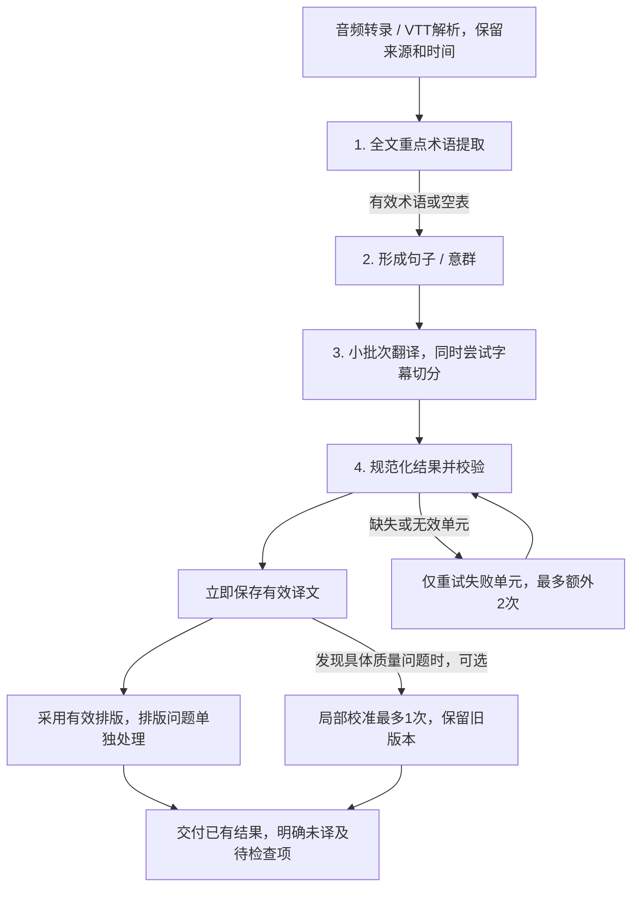

# 视频翻译流程优化方案：先完成翻译，再提升质量

> 状态更新（2026-10-22）：本方案首版的流程替换因字幕成品质量回退已撤回。当前以 `8b4bd9db` 默认 legacy 流程为基础，只保留和补充独立缺陷修复。下文是历史方案，不是当前实施规格；见[撤回与修复记录](video-translation-legacy-repair-20261022.md)。

日期：2026-10-22。状态：逐段方案及后续收紧建议均已由用户确认；音频与 VTT 首版已实施，见[实施记录](video-translation-implementation-20261022.md)。

复审提示：下文保留逐段确认时的原文。[方案复审](video-translation-design-review-20261022.md)已收紧合并翻译与切分、固定批次/上下文参数及自动质量触发：实际先分段再准备术语，主调用只翻译，复用已有预算组批和有限上下文，只对必要单元做一次局部排版候选。冲突处以已批准的复审及实施记录为准，本文不单独作为最终实施规格。

本版替换同名文档此前的质量优先提案。原提案中的必经母语润色、全量模型终审及多轮质量修复，不属于当前方案。既有历史方案和实验文档保留为参考，不能覆盖本次确认的要求。

## 1. 目标、范围与依据

优先级为：取得有效译文并保存成果 → 能恢复并处理失败部分 → 提升准确性、自然度和字幕可读性。低质量译文与没有译文必须区分；格式偏差、排版失败和润色失败，不应连带丢弃已经有效的译文。

本轮处理音频与 VTT 输入。音频先转录，VTT 先解析，随后共用后续流程。原始 SRT 翻译暂不调整；配音、合成和下载也不作为本轮翻译算法改造的新增范围。

依据为 OpenCreator `8b4bd9db` 默认 legacy 路径、VideoLingo `01f84349` 的代码比较，以及 `os0V5ADLVjM` 的同源同模型冷启动对照。证据位于工作区 `benchmarks/os0V5ADLVjM-audit-20261021`。该对照不含 ASR、配音、合成和完整 GUI 验收，不能当作原生入口的端到端复现或所有语言的质量结论。

| 来源 | 采用的机制 | 本轮取舍 |
| --- | --- | --- |
| OpenCreator | 来源位置、时间映射、覆盖检查、检查点、版本保存 | 保留，并贯通工作台恢复和最终状态 |
| OpenCreator | 术语证据及语境 | 术语结合句意使用，失败允许跳过 |
| VideoLingo | NLP/语义片段作为实际翻译单元，小批次附带前后文 | 采用；不要求每个单元都是完整语法句 |
| VideoLingo | 忠实译文与可选表达优化分开，润色失败可回退 | 采用回退原则；不默认增加第二轮润色 |
| 两者现有复杂链路 | 多轮切分、反复排版修复、全量模型审查 | 不作为新流程必经步骤 |

源码参考：[VideoLingo NLP 入口](../../../VideoLingo/core/_3_1_split_nlp.py)、[长段语义切分](../../../VideoLingo/core/_3_2_split_meaning.py)、[批次和上下文](../../../VideoLingo/core/_4_2_translate.py)、[翻译和可选润色](../../../VideoLingo/core/translate_lines.py)。这些是相邻工作区参考，项目独立检出时不一定存在。

仓库已有[意群实验路径](../../runtime/krillinai/docs/subtitle-segmented-translation.md)。实现时先复用可用模块并消除与本方案冲突的必经依赖，不另复制一整套流程，也不以打开实验开关代替验收。

## 2. 已确认的四段主流程

图中重试回边受每个失败单元最多额外两次的上限约束，不构成无限循环。四段是内部处理职责，不给用户增加四个手动操作步骤。

### 2.1 第一段：提取全文重点术语

- 音频转录或 VTT 解析后，提取人名、产品名、专业词、缩写等重点，避免大量收集普通词。
- 保存原词、建议译法和必要释义；同词不同义可以采用不同译法，不能用术语表强制覆盖当前句意。
- 全文在预算内则一次提取；长视频分段提取、程序合并，避免只覆盖开头。提取调用的分段不定义后续翻译句界。
- 舍弃原文不存在、冲突或格式无效的条目，保留有效部分。超时或结果无效时，用已有有效术语或空表继续。
- 保存有效术语，续跑复用。不增加必经术语审校、术语修复调用。
- 鉴权、额度等整个服务不可用的问题，按统一执行错误策略处理，不反复请求术语来探测服务。

### 2.2 第二段：形成可翻译的句子与意群

目标是边界尽量符合语义、长度适合处理、来源可追踪，不是让每个片段都成为完整语法句，也不是先满足字幕行长。

1. 结合可靠句末标点与 NLP 语法信息确定边界，保护缩写、小数、姓名和紧密短语。标点与 NLP 共同提供信息，不把“有输出”直接当作边界可靠。
2. 普通句尽量保持完整；长复句可在转折、因果、并列等合适位置拆成意群，保留同一句内的关联。
3. VTT 的 cue 是显示片段，不直接等同于一句话。允许跨 cue 组成语义单元，保留原始 cue/词时间和顺序。
4. NLP 不可用时使用已有标点、时间间隔等本地信息继续。无标点且语法边界不明确时，不能声称纯程序保证恢复完整句。
5. 对 NLP 拆不开的疑难长段，最多一次模型辅助，仅建议分割位置，由程序从原文取片段。失败回退本地规则，不作为继续翻译的前置条件。
6. 程序检查覆盖、顺序、重复及来源映射；边界不够自然属于质量问题，不阻断任务。请求预算的保护性切分不能被标记成完整语义句。

来源处理先修复 VTT 全片按词文本去重的问题。仅依据相邻字幕实际滚动重叠去重，不能删除不同时间真实重复的单词。原始来源与规范化结果分别保留，清洗必须能追溯。

NLP 运行窗口、模型请求预算、字幕显示长度是三种不同限制。不得沿用 800 UTF-8 字节作为语义句界，也不得在此应用 60/75 字符的字幕限制。

### 2.3 第三段：小批次结合上下文翻译

- 默认一批处理 3 个相邻语义单元。同一长句拆出的意群优先同批；内容特别长时缩小批次，批次边界不反过来改写语义边界。
- 批次外默认携带前 2 句、后 1 句原文。句界不可靠时提供相邻原文范围；上下文是只读参考，不纳入本批输出或覆盖计数。
- 不强依赖上一批译文，避免错误向后传播，也便于并行处理。只携带当前内容相关的术语，避免逐批复制整份词表。
- 主调用一次完成忠实、自然的翻译，保留事实、否定、数字、人物关系及专业含义。不默认增加第二轮直译改写或润色。
- 同一次调用尝试给出字幕切分建议。译文与切分分别验收；取得有效译文立即保存，切分不符合要求不能连带触发整句、整批重译。
- 字幕切分有效则采用；超长、边界不合适或对齐失败时，保留译文，交给排版处理，必要时只处理相关小段。

默认批次和上下文数量是已确认的初始策略，不是已实测证明最优的普适参数；应在实际样本中验证，避免新增用户必填配置。

### 2.4 第四段：规范化、校验与有限恢复

| 类型 | 例子 | 动作 |
| --- | --- | --- |
| 执行或结果错误 | 请求失败、缺失单元、空译文、无法识别归属、整段明确未翻译 | 恢复执行或重译失败单元 |
| 字幕排版问题 | 长度不符合配置、切分不自然、原译片段对齐失败 | 保留译文，只处理排版 |
| 翻译质量问题 | 表达生硬、术语不一致、语气不自然 | 按需局部校准，失败保留旧版 |

**规范化先于重译。** 可以处理代码块包裹、已知且无歧义的字段别名，以及能够按 ID 确定的返回顺序变化。不能猜测缺失内容，不能在字段冲突时擅自选择，也不能接受无法确认对应来源的译文。

**失败单元最多额外生成两次。** 一批 3 个单元只有一个失败时，先保存其余两个，只重试失败项。第一次带具体错误、相关术语与上下文重新翻译；第二次简化为只取得译文，取消字幕切分等附加输出，之后单独处理排版。重试计数持久化，续跑不应悄悄重置自动重试上限；用户主动再次重试需记录为新的明确操作。

临时网络故障和限流由统一机制处理，限制退避和累计尝试，不能各层嵌套放大调用。鉴权、额度等配置问题保留成果并提示处理，不逐句消耗内容重试。用户取消应及时退出，不转成自动重试。

**自动规则发现的语义疑点，不直接等同于确定错译。** 数字不同、否定没有逐字对应、人名原样保留都可能合理。结构、覆盖、非空及时间校验不能证明语义完全正确。已确认的错译局部纠正；只有怀疑时标为待检查，不无限重试，不伪称语义已验证通过。

**质量校准按需最多一次。** 不逐句额外调用模型评分，不设全量模型终审。出现具体问题线索时只处理相关片段；新结果经过基本校验再保存为新版本，旧译文始终保留。校准超时、缺项、空译文或结构无效时使用旧版；无法可靠判断的质量问题允许交由用户检查。对已经确认的错误，保留候选不等于宣称问题已解决。

## 3. 交付状态和恢复要求

| 实际结果 | 对外状态要求 |
| --- | --- |
| 所有单元取得有效译文 | 翻译完成；不等同于所有语义经过人工或模型验证 |
| 译文完整，但有质量疑点 | 完成并保留建议检查的片段和位置 |
| 仍有单元未取得有效译文 | 部分完成，明确未译数量及位置，支持只继续这些内容 |
| 服务不可用导致无法继续 | 保留成果，说明执行问题及恢复入口；不能伪装成普通完成 |

译文完成、字幕排版完成、视频合成完成分别记录，不能相互冒充。尤其不能把源文回填到译文栏后标成全部翻译成功。姓名、代码等无需翻译的文本可合法保留，不能仅凭原译相同一概判错。

来源、术语、分段、有效译文、排版、版本、失败项、质量疑点和重试状态应分别可恢复。恢复是否有效需核对来源、语言、模型/提示词和对应算法版本；不能因显示设置变化把内容成果整体作废。工作台重试应复用适用的已有执行状态，避免创建新目录后失去旧检查点。

Runtime 的实际结果经 Daemon 持久化并进入现有工作台和共享协作面板，不能只留在日志或瞬时提示。复用现有共享面板，不创建独立 Agent 面板。

## 4. 建议实施顺序

以下保留确认时的建议顺序；实施时采用了复审后的收紧策略。实际完成情况及验收边界另见实施记录。

1. **先修成功率基线。** 修复 VTT 丢词、有效正文被字段差异误判、整批重译及失败结果误报成功；贯通成果保存、有限重试和工作台恢复。先让已有流程能保存并复用已完成内容。
2. **再调整分段与翻译组织。** 让真实句子/意群成为翻译单元，替换预算块冒充父句的做法；接入全文重点术语、默认 3 单元批次、前 2 后 1 原文上下文及相关术语。
3. **最后完善排版与按需校准。** 接收同次切分建议，排版失败与内容失败分开；按需一次局部校准，失败保留旧版本。排版降级的交付底线已确认，见第 6 节。具体调用方式需结合复审建议调整。
4. **完成候选后做真实入口验收。** 验证音频和原生 VTT 入口、服务错误恢复、部分失败续跑，以及最终字幕是否实际可用；通过后再切换默认流程。

现有实验路径有可复用能力，也有历史重复、人称和专名问题，不能直接视为新流程已完成。迁移最终应收敛到可维护的共用链路，避免长期新增多条相似默认路径。

## 5. 最小充分验证与验收

确定性修复先跑最近的回归和定向集成验证，不每改一处就重跑完整模型测试。形成完整候选后再安排必要的真实模型及入口对照。

- 来源回归：本片原生 VTT 的 `notion`、`one` 丢词案例，滚动字幕重叠，以及不同时间真实重复词的正确反例。
- 结果读取：字段别名、返回顺序、缺失/重复/冲突 ID、部分成功；有效项应保留，失败项独立恢复。
- 分段回归：`all | of this`、`before | school starts`、姓名被切断等案例；保持原文覆盖和顺序。原始识别已错的人名不能凭空认定应恢复哪个真实姓名。
- 故障恢复：术语失败、NLP 不可用、模型辅助拆分失败、切分无效、质量校准失败、网络/限流、鉴权错误、取消、应用重启及工作台继续。
- 状态回归：仍有未译项时不能普通成功 100%；质量疑点、排版待处理与无有效译文分别展示；恢复不能重复消耗已完成项的模型调用。
- 真模型对照：保留现有视频并增加未参与调参的素材，固定来源、模型和可比配置；记录有效译文覆盖、未译项、重试、耗时、token、排版和人工确认的具体语义问题。
- 音频与 VTT 分开验证入口。已有共同词级来源内核对照不能替代音频 ASR 或原生 VTT 的完整流程验收。

硬校验通过不代表语义完全正确，单片结果也不能推断总体成功率。先用故障注入和真实入口证明不会因可降级环节丢成果，再评价质量；不承诺尚未测得的成功率或成本降幅。

以上为设计阶段的验证要求。已运行的业务回归、真实 VTT 模型测试及尚未完成的 UI/真实 ASR 验收，分别记录在实施记录中，不能把要求清单当作全部已完成。

## 6. 已确认的交付边界

这是第四段的结果交付规则，不增加新的必经模型调用：

1. 模型切分建议有效则直接采用；无效先用程序调整切口和换行，不为排版重新翻译全文。
2. 局部切分或对齐仍失败时，使用已有完整译文及其可验证的完整语义单元时间范围，避免伪造精细的词句对齐。允许部分字幕超出行长目标，记录具体位置，提供下载和编辑入口。后续调整只处理这些条目。
3. 对外明确“翻译完成，部分字幕排版待调整”，不宣称所有显示设置已经满足。长行和可能较差的阅读节奏属于可见的降级，不能静默略过。
4. 如果连合法时间范围也无法生成，则交付已有译文文本，字幕生成仍标为待处理；不能制造时间戳后伪称字幕完整完成。
5. 最终仍无有效译文的片段按“部分完成”展示，不能用上述排版降级掩盖未译。

长度配置的口径在实施时统一：已核对当前 `subtitleTargetLength` 按字素显示宽度计数，宽字符为 2，常见英数字符为 1；还需核对 UI 提示与参数传递。不能混用 UTF-8 字节、字符、字素与显示宽度，也不能暗中继续强制 75 的旧限制。如果需要改变用户设置的含义，应先提出具体调整。

本节交付边界已经确认。实施顺序为建议；四段内部的默认数字为此前确认的初始值，其依据和修订见方案复审。实现细节不应擅自扩张为额外必经模型审核或额外用户操作。
