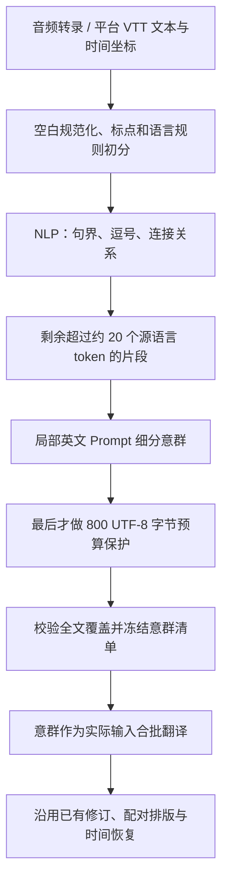

# 音频与 VTT 源文意群拆分

日期：2026-10-22。范围：OpenCreator 工作区 `runtime/krillinai`，尚未提交或部署。本轮落实“先拆句 → 批量翻译 → 校准”中的源文拆句，保留现有翻译、修订及最终字幕排版阶段。

## 实际顺序

1. 标点初分不再抢先按 800 字节截断，NLP 能看到未被预算截断的原句。
2. NLP 输出直接成为翻译输入，拥有顺序稳定的 `sentence_id`。不再把它们只作为完整父句内部的排版建议，也不在此后重复请求 NLP 细分。
3. NLP 无法使用时保留标点初分结果，通过 Unicode 词元估算哪些长段值得模型细分；某一个原句的 NLP 输出无效时，只回退该原句。
4. 剩余长段用简短英文 Prompt，输入只有源语言、当前片段、约 20 token 的软目标；纠错时再附具体结构错误。无全文摘要、术语、邻句或排版参数。
5. 每片段正常调用一次，仅 JSON、覆盖或切口结构错误允许再纠正一次。长度略超、未再拆分属于可接受结果；服务错误直接保留当前片段，不用翻译网络重试层反复拆句。
6. 超过请求安全预算时才调用既有程序切分。20 个 NLP token、800 UTF-8 字节和字幕显示长度是三种不同约束，不能相互替代。

## 合批与质量取舍

意群可以是从句或有意义的短语，不要求每条都是完整句。正文 Prompt 已同步说明：整批理解，结合已有术语与上下文翻译，允许相邻译文延续，避免把共享内容在每个片段重复补齐。

同一标点原句拆出的意群尽量放进同一批；单个原句过大时仍受现有批大小和输入／输出预算限制。沿用现有批前后上下文策略，不增加新的全文模型分析步骤。音频多段仍先以全片意群整理语境，再把术语作用域 ID 映射回各段的局部 ID。

NLP 连接词规则额外保护共享中心词的名词并列，例如 `Rationalist or Idealist philosophers`，避免提前拆成 `Rationalist / or Idealist philosophers`。不照搬 VideoLingo 中超过 60 token 后的提前均分，而让模型处理尚未找到自然切口的长段。

这一步改善模型收到的输入单位，不能单独保证译文自然度、逐段对齐和最终显示长度。后续已有的修订与字幕排版继续负责这些问题，本轮没有把这些阶段整体重写。

## 覆盖、缓存和入口边界

- 片段必须按原顺序连续覆盖全部源文，仅允许边界空白差异；不能改写、漏字、重复原文，不能从单词、数字单位或 Unicode 字素中间切开。
- 每条清单保存文本、原句组和规范化源文中的 UTF-8 字节坐标；坐标用于校验，时间轴仍由既有源文位置映射恢复。
- `translation-source-splits/` 保存各片段已完成的模型拆分；取消后续跑复用已完成部分。
- `translation-source-units/` 保存最终清单，包括模型或 NLP 不可用时采用的降级结果；续跑不会因为服务恢复而改变翻译单元及 ID。
- 缓存指纹包含源文、语言、相关 Prompt／NLP 实现、模型与 endpoint，避免误用不同输入或实现的结果。
- `newTranslator` 默认启用音频／平台 VTT 意群流程。原始 SRT 导入入口使用任务副本关闭新前处理，不修改共享 Translator。
- 模型拆句失败只回退分段；取消和检查点写入失败仍明确返回，不假装完成。

## 验证记录

定向测试已覆盖：NLP 先于预算、结构错误单次纠正、软长度接受、服务失败回退、全文覆盖、单句局部降级、原句组批、音频／VTT 实际使用意群、原始 SRT 路由隔离、取消后的局部复用和跨音频段术语 ID 映射。

真实 spaCy `3.8.16 + en_core_web_md` 的分句与运行时测试通过；Python 边界单测 7 项通过。音频转录／词时间／续跑集成测试和 Runtime CLI 构建通过。

扩大测试中 Pipeline 包通过；Service 包的 5 项既有失败已在修改前备份构成的隔离副本中复现：两项旧请求失败语义测试、两项 ASS 样式测试及一项重复口头停顿测试。本轮没有修改这些行为。音频 worker 的请求次数测试已区分新增拆句请求与正文翻译请求。

真实视频验收使用 `os0V5ADLVjM` 已有的源文字幕，不重新下载、不重跑 ASR，也不重译 VideoLingo。最初一次脚本读取到空的旧网关配置，模型请求未送达，已排除这次结果；有效复测使用本机既有 DeepSeek 配置，模型 `deepseek-v4-pro`，并记录完整请求、响应与 usage。

### 全片复测结果

- 模型细分：94 次请求，30,988 tokens，没有结构纠错请求，全部 HTTP 200；约 174 秒完成前处理。
- 得到 472 个源文意群；按英文空格词统计，中位数 9、P95 为 19，最长 31 词。这里的空格词数不等于 spaCy token 数。
- 全片生成 522 条字幕，源文连续完整覆盖，472 个翻译单元全部有译文，没有正文失败回填。
- 后续全流程共 363 次模型请求、260,030 tokens，约 594 秒；此数字包含拆句、语境、初译、修订、核验及排版，不能误当成单纯拆句成本。
- 译文侧最大 68 显示单位，超过 75 的为 0；原文侧仍有 21 条超过 75，最大 138，全部保留为待调整排版。
- 一部分全片语境整理未通过既有校验，保留可用章节语境后继续交付，未把可选分析失败升级成整片失败。

与既有文件的长度对照如下，均按实际单行显示单位统计，汉字通常占 2 单位。VideoLingo 沿用旧产物，本轮没有重新翻译；旧 KrillinAI 是 2026-10-21 audit 中的产物，**不是本轮修改前工作区的受控 A/B**。本轮直连 DeepSeek，旧产物经原服务生成，因此这些数字只能说明交付现状，不能单凭它们归因或给翻译自然度评分。

| 产物 | 字幕条数 | 原文超过 75 | 原文最大 | 译文超过 75 | 译文最大 |
| --- | ---: | ---: | ---: | ---: | ---: |
| 本轮 | 522 | 21 | 138 | 0 | 68 |
| 既有 KrillinAI | 475 | 15 | 98 | 0 | 72 |
| 既有 VideoLingo | 726 | 0 | 50 | 0 | 43 |

### 已确认的边界与未解决问题

`but I did make several oopsies ... what notion had to offer I spent so much time ...` 已拆成两个实际翻译单元，与既有 VideoLingo 的 meaning split 在此处一致。VideoLingo 的 NLP 结果本来也没有拆开这两个陈述，是后续模型拆分才完成的；不能把该例归功于 NLP 单独完成。

20 token 是软目标，模型返回 31 词、结构完整但没有继续细分的片段时，本轮按已确认策略接受，没有以质量理由重试。这仍可能给后置排版留下较长输入。例如 `which is so fun I love my kitchen board ...` 被原样保留为一个意群。需要与后续批量翻译、排版一起评估，不能把意群数量增加视为质量自动提高。

后置配对仍有不自然的语法切口，例如原文 `from / unlocking`。原文侧超长也没有整体消失，既有 KrillinAI 文件中的 15 条在本次产物中变为 21 条。**本轮通过了拆句功能、全文覆盖和成功交付验证，尚未通过整体字幕质量验收。** 本轮按用户要求只实现源文拆句，不以强行截断或丢译文来掩盖后置排版问题。

复测目录：`benchmarks/os0V5ADLVjM-source-units-20261022-r2/`（与 OpenCreator 项目平级的 `benchmarks` 中）。包含 `api-events.jsonl`、各阶段 usage、源文意群清单、检查点、完整 SRT、分析脚本和 `analysis.json`。源文超长清单及对应译文保存在 `analysis.json`，便于后续逐条确认。
