

<h1>
  <picture>
    <source media="(prefers-color-scheme: dark)" srcset="../images/OpenCreator_logo_vector_dark.svg" />
    
  </picture>
   
  İçerik üreticileri için açık kaynaklı yapay zekâ çalışma alanı ve Skills
</h1>

Senaryoları, videoları, görselleri, sesi, avatarları, çeviriyi ve düzenlemeyi; görsel araçları, yeniden kullanılabilir Skills ve Agents ile tek bir çalışma alanında birleştirir.

<strong>OpenCreator daha önce KrillinAI adıyla biliniyordu.</strong>

[English](../../README.md) | [简体中文](../zh/README.md) | [日本語](../ja/README.md) | [한국어](../ko/README.md) | [Bahasa Indonesia](../id/README.md) | [Español](../es/README.md) | [Français](../fr/README.md) | [Deutsch](../de/README.md) | [Português](../pt/README.md) | [Русский](../ru/README.md) | [العربية](../ar/README.md) | [ภาษาไทย](../th/README.md) | **Türkçe**

[Öne Çıkanlar](#proje-özellikleri) · [İçerik Üretim Araçları](#içerik-üretim-araçları) · [Skills](#skills) · [Örnekler](#örnekler) · [Hızlı Başlangıç](#hızlı-başlangıç) · [Desktop](#desktop) · [Belgeler](#belgeler) · [Topluluk](#topluluk)

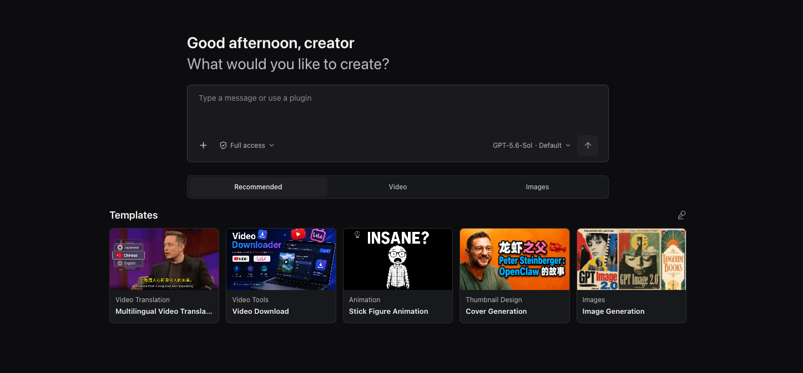

## Proje Özeti

OpenCreator, yaratıcı ve yazılım geliştirme çalışmalarını yerel bilgisayarında sürdürmek isteyen bireyler ve ekipler için tasarlanmıştır. Yeni bir Agent döngüsü geliştirmek yerine Codex CLI'ı yürütme motoru olarak kullanır; bunun çevresine kararlı bir yerel Runtime, görsel bir çalışma alanı ve Desktop uygulaması ekler.

OpenCreator birbirine bağlı iki çalışma biçimi sunar:

- **İçerik çalışma alanı:** Video çevirme ve indirme, görsel ve video üretimi, seslendirme, makale ve sosyal medya gönderisi yazımı, kısa video senaryosu ve çöp adam animasyonu için görsel araçları ve üretim şablonlarını kullanın.
- **Agent görüşmesi:** Yaratıcı veya teknik görevleri doğal dille başlatın ve yönetin; görüşmeleri projelere göre düzenleyin; Runs işlemlerini arka planda sürdürün; onayları, ekleri, dosyaları, Skills, MCP'yi, zamanlamaları, bildirimleri, belleği ve tanılama bilgilerini tek yerden yönetin.

Web, tek frontend uygulamasıdır. Desktop aynı Web derlemesini yükler ve yalnızca klasör seçimi, pencere yaşam döngüsü, sistem tepsisi ve yerel bildirimler gibi işletim sistemi gerektiren yetenekleri ekler. Aynı veri ve içerik görünümü kullanıldığı için iki platform da ortak kullanıcı arayüzünü ve Runtime davranışını paylaşır.

## Proje Özellikleri

- 🤖 **Codex Native:** İkinci bir yürütme motoru geliştirmeden Codex Agent döngüsünü, modellerini, akıl yürütme yeteneklerini, araç çağrılarını, görüşmeleri, Skills ve MCP'yi kullanın.
- 🚀 **Kullanıma hazır Desktop uygulaması:** Codex CLI içeren Desktop uygulamasını doğrudan başlatın; yerel Runtime gerektiğinde çalışır ve varsayılan projeyi otomatik hazırlar.
- ⚙️ **Codex ayarlarını yeniden kullanır:** İlk açılışta yerel Codex yapılandırmasını tarar ve çalışan ChatGPT oturumunu veya API anahtarı ayarını yeniden kullanmayı önerir. Diğer model sağlayıcıları için yönlendirmeli bir form sunar.
- 🔄 **Yönetilen Runtime bileşenleri:** Paketlenmiş, etkin ve en yeni yt-dlp sürümlerini inceleyin; güncellemeleri denetleyin ve güncelleme başarısız olursa çalışan sürümü koruyarak elle güncelleyin.
- 🎨 **Çoklu ortam üretimi:** Video, görsel, ses, altyazı ve belgeleri tek bir bağlı iş akışında oluşturun ve yönetin.
- 🧩 **Üretim şablonları:** Komutları ve ayarları her seferinde sıfırdan kurmadan yeniden kullanılabilir şablonlarla görsel ve video üretimine başlayın.
- 🔗 **İki modlu iş akışı:** Görsel çalışma alanı veya Agent görüşmesi üzerinden çalışın; ortak durum makinesi adımları, ilerlemeyi ve sonuçları senkronize eder.
- 🕘 **Sürümleme:** Her revizyon önceki ayarları ve çıktıları koruyan yeni bir sürüm oluşturur.
- 🧩 **Yeniden kullanılabilir Skills:** Video iş akışı Skills'lerini kullanın, kendi Skills'inizi ekleyin ve MCP'yi Codex yerel yapılandırmasıyla yönetin.
- 🧠 **Bellek:** Genel, proje ve konu belleğini özetler ve tekrar üretilebilir Run giriş anlık görüntüleriyle saklayın.
- 🔐 **Yerel güvenlik:** Verileri, ekleri ve günlükleri varsayılan olarak yerel tutun; onaylar ve hassas bilgileri ayıklanmış tanılama günlükleri kullanın.
- 🌐 **Yerelleştirilmiş arayüz:** Web veya Desktop istemcisini Basitleştirilmiş Çince, İngilizce veya İsveççe olarak, sistem dilini otomatik algılayarak ya da elle seçerek kullanın.

## İçerik Üretim Araçları

Mevcut sürüm on içerik üretim aracı içerir. Kullanılabilir modeller ve servisler yerel Codex ortamınıza ve AI servisi ayarlarınıza bağlıdır.

Dashboard'u açarak makale, Xiaohongshu gönderisi ve kısa video senaryosu yazın; çöp adam animasyonu oluşturun; video çevirin veya indirin; küçük resim, görsel ve video üretin; Smart Dubbing ile seslendirme yapın.

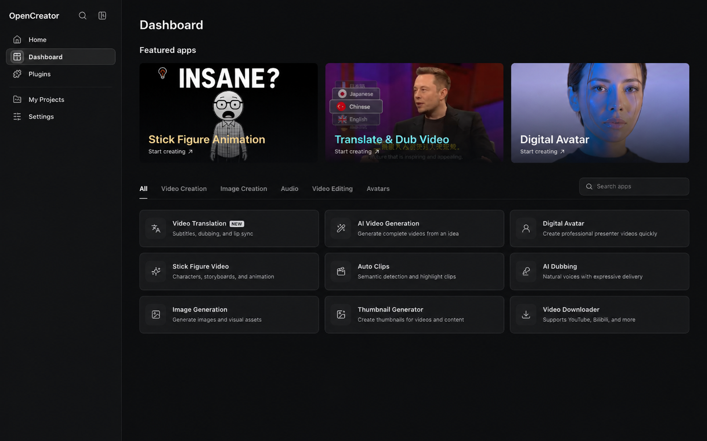

> Yeni içerik üretim araçları sürekli eklenmektedir.

**Video Translation 14 kaynak dili ve 101 hedef dili destekler.** Kaynak diller arasında Basitleştirilmiş Çince, İngilizce, İspanyolca, Fransızca, İtalyanca, Brezilya Portekizcesi, Endonezce, Tayca, Japonca, Korece, Almanca, Türkçe, Rusça ve Malayca bulunur.

| Çalışma alanı | Durum | Yetenekler |
| --- | --- | --- |
| Video Translation | ✅ Kullanılabilir | Yerel veya herkese açık videoları içe aktarma; bulut ya da yerel Whisper ile transkripsiyon; altyazı bölümlendirme, hizalama, terminoloji ve çeviri için LLM bağlamı; çift dilli altyazı, dublaj, özel ses örneği, altyazı stili ve yatay/dikey kompozisyon; SRT, ses veya video dışa aktarma |
| Video Downloader | ✅ Kullanılabilir | YouTube, Bilibili, X, TikTok, Instagram, Douyin, Facebook, Xiaohongshu ve Pinterest'teki tekil herkese açık videoları analiz etme; formatları karşılaştırma; video veya ses indirme. Bazı kaynaklar platform çerezleri gerektirebilir |
| Thumbnail Generator | ✅ Kullanılabilir | Konu, video bağlantısı ve isteğe bağlı referans görselden küçük resim varyasyonları üretme |
| Image Generation | ✅ Kullanılabilir | İstem ve isteğe bağlı referans görselle GPT Image kullanarak görsel üretme; oran ve çıktı sayısını ayarlama; görselleri tek tek önizleme ve indirme |
| Article Writer | ✅ Kullanılabilir | Konu, bağlantı, video veya belgelerden konu seçenekleri, taslak ve makale üretme; görseller ekleyip Markdown, HTML veya PDF dışa aktarma |
| Xiaohongshu Posts | ✅ Kullanılabilir | Konu veya kaynak materyalden hedef kitle, gönderi türü ve uzunluk kontrolleriyle eksiksiz Xiaohongshu gönderisi üretme; sonucu kopyalama veya indirme |
| Short Video Script | ✅ Kullanılabilir | Konu veya kaynak materyalden kitle, platform, süre ve tona göre çekime hazır bölümlendirilmiş kısa video senaryosu oluşturma; düzenleme, kopyalama veya indirme |
| Stick Figure Animation | ✅ Kullanılabilir | Metin veya YouTube içeriğini anlatım, ses, storyboard görselleri, altyazı ve indirilebilir animasyona dönüştürme |
| Auto Clips | Geliştiriliyor | Uzun videoları analiz ederek öne çıkan bölümleri yeniden kullanılabilir kısa kliplere dönüştürme |
| Smart Dubbing | ✅ Kullanılabilir | Seçilebilir ses, tempo ve duygu kontrolleriyle senaryoları seslendirme |
| Video Generation | ✅ Kullanılabilir | İstem ve referans görsellerden Seedance ile video üretme; her sürümü önizleme, yeniden üretme ve indirme |
| Digital Avatar | Geliştiriliyor | Senaryo, ses ve avatar sunumunu birleştirerek konuşan kişi videoları üretme |

## Üretim Şablonları

Her istemi ve ayarı sıfırdan oluşturmak yerine bir şablonla üretime başlayın. Video üretimi ve görsel tasarım gibi kategorilerde öne çıkan şablonları inceleyerek fikrinize uygun bir başlangıç noktası bulun.

Koleksiyon, OpenCreator ve bağımsız üreticiler tarafından hazırlanan şablonları bir araya getirir. Üçüncü taraf şablonlar, ayrıntı sayfasında üreticilerini belirtir ve özgün kaynağa bağlantı verir.

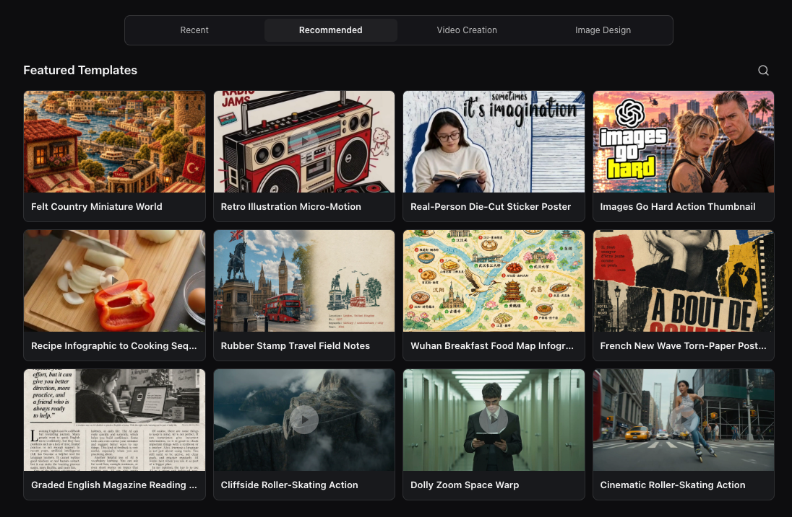

Bir şablonu açarak örnek sonucu, istemi, ayarları, etiketleri, yazarı ve özgün kaynağı inceleyin. Kendi çalışmanızı başlatmak için **Use this template** seçeneğini kullanın, ardından girdileri çalışmanıza göre ayarlayın.

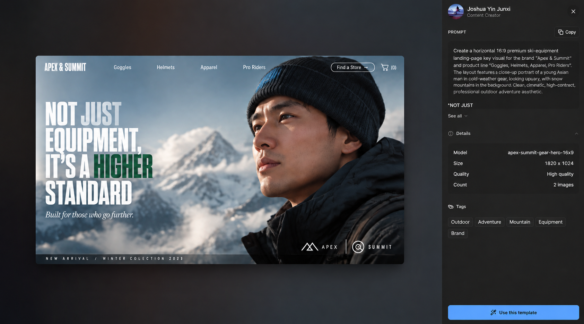

## Skills

İçerik üretim araçları görsel kontroller sunar; Skills ise Agent'a yeniden kullanılabilir talimatlar ve araç iş akışları sağlar. Depo, video üretim Skills'lerinin yanı sıra yerel Codex Skills'lerini yönetme desteği içerir.

Depodaki [skills/](../../skills/) klasörü, gömülü KrillinAI CLI ile çalışan Agent'lar için yeniden kullanılabilir talimatlar içerir.

| Skill | Yetenekler |
| --- | --- |
| [KrillinAI CLI](../../skills/krillinai-cli/SKILL.md) | Komut seçme, yapılandırmayı denetleme, ilerleme, manifest, çıktı ve hataları yorumlama |
| [Subtitle](../../skills/krillinai-subtitle/SKILL.md) | Platform altyazılarını indirme veya medyayı yazıya dökme, altyazı çevirme, çift dilli ve kısa dikey altyazı üretme |
| [TTS](../../skills/krillinai-tts/SKILL.md) | Altyazılardan hedef dil dublajı üretme ve isteğe bağlı dublajlı video oluşturma |
| [Landscape Render](../../skills/krillinai-render-horizontal/SKILL.md) | Çift dilli altyazı veya dublajlı ses ve hedef dil altyazılarıyla yatay video oluşturma |
| [Portrait Render](../../skills/krillinai-render-vertical/SKILL.md) | Başlık, çift dilli altyazı veya dublajla dikey video oluşturma |
| [Cover](../../skills/krillinai-cover/SKILL.md) | Eksiksiz bir metin isteminden kapak görseli üretme ve son istemi kaydetme |
| [Pipeline Plan](../../skills/krillinai-pipeline/SKILL.md) | Çok aşamalı çıktı planını deneme modunda doğrulama; gerçek işi aşama Skills'leriyle yürütme |

### Kendi Skills'lerinizi Genişletin

OpenCreator, sabit araçlarla sınırlı kalmadan `SKILL.md` ile tanımlanan yerel Codex Skills'lerini destekler. Kullanılabilirlik etkin Codex home ve yüklü Skills'e bağlıdır; video iş akışı Skills'leri CLI ve ilgili servislerin yapılandırılmasını gerektirir. Bir Skill'in depoda bulunması, otomatik olarak yüklendiği veya tüm harici servislerin pakete dahil olduğu anlamına gelmez.

## Görüşme ve Çalışma Alanı Birlikte İlerler

Görevleri doğal dille anlatın, gerektiğinde ayrıntılı kontrol için görsel araçlara geçin.

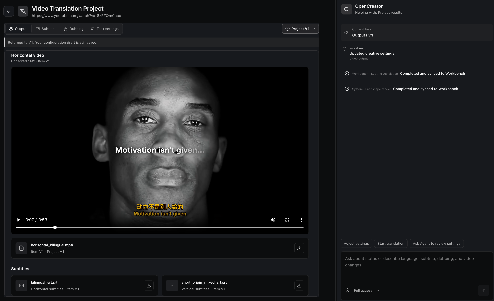

### Ayrıntılı çalışma alanı kontrolleri

Altyazıları, sahneleri, sesi ve üretim ayarlarını hassas biçimde düzenleyin.

### Görüşmeyle esnek düzenleme

Agent'a neyi değiştirmesi gerektiğini söyleyin ve sonucu doğal dille iyileştirin.

### Senkronize durum

Görüşme ve çalışma alanı güncel görev durumunu paylaşır; hiçbir şeyi tekrar anlatmanız gerekmez.

### Bağımsız sürümler

Her revizyon önceki sonuçları veya ayarları ezmeden ayrı bir sürüm oluşturur.

## Desteklenen Modeller

Dil modeli kullanılabilirliği Codex model kataloğuna veya OpenAI uyumlu sağlayıcınıza bağlıdır. Görsel, video, ses ve transkripsiyon modelleri **Settings → AI Services** bölümünde yapılandırdığınız servisleri kullanır.

Gösterilen sağlayıcılar örnektir; gerçek kullanılabilirlik kimlik bilgilerinize, sağlayıcı hesabınıza ve platforma bağlıdır.

### Dil modelleri

<table>
<tr>
<td align="center" width="20%"> <strong>GPT</strong></td>
<td align="center" width="20%"> <strong>DeepSeek</strong></td>
<td align="center" width="20%"> <strong>Qwen</strong></td>
<td align="center" width="20%"> <strong>Kimi</strong></td>
<td align="center" width="20%"> <strong>GLM</strong></td>
</tr>
<tr>
<td align="center" width="20%"> <strong>Grok</strong></td>
<td align="center" width="20%"> <strong>Doubao</strong></td>
<td align="center" width="20%">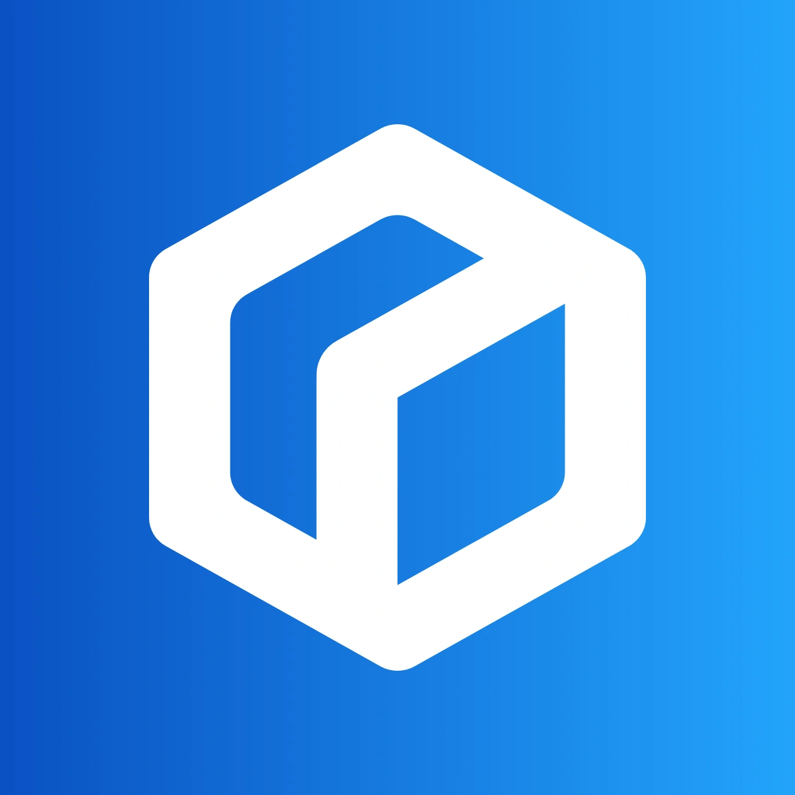 <strong>ERNIE</strong></td>
<td align="center" width="20%"> <strong>Hunyuan</strong></td>
<td align="center" width="20%"> <strong>MiniMax</strong></td>
</tr>
</table>

### Görsel

<table>
<tr>
<td align="center" width="25%"> <strong>GPT Image</strong></td>
<td align="center" width="25%">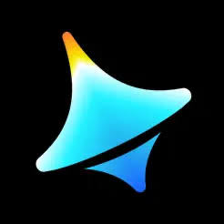 <strong>Seedream 4.0</strong> Jimeng</td>
<td align="center" width="25%">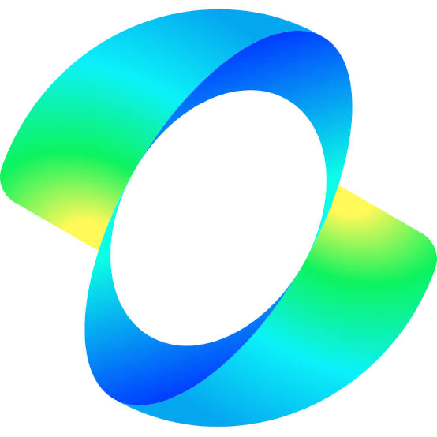 <strong>Kling v2.1</strong> Kling Image</td>
<td align="center" width="25%">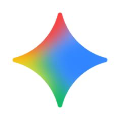 <strong>Nano Banana</strong> Gemini 2.5 Flash Image</td>
</tr>
</table>

### Video

<table>
<tr>
<td align="center" width="33%">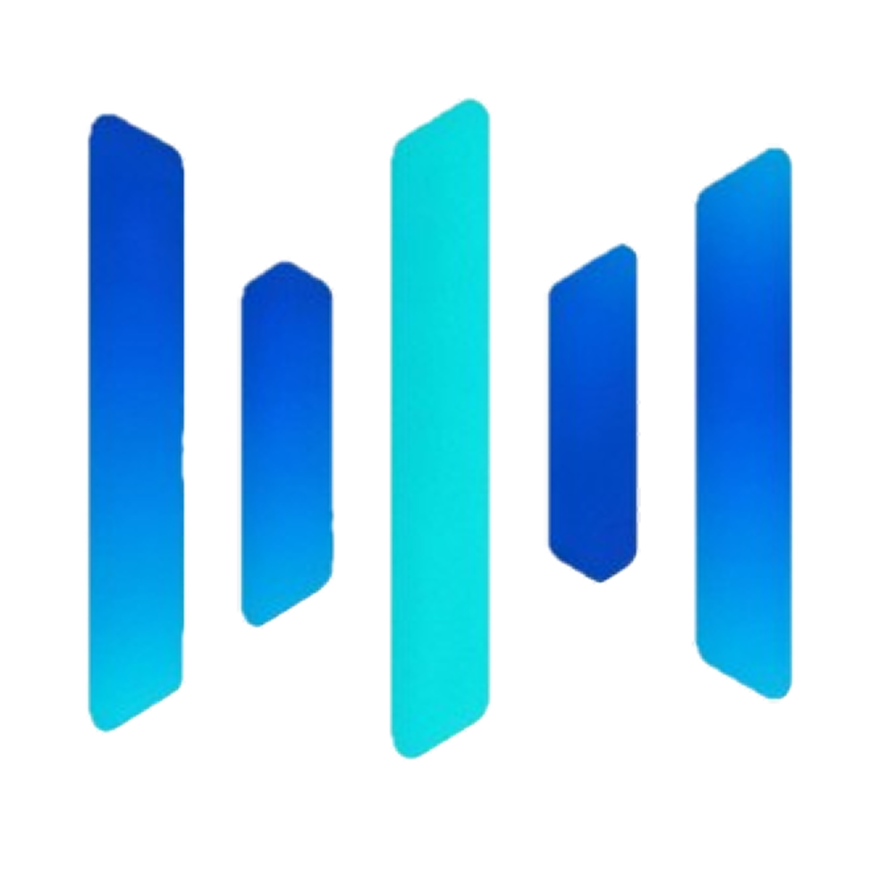 <strong>Seedance 2.5</strong></td>
<td align="center" width="33%"> <strong>Kling v2.1 Master</strong></td>
<td align="center" width="33%"> <strong>Veo 3.1</strong></td>
</tr>
</table>

### Ses ve transkripsiyon

<table>
<tr>
<td align="center" width="16%"> <strong>Whisper</strong></td>
<td align="center" width="16%"> <strong>OpenAI TTS</strong></td>
<td align="center" width="16%"> <strong>MiniMax</strong></td>
<td align="center" width="16%"> <strong>Edge TTS</strong></td>
<td align="center" width="16%"> <strong>Aliyun Speech</strong></td>
<td align="center" width="16%"> <strong>Volcengine Speech</strong></td>
</tr>
</table>

Yerel transkripsiyon için kullanılabilir olduğunda faster-whisper, WhisperKit ve whisper.cpp de desteklenir.

## Örnekler

### Video Çevirisi

Aşağıdaki herkese açık örnekler, OpenCreator hâlâ KrillinAI adıyla bilinirken üretildi. OpenCreator'ın Video Translation çalışma alanının daha geniş Agent iş akışına taşıdığı altyazı hizalama, çeviri, dublaj ve dikey video iş akışını gösterirler.

Proje, aşağıdaki altyazı dosyasını 46 dakikalık yerel bir videodan tek çalıştırmada, elle altyazı düzeltmesi yapmadan oluşturdu. Yayımlanan sonuç; tam kapsam, üst üste binmeyen satırlar, doğal bölümlendirme ve yüksek kaliteli çeviri sunar.

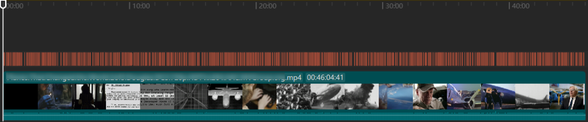

<table width="100%">
<tr>
<td width="33%">

#### Altyazı Çevirisi

https://github.com/user-attachments/assets/bba1ac0a-fe6b-4947-b58d-ba99306d0339

</td>
<td width="33%">

#### Dublaj

https://github.com/user-attachments/assets/0b32fad3-c3ad-4b6a-abf0-0865f0dd2385

</td>
<td width="33%">

#### Dikey Mod

https://github.com/user-attachments/assets/c2c7b528-0ef8-4ba9-b8ac-f9f92f6d4e71

</td>
</tr>
</table>

> Bu video örnekleri ve altyazı hizalama görseli, OpenCreator hâlâ KrillinAI adını kullanırken üretildi.

### Video Üretimi

Seedance ile metin istemi veya referans görselden video üretin; model, en-boy oranı, çözünürlük ve süreyi ayarlayın, ardından her sürümü önizleyin, yeniden üretin veya indirin.

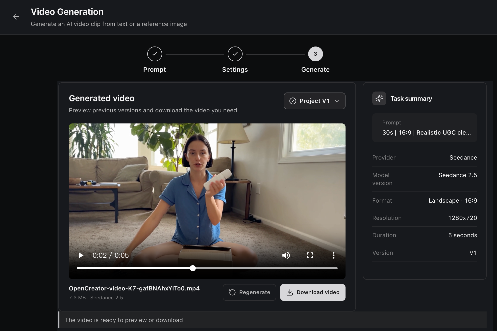

### Video İndirme

Herkese açık bir video bağlantısını analiz edin, kullanılabilir formatları karşılaştırın ve video ya da sesi doğrudan projenize indirin.

Desteklenen video kaynakları:

<table align="center">
  <tr>
    <td align="center" width="96"> <strong>YouTube</strong></td>
    <td align="center" width="96"> <strong>Bilibili</strong></td>
    <td align="center" width="96"> <strong>X</strong></td>
    <td align="center" width="96"> <strong>TikTok</strong></td>
    <td align="center" width="96"> <strong>Instagram</strong></td>
    <td align="center" width="96"> <strong>Douyin</strong></td>
    <td align="center" width="96"> <strong>Facebook</strong></td>
    <td align="center" width="96"> <strong>Xiaohongshu</strong></td>
    <td align="center" width="96"> <strong>Pinterest</strong></td>
  </tr>
</table>

Kullanılabilirlik videoya ve bölgeye göre değişir; bazı kaynaklar platform çerezleri gerektirebilir.

**Xiaohongshu video gönderileri:** Herkese açık `https://www.xiaohongshu.com/explore/<24-character hex note ID>` URL'sini, varsa `xsec_token` ve diğer sorgu parametreleri dahil eksiksiz yapıştırın. Yalnızca görsel içeren gönderilerde video formatı bulunmaz; profil sayfaları ve `xhslink.com` paylaşım bağlantıları henüz desteklenmez. Bir bağlantının tanınması indirilebileceğini garanti etmez: süresi dolmuş token'lar, erişim kısıtlamaları veya platform değişiklikleri indirmeyi engelleyebilir. OpenCreator tarayıcı çerezlerini otomatik içe aktarmaz.

**Pinterest video Pin'leri:** Herkese açık `https://www.pinterest.com/pin/<numeric ID>/` bağlantısını yapıştırın. Yalnızca görsel içeren Pin'lerde indirilebilir video formatı bulunmaz; panolar ve profiller desteklenmez.

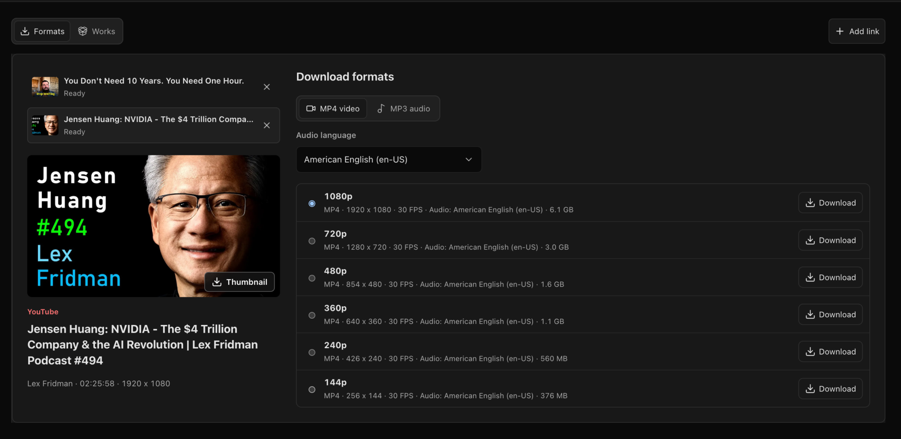

### Çöp Adam Animasyonu

OpenCreator, bu özgün karakter koleksiyonunu [Stickman on Behance](https://www.behance.net/gallery/254715463/Stickman) eserinin yaratıcısı [Harbor Hsia](https://www.behance.net/xiaheyuan1) ile birlikte geliştirdi. Yerleşik karakter kadrosu, animasyon iş akışı boyunca karakter kimliklerini tutarlı tutar.

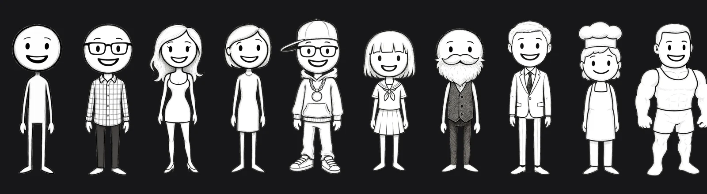

Metin veya YouTube içeriğini; senaryo incelemesi, anlatım, zamanlama, storyboard görselleri, altyazılar, render ve indirilebilir video çıktısı içeren yönlendirmeli bir iş akışıyla eksiksiz animasyona dönüştürün.

## Hızlı Başlangıç

### Desktop Uygulamasını Kurma

[En yeni OpenCreator sürümünden](https://github.com/krillinai/OpenCreator/releases/latest) platformunuza uygun yükleyiciyi indirin (macOS Apple Silicon, macOS Intel veya Windows x64). Kurup uygulamayı açın; Desktop uygulamasını kullanmak için Node.js veya pnpm gerekmez. Desktop paketi Codex CLI içerir; gerçek model görevleri için kullanılabilir bir ChatGPT oturumu veya API anahtarı yapılandırması gerekir.

İlk açılışta Desktop yerel Runtime'ı başlatır, varsayılan projeyi hazırlar ve yerel Codex yapılandırmanızı denetler. Kullanılabilir bir oturum veya API anahtarı ve model ayarları bulursa bunları yeniden kullanmak için **Use local Codex and continue** seçeneğini onaylayın. Aynı başlangıç akışında başka bir sağlayıcı da yapılandırabilirsiniz:

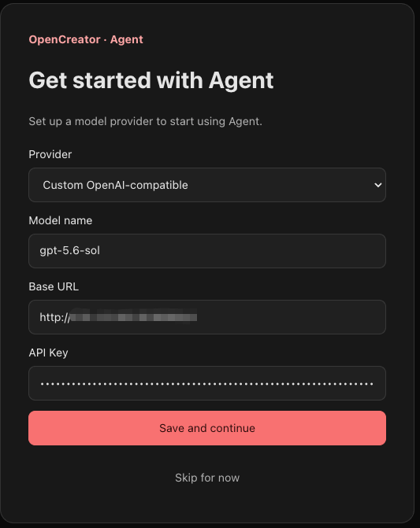

Kurulumdan sonra görevi başlatmak için giriş alanına isteğinizi yazın. Sorun yaşarsanız [kullanıcı kılavuzu ve sorun giderme](../opencreator-user-guide-and-troubleshooting.md) belgesine bakın.

### Web'i Kaynaktan Çalıştırma

Geliştirme veya tarayıcı üzerinden kullanım için kurun:

- Node.js 22 veya daha yeni bir sürüm
- Deponun `packageManager` alanında sabitlenen pnpm 9.15.0
- Terminalinizden erişilebilen bir Codex CLI çalıştırılabilir dosyası
- Gerçek model görevleri için geçerli bir Codex CLI oturumu

Önce yerel ortamınızı denetleyin:

~~~bash
node --version
pnpm --version
codex --version
~~~

~~~bash
git clone https://github.com/krillinai/OpenCreator.git
cd OpenCreator
corepack enable
pnpm install
pnpm web:dev
~~~

`http://127.0.0.1:19861/` adresini açın. Geliştirme sunucusu yerel daemon'ı gerektiğinde başlatır ve aynı kaynaktan çalışan proxy üzerinden geçici bir Runtime token'ı sağlar; bağlantı token'ını elle kopyalamanız gerekmez.

İlk açılışta Runtime varsayılan projeyi hazırlar ve yerel Codex ayarlarını denetler. Yerel Codex'i kullanmak için mevcut ChatGPT oturumunu veya API anahtarını onaylayın ya da bir sağlayıcı seçerek model, endpoint ve API anahtarını girin. Kurulumdan sonra giriş alanı hazırdır. Yalnızca daemon üzerinde çalışmak için:

~~~bash
pnpm daemon:dev
~~~

Daemon yalnızca loopback adresinde dinler ve bağlantı adresiyle geçici token'ı standart çıktıya bir kez yazar.

## Desktop

Desktop ve tarayıcı, `apps/web` içindeki aynı React frontend'i kullanır. Ortak proje, görüşme, görev ve ayarlar aynı Daemon/API'yi çağırır. Electron yalnızca gerçek sistem yolları, pencere kontrolleri, sistem tepsisi ve yerel bildirimler ekler.

### Geliştirme Modu

~~~bash
pnpm desktop:dev
~~~

### Yerel Paketleme

| Komut | Çıktı |
| --- | --- |
| `pnpm desktop:package` | Yerel doğrulama için mevcut platformda çalıştırılabilir bir klasör |
| `pnpm desktop:dist` | Mevcut platform için bir yükleyici |
| `pnpm desktop:release` | Resmî sürüm paketleme giriş noktası |
| `pnpm --filter @opencreator/desktop verify:package` | Mevcut Desktop paketinin doğrulanması |
| `pnpm krillinai:package` | Seçili platform için ayrı KrillinAI Server ve CLI arşivleri |

Desktop paketleme, mevcut çalışma alanından Web'i yeniden derler; commit, dirty durumu, platform, mimari ve Web hash'ini kaydeder; `apps/web/dist` ile uygulamaya gömülen kaynakları karşılaştırır. Fark varsa paketleme başarısız olur. İmzalama, noter onayı, Windows derlemeleri ve yayın gereksinimleri için [Desktop yayın kılavuzuna](../operations/opencreator-desktop-release-runbook.md) bakın.

## Temel İş Akışları

### Görüşmeler ve Runs

1. Bir proje seçin veya yeni bir görüşme başlatın.
2. Görevi girin; izin düzeyini, Profile'ı, modeli ve akıl yürütme düzeyini seçin.
3. Run çalışırken takip görevlerini sıraya alın veya görevi kesip hemen devam edin.
4. Timeline üzerinden akıl yürütme özetlerini, araç çağrılarını, dosya değişikliklerini, onayları ve sonuçları inceleyin.
5. Görev merkezinden çalışan, tamamlanan, başarısız olan ve onay bekleyen görevleri genel olarak izleyin.

### Skills ve MCP

- Eklenti merkezinden Skill pazarını, kurulum geçmişini ve yerelde kullanılabilir Skills'i inceleyin.
- Bir sonraki görevin iş akışını izlemesi için giriş alanından `/` veya ekleme menüsüyle bir Skill seçin.
- MCP yönetimi, ikinci bir yürütme motoru yerine Codex'in kendi komutları ve yapılandırmasını kullanır.
- OpenCreator varsayılan olarak etkin `$CODEX_HOME` dizinini kullanır; genel Skills veya MCP yapılandırmasını değiştirmeden önce etkisini doğrulayın.

### Zamanlamalar ve Özel Görev Konuları

- Her zamanlama, kalıcı ve kendisine ayrılmış bir OpenCreator görüşmesine sahiptir.
- Otomatik tetiklemeler, elle çalıştırmalar ve kullanıcı takip görevleri aynı görüşmeyi yeniden kullanır; `queue` veya `skip` politikasıyla sırayla çalışır.
- Zamanlamanın silinmesi, ayrılmış görüşmeyi arşivler; mevcut Runs, sonuçlar ve temel Codex geçmişini korur.
- Temel Codex thread'inin yenilenmesi veya kurtarılması, OpenCreator görev girişini veya sayfa yolunu değiştirmez.

## OpenCreator Sistem Mimarisi

OpenCreator, görsel çalışma alanını ve Agent görüşmesini aynı yaratıcı görevin iki arayüzü olarak ele alır. Her içerik üretim iş akışı bir state machine olarak modellenir: kaynak girdisi, yapılandırma, üretim, inceleme, revizyon ve dışa aktarma açık durumlara ve olaylara dönüşür. Çalışma alanı eylemleri ve görüşme komutları aynı state machine'e girer; güncel adım, yapılandırma, ilerleme, sürümler ve sonuçlar iki arayüze de yansıtılır. Böylece ikinci bir doğruluk kaynağı oluşturmadan çalışma alanı ve görüşme senkronize kalır.

Yaratıcı çalışmalar yinelemelidir; revizyonlar mevcut sonucu ezmez. Her düzeltme veya yeniden üretim, mevcut iş akışı durumundan yeni bir sürüm oluşturur ve önceki sürümlerin ayarlarını ve çıktılarını inceleme, karşılaştırma ve geliştirmeye devam etmek için korur.

~~~text
+-----------------------------+     +------------------------------------+
| Browser Access              |     | Desktop Host                       |
|                             |     | Shared Web build + Electron        |
+--------------+--------------+     +------------------+-----------------+
               |                                       |
               +-------------------+-------------------+
                                   v
+----------------------------------------------------------------------------+
| Creator Experience / apps/web                                              |
| Dashboard / Creator Tools / Agent Conversation / Settings / Files          |
+-------------------------------------+--------------------------------------+
                                      |
+-------------------------------------v--------------------------------------+
| Collaboration Core                                                         |
| Shared workflow state / Steps / Progress / Results / Versions              |
+-------------------------------------+--------------------------------------+
                                      | Runtime API + SSE
+-------------------------------------v--------------------------------------+
| Local Runtime / apps/daemon                                                 |
| Projects / Runs / Approvals / Schedules / Memory / Notifications           |
| Component status / Update checks / Verified updates / Safe fallback        |
+-------------+------------------------+------------------------+-------------+
              |                        |                        |
              v                        v                        v
+---------------------+  +---------------------+  +-------------------------+
| Local Data          |  | Codex Engine        |  | Media Toolchain         |
| SQLite / Files      |  | CLI / app-server    |  | FFmpeg / yt-dlp         |
| System credentials  |  | Skills / MCP        |  | Whisper / AI services   |
+---------------------+  +---------------------+  +-------------------------+
~~~

| OpenCreator Bileşeni | Sorumluluk | Uygulama |
| --- | --- | --- |
| Creator Experience | Dashboard, içerik üretim araçları, Agent görüşmesi, ayarlar ve dosyalar | `apps/web` · React 18 · Vite · TypeScript |
| Collaboration Core | Çalışma alanı adımlarını, görüşme bağlamını, ilerlemeyi, sonuçları ve revizyonları senkronize tutar | Ortak iş akışı durumu · `CreatorCollaborationPanel` · sürüm geçmişi |
| Local Runtime | Projeleri, Runs, onayları, zamanlamaları, belleği ve bildirimleri yönetir | `apps/daemon` · Fastify · Runtime API · SSE |
| Runtime bileşenleri | Paketlenmiş, etkin ve en yeni sürümleri takip eder; düzenli denetler ve yalnızca kullanıcının istediği güncellemeleri kurar | yt-dlp nightly · güncelleme doğrulama · çalışan sürüme geri dönüş |
| Codex Engine | Agent döngüsü, oturumlar, akıl yürütme, araçlar, Skills ve MCP | Codex CLI · app-server |
| Medya araç zinciri | Yaratıcı medyayı indirir, yazıya döker, dönüştürür, üretir ve dışa aktarır | yt-dlp · Whisper · FFmpeg · yapılandırılmış AI servisleri |
| Yerel veri | Proje verilerini, Runs, ekleri, çıktıları ve kimlik bilgilerini yerelde saklar | SQLite · dosya sistemi · sistem kimlik bilgisi deposu |
| Desktop Host | Ortak Web derlemesini yükler ve işletim sistemi yeteneklerini ekler | `apps/desktop` · Electron · Preload Bridge |

Temel ilkeler:

- Çalışma alanı ve Agent görüşmesi aynı iş akışı durumunun senkronize görünümleridir; paralel görev durumları tutmak yerine aynı state machine'e olay gönderirler.
- Revizyonlar eski sonuçların üzerine yazmak yerine yeni sürümler oluşturur; her yaratıcı yinelemenin bağlamını ve çıktısını korur.
- Frontend doğrudan Codex başlatmaz ve ham Codex JSONL olaylarına bağlı değildir.
- Daemon süreç yaşam döngüsünü, olayların normalleştirilmesini, kalıcılığı, onayları ve bildirim kuyruğunu yönetir.
- Codex, Agent döngüsü, Skills ve MCP için yürütmenin kaynağı olmaya devam eder.
- Browser Bridge ve Desktop Bridge genel ürün mantığını ayrı ayrı uygulamaz.

## Depo Yapısı

~~~text
OpenCreator/
├── apps/
│   ├── web/          # Tek React frontend uygulaması
│   ├── daemon/       # Yerel Fastify Runtime ve Codex adaptörü
│   ├── desktop/      # Electron Main, Preload, yerel yetenekler ve paketleme
│   └── harness/      # Runtime komut satırı doğrulama aracı
├── packages/
│   ├── protocol/     # Web, Daemon ve Desktop arasında paylaşılan sözleşmeler
│   └── skill-market/ # Skill pazaryeri modelleri ve ortak mantık
├── docs/             # Tasarım belgeleri, API referansları ve çalışma kılavuzları
├── scripts/          # Depo seviyesindeki denetimler
└── .runtime/         # İlk çalıştırmada oluşturulan yerel Runtime verileri
~~~

## Yapılandırma

### AI Servisi API Anahtarları

Kullanılan model, transkripsiyon, ses ve görsel sağlayıcılarını **Settings → AI Services** bölümünden yapılandırın. Seçilen sağlayıcıya göre Base URL, API Key, model, proxy veya sağlayıcıya özel kimlik bilgileri istenir.

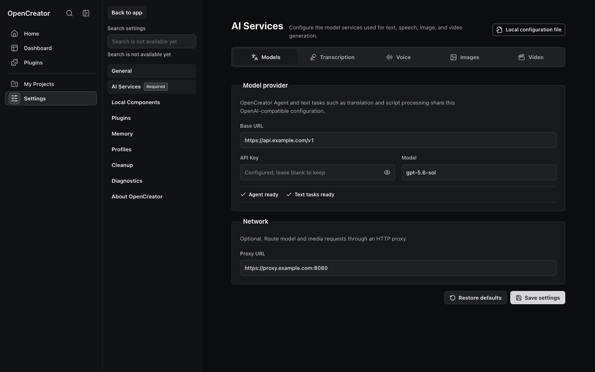

Kimlik bilgileri yerel Runtime'ın sistem kimlik bilgisi deposunda saklanır ve depoya kesinlikle commit edilmemelidir. Edge TTS gibi bazı yerel veya sistem tabanlı sağlayıcılar API anahtarı gerektirmez.

### Hesaplar ve Abonelikler

Kişisel merkez; hesabınızı, doğrulanmış aboneliğinizi ve kullanılabilir kredilerinizi gösterir. Oturum açma işlemi tarayıcınızda `https://www.open-creator.ai/device` adresini açar. Web sitesinde oturum açıp cihazı onaylayın; yerel Daemon kendi oturumunu alır. Tarayıcı ve istemci aynı hesabı paylaşır ancak bağımsız oturumlar kullanır.

Abonelik planları OpenCreator içinde seçilir. Satın alma Stripe Checkout'u, abonelik yönetimi ise Stripe Billing Portal'ı açar. İstemci ödeme dönüşleri, web sitesi oturumu gerektirmeden sitenin `/billing/return` sayfasını kullanır. OpenCreator, doğrulanmış Stripe bildirimlerinden sonra hakları Gateway üzerinden yeniler. Web sitesinin `/pricing` ve `/account` sayfaları aynı abonelik altyapısına başka bir satın alma girişi sağlar.

### Üçüncü Taraf Runtime Bileşenleri

**Settings → Third-party Components** bölümünden kullanılan yt-dlp nightly sürümünü, OpenCreator ile paketlenmiş sürümü, kaynağını ve en yeni sürümü inceleyin. OpenCreator yedi günde bir güncelleme kontrolü yapar ancak otomatik kurulum yapmaz. Güncellemeler açık kullanıcı eylemi gerektirir; indirme, doğrulama veya kurulum başarısız olursa çalışan sürüm korunur.

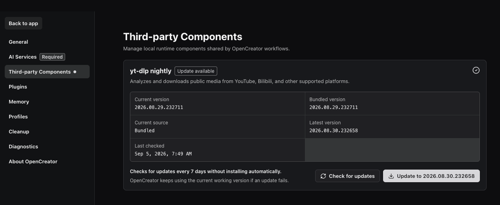

### Runtime Ortam Değişkenleri

Çoğu kullanıcı ortam değişkenlerine ihtiyaç duymaz. Yalıtılmış veri, belirli bir Codex çalıştırılabilir dosyası veya özel proje dizini gerektiğinde kullanabilirsiniz:

| Değişken | Varsayılan | Amaç |
| --- | --- | --- |
| `OPENCREATOR_DATA_DIR` | `.runtime` | OpenCreator veritabanı, Runs, ekler ve yönetilen çalışma alanları |
| `OPENCREATOR_GATEWAY_ORIGIN` | `https://www.open-creator.ai` | Hesap oturumu, abonelikler, krediler ve resmî model servisleri için Gateway; yerel Gateway kullanmak için değiştirilebilir |
| `OPENCREATOR_CODEX_BIN` | `codex` | Codex CLI çalıştırılabilir dosyasının yolu |
| `CODEX_HOME` | `~/.codex` | Codex oturumları, yapılandırma, Skills, MCP ve Profiles için doğruluk kaynağı |
| `OPENCREATOR_DEFAULT_CWD` | Geçerli çalışma dizini | Varsayılan daemon çalışma dizini |
| `OPENCREATOR_DEFAULT_PROJECT_ROOT` | Runtime'ın varsayılan politikası | Yönetilen proje kökü; ayarlandığında OpenCreator bunun `OpenCreator/` alt dizinini kullanır |
| `OPENCREATOR_CODEX_THREAD_ROTATION_RUN_THRESHOLD` | `50` | Uzun süreli zamanlamanın Codex thread'ini yenilemek için sonlanmış Run eşiği; `0` ile proaktif yenileme kapatılır |

Örnek:

~~~bash
OPENCREATOR_DATA_DIR=/path/to/opencreator-data \
CODEX_HOME=/path/to/codex-home \
pnpm web:dev
~~~

## Veri ve Güvenlik

Runtime verileri varsayılan olarak depo kökündeki `.runtime/` altında saklanır:

| Yol | İçerik |
| --- | --- |
| `.runtime/app.sqlite` | Projeler, görüşmeler, Runs, olaylar, zamanlamalar, bildirimler, ek meta verileri, onaylar, bellek ve özetler |
| `.runtime/runs/` | Hassas bilgileri ayıklanmış günlükler, tanılama verileri ve Run meta verileri |
| `.runtime/attachments/` | Kontrollü ek dosyaları |
| `.runtime/workspaces/` | Runtime tarafından yönetilen proje çalışma alanları |

Codex oturumları ve yapılandırması `$CODEX_HOME` içinde kalır; `.runtime/` klasöründen ayrı yedeklenmelidir.

Güvenlik sınırları:

- Daemon yalnızca 127.0.0.1 üzerinde dinler; sağlık denetimi dışındaki API'ler Bearer token gerektirir.
- HTML önizleme komut dosyalarını, gezinmeyi ve açılır pencereleri varsayılan olarak devre dışı bırakır; yalnızca aynı çalışma alanındaki kontrollü göreli kaynaklara izin verir.
- Hassas bellek ikinci bir onay gerektirir; OpenCreator doğrulanmamış önerileri kalıcı olarak otomatik saklamaz.
- Tanılama ve Run günlükleri döndürülmeden veya dışa aktarılmadan önce hassas bilgileri ayıklar.
- Desktop paketlerinde ASAR bütünlüğü ve çerez şifrelemesi etkinleştirilir; RunAsNode, NODE_OPTIONS ve Node CLI Inspector devre dışıdır.

Yedekleme, geri yükleme, temizleme ve sıfırlama için [kullanıcı kılavuzuna ve sorun giderme referansına](../opencreator-user-guide-and-troubleshooting.md) bakın.

## Geliştirme

### Sık Kullanılan Komutlar

| Komut | Amaç |
| --- | --- |
| `pnpm web:dev` | Web'i başlatır ve yerel daemon'ı gerektiğinde açar |
| `pnpm daemon:dev` | Yalnızca daemon'ı başlatır |
| `pnpm desktop:dev` | Bağımlılıkları derler ve Electron'u geliştirme modunda açar |
| `pnpm test` | Workspace birim ve entegrasyon testlerini çalıştırır |
| `pnpm typecheck` | Depodaki TypeScript kontrollerini çalıştırır |
| `pnpm build` | Tüm workspace'leri derler |
| `pnpm e2e` | Web Playwright E2E testlerini çalıştırır |
| `pnpm smoke:ci` | Sahte Codex Runtime smoke testini çalıştırır |
| `pnpm perf:check` | Kayıtlı performans temelini kontrol eder |

Değişiklik göndermeden önce [katkı rehberinde](../../CONTRIBUTING.md#what-reviewers-check) açıklandığı gibi etkisine uygun doğrulamayı seçin. Belgeleme, metin ve stil değişiklikleri için ilgili kontroller yeterlidir; ortak davranış ve Runtime değişiklikleri hedefli modül testleri ve typecheck gerektirir. Etkilenen kapsam gerektirdiğinde tüm workspace testlerini veya derlemelerini çalıştırın ve PR açıklamasında çalıştırdığınız kontrolleri belirtin.

Desktop, Host Bridge, Runtime proxy veya ortak frontend iş akışlarındaki değişiklikler ayrıca Web/Desktop tutarlılık testleri, paketlenmiş uygulama E2E testleri ve Web derleme hash doğrulaması gerektirir. Yalnızca Web birim testlerinin geçmesi, Desktop sürümünün hazır olduğunu göstermez.

Gerçek Codex smoke testi varsayılan olarak kapalıdır. Açıkça etkinleştirmek için:

~~~bash
OPENCREATOR_RUN_REAL_CODEX_SMOKE=1 \
pnpm --filter @opencreator/daemon test -- test/smoke/real-codex-smoke.test.ts
~~~

## Belgeler

- **OpenCreator'ı kullanın:** [Hızlı Başlangıç](#hızlı-başlangıç) · [Kullanıcı kılavuzu ve sorun giderme](../opencreator-user-guide-and-troubleshooting.md)
- **Geliştirin ve genişletin:** [Katkı rehberi](../../CONTRIBUTING.md) · [Davranış kuralları](../../CODE_OF_CONDUCT.md) · [Skill katkısı](../contributing/skills-contributing.md) · [Üretim şablonu katkısı](../contributing/templates-contributing.md) · [Runtime API v1](../runtime-api-for-ui-v1.md) · [Görsel bileşen yönergeleri](../visual-component-guidelines.md)
- **Bakım ve yayın:** [Codex-native Runtime tasarımı](../2026-07-03-codex-native-agent-runtime-design.md) · [Desktop yayın kılavuzu](../operations/opencreator-desktop-release-runbook.md) · [Windows Desktop yayın rehberi](../operations/opencreator-desktop-windows-release.md)

## Çeviri İlkesi

Kök `README.md` dosyası kanonik İngilizce belgedir. Bakımı yapılan çeviriler `docs/<locale>/README.md` altında tutulur. Bir dili seçiciye yalnızca belge tamamen çevrildikten ve İngilizce yapıyla senkronize edildikten sonra ekleyin.

## Topluluk

GitHub'da OpenCreator'a <strong>en az 100 ülke ve bölgeden</strong> kullanıcı yıldız vermiştir.

### Ekip

Her ekip üyesi kendi alanından, standartlarından, katkı incelemelerinden ve topluluk desteğinden sorumludur.

<table border="1" cellpadding="12">
  <tr>
    <td align="center" valign="middle" width="160" height="160"> <a href="https://github.com/wulien">wulien</a> Kod ve hata düzeltmeleri</td>
    <td align="center" valign="middle" width="160" height="160"> <a href="https://github.com/DLe-kb">DLe-kb</a> Üretim şablonları</td>
    <td align="center" valign="middle" width="160" height="160"> <a href="https://github.com/xiaheyuan">xiaheyuan</a> Tasarım ve varlıklar</td>
    <td align="center" valign="middle" width="160" height="160"> <a href="https://github.com/krillinai">krillinai</a> Skills ve belgeler</td>
    <td align="center" valign="middle" width="160" height="160"> <a href="https://github.com/hbxugang">hbxugang</a> Kurumsal dağıtım</td>
  </tr>
</table>

### Katkıda Bulunanlar

Kod, belge, geri bildirim, issue, Skills, çizimler ve fikirleriyle katkı sağlayan herkese teşekkürler. Bu README listesi, GitHub'ın otomatik oluşturduğu Contributors grafiğinden bağımsız olarak yönetilir.

  
  
  
  
  
  
  
  
  
  
  
  
  
  
  
  
  
  
  
  
  
  
  

### Katkı Sağlama

Katkılar şu alanlarda memnuniyetle karşılanır:

| Tür | Katkı | Konum | Gönderim biçimi |
| --- | --- | --- | --- |
| Kod | Hata düzeltmeleri, üretim iş akışları ve ortak özellikler | `apps/web/`, `apps/daemon/` | Test içeren tek odaklı PR |
| Skills | Yeniden kullanılabilir Agent iş akışları | [skills/](../../skills/) | `SKILL.md` ve isteğe bağlı referanslar içeren tek klasör → [rehber](../contributing/skills-contributing.md) |
| Üretim şablonları | Görsel, video veya kapak şablonları | [template/](../../template/) | `template.json` ve varlıkları içeren klasör → [rehber](../contributing/templates-contributing.md) |
| Görsel ve tasarım | Özgün çizimler, ikonlar veya UI tasarımları | Kararlaştırılan varlık konumu | Önizleme, kaynak dosya ve lisans içeren PR |
| Üçüncü taraf servisleri | AI veya medya sağlayıcısı desteği | İlgili Web veya Daemon modülü | Hata yönetimi, kimlik bilgisi güvenliği ve testler |
| Belgeler ve çeviriler | Belge geliştirmeleri veya yeni yerel ayarlar | `README.md`, `docs/`, `docs/<locale>/` | Tek PR |

Yerel kurulum, inceleme ölçütleri ve sık reddedilme nedenleri için [CONTRIBUTING.md](../../CONTRIBUTING.md) dosyasına bakın ([10 dilde](../zh/CONTRIBUTING.md) mevcuttur).

## Star Geçmişi

OpenCreator daha önce KrillinAI olarak adlandırılıyordu. Bu grafik, yeniden adlandırma öncesi ve sonrasındaki depo geçmişini kapsar.

## İlgili Projeler

| Proje | Rol |
| --- | --- |
| [OpenAI Codex](https://github.com/openai/codex) | Model erişimi, akıl yürütme, araç çağrıları, oturumlar, Skills ve MCP entegrasyonunun arkasındaki Agent yürütme motoru |
| [yt-dlp](https://github.com/yt-dlp/yt-dlp) | Herkese açık medya bağlantılarını analiz eder ve içerik iş akışları için video veya ses indirir |
| [FFmpeg](https://ffmpeg.org/) | Medya dönüştürme, kompozisyon, kare çıkarma ve çıktı doğrulama |
| [Whisper](https://github.com/openai/whisper), [whisper.cpp](https://github.com/ggml-org/whisper.cpp), [faster-whisper](https://github.com/SYSTRAN/faster-whisper) ve [WhisperKit](https://github.com/argmaxinc/WhisperKit) | Yerel ve bulut tabanlı konuşma transkripsiyonu seçenekleri |
| [React](https://react.dev/) | Web ve Desktop deneyimlerinin ortak kullanıcı arayüzü temeli |
| [Fastify](https://fastify.dev/) | Yerel Runtime'ın HTTP ve API temeli |
| [Electron](https://www.electronjs.org/) | Yerel yetenekler, uygulama yaşam döngüsü ve paketleme için Desktop host |
| [SQLite](https://www.sqlite.org/) | Projeler, görüşmeler, Runs, zamanlamalar, bellek ve çalışma alanı verileri için yerel kalıcılık |
| [Model Context Protocol](https://modelcontextprotocol.io/) | Harici araçları ve servisleri Agent çalışma alanına bağlayan açık protokol |

---

**OpenCreator · Yerel üret, kesintisiz çalış.**

