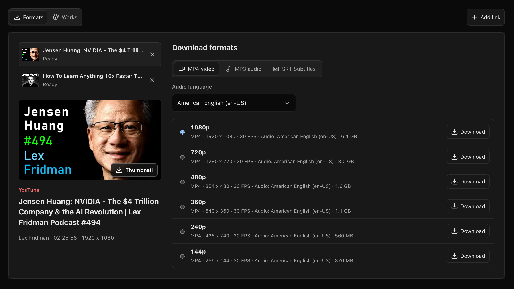

<div align="center">

<h1>
  <picture>
    <source media="(prefers-color-scheme: dark)" srcset="../images/OpenCreator_logo_vector_dark.svg" />
    
  </picture>
  <br />
  Không gian làm việc AI mã nguồn mở & Skills dành cho nhà sáng tạo
</h1>

<p>Kết hợp thiết lập trực quan, Skills tái sử dụng và Agent để viết kịch bản, làm video, hình ảnh, giọng nói, dịch thuật và biên tập trong cùng một không gian làm việc.</p>

<p><strong>OpenCreator trước đây có tên là KrillinAI.</strong></p>

<a href="https://trendshift.io/repositories/13360" target="_blank"></a>

[English](../../README.md) | [简体中文](../zh/README.md) | [日本語](../ja/README.md) | [한국어](../ko/README.md) | [Bahasa Indonesia](../id/README.md) | [Español](../es/README.md) | [Français](../fr/README.md) | [Deutsch](../de/README.md) | [Português](../pt/README.md) | [Русский](../ru/README.md) | [العربية](../ar/README.md) | [ภาษาไทย](../th/README.md) | [Türkçe](../tr/README.md) | [हिन्दी](../hi/README.md) | [বাংলা](../bn/README.md) | [اردو](../ur/README.md) | **Tiếng Việt** | [Filipino](../fil/README.md)

[](https://github.com/krillinai/OpenCreator/stargazers)
[](https://www.apache.org/licenses/LICENSE-2.0)
[](https://space.bilibili.com/242124650)
[](https://atomgit.com/krillinai/OpenCreator)
[](https://discord.gg/fUNvbqDaw)
[](https://qm.qq.com/q/W4YC0PLMeA)

[Điểm nổi bật](#project-highlights) · [Công cụ sáng tạo](#creator-tools) · [Skills](#skills) · [Ví dụ](#examples) · [Bắt đầu](#quick-start) · [Desktop](#desktop) · [Tài liệu](#documentation) · [Cộng đồng](#community)

</div>


<a id="project-overview"></a>

## Tổng quan dự án

OpenCreator dành cho cá nhân và nhóm muốn thực hiện công việc sáng tạo và phát triển ngay trên máy. Dự án sử dụng Codex CLI làm bộ máy thực thi, bổ sung Runtime cục bộ ổn định, không gian làm việc trực quan và ứng dụng Desktop, thay vì xây dựng lại vòng lặp Agent.

OpenCreator cung cấp hai cách làm việc kết nối với nhau:

- **Không gian nội dung**: dùng công cụ trực quan và mẫu sáng tạo để dịch, tải video; tạo ảnh, video, lời thuyết minh; viết bài và bài đăng mạng xã hội; viết kịch bản video ngắn và làm hoạt hình người que.
- **Hội thoại Agent**: giao và hướng dẫn tác vụ sáng tạo hoặc phát triển bằng ngôn ngữ tự nhiên; tổ chức hội thoại theo dự án, để các Run tiếp tục chạy nền và quản lý phê duyệt, tệp đính kèm, tệp, Skills, MCP, lịch chạy, thông báo, bộ nhớ và chẩn đoán tại một nơi.

Web là bản triển khai giao diện duy nhất. Desktop tải cùng bản dựng Web và bổ sung những khả năng cần hệ điều hành như chọn thư mục, vòng đời cửa sổ, khay hệ thống và thông báo gốc. Với cùng dữ liệu và kích thước vùng nội dung, hai nền tảng có cùng giao diện chung và hành vi Runtime.

<a id="project-highlights"></a>

## Điểm nổi bật

- 🤖 **Tích hợp Codex**: tái sử dụng vòng lặp Agent, mô hình, suy luận, lệnh gọi công cụ, hội thoại, Skills và MCP của Codex mà không phải duy trì bộ máy thực thi thứ hai.

- 🚀 **Desktop dùng ngay**: ứng dụng đã kèm Codex CLI; Runtime cục bộ khởi động khi cần và tự chuẩn bị dự án mặc định.

- ⚙️ **Tái sử dụng cấu hình Codex**: lần đầu mở, ứng dụng quét cấu hình Codex cục bộ và đề nghị dùng lại đăng nhập ChatGPT hoặc API key hoạt động. Có biểu mẫu hướng dẫn cho nhà cung cấp khác.

- 🔄 **Quản lý thành phần Runtime**: xem phiên bản yt-dlp đi kèm, đang dùng và mới nhất; kiểm tra định kỳ và cập nhật thủ công; giữ phiên bản đang hoạt động nếu cập nhật thất bại.

- 🎨 **Sáng tạo đa phương thức**: tạo và quản lý video, ảnh, âm thanh, phụ đề và tài liệu trong một quy trình kết nối.

- 🧩 **Mẫu sáng tạo**: bắt đầu tạo ảnh và video từ mẫu tái sử dụng, không phải soạn lại prompt và thiết lập từ đầu.

- 🔗 **Hai cách thao tác**: dùng không gian trực quan hoặc hội thoại Agent; máy trạng thái dùng chung đồng bộ các bước, tiến độ và kết quả.

- 🕘 **Quản lý phiên bản**: mỗi lần chỉnh sửa tạo phiên bản mới, giữ thiết lập và đầu ra trước đó để xem lại và so sánh.

- 🧩 **Skills tái sử dụng**: dùng Skills xử lý video, mở rộng Agent bằng Skills riêng và quản lý MCP qua cấu hình gốc của Codex.

- 🧠 **Bộ nhớ**: lưu bộ nhớ toàn cục, theo dự án và luồng, cùng bản tóm tắt và ảnh chụp đầu vào Run có thể tái lập.

- 🔐 **Bảo mật cục bộ**: dữ liệu, tệp đính kèm và nhật ký mặc định lưu trên máy, có phê duyệt và chẩn đoán đã che thông tin nhạy cảm.

- 🌐 **Giao diện đa ngôn ngữ**: Web và Desktop hỗ trợ 43 ngôn ngữ, nhận diện ngôn ngữ hệ thống, chọn thủ công và bố cục từ phải sang trái cho tiếng Ả Rập, Ba Tư, Urdu và Do Thái.

<a id="creator-tools"></a>

## Công cụ sáng tạo

Bản hiện tại có mười công cụ sáng tạo. Mô hình và dịch vụ khả dụng tùy thuộc môi trường Codex cục bộ và thiết lập dịch vụ AI.

Mở Dashboard để viết bài, bài đăng Xiaohongshu, kịch bản video ngắn; làm hoạt hình người que; dịch hoặc tải video; tạo ảnh thu nhỏ, ảnh, video; và tạo lời thuyết minh với Text to Speech.


> Các công cụ sáng tạo mới tiếp tục được bổ sung.

**Dịch video cung cấp 123 ngôn ngữ nguồn và 124 tùy chọn đích, bao gồm đầu ra bính âm.** Tìm theo tên bản địa, tên tiếng Anh, tiếng Trung hoặc mã ngôn ngữ. Phạm vi nhận dạng và tổng hợp giọng nói phụ thuộc vào dịch vụ và mô hình đã chọn.

- **Chỉ dịch phụ đề**: Nhập và xem trước SRT rồi dịch mà không cần video nguồn, lồng tiếng hay kết xuất video.

- **Chỉnh sửa phụ đề nâng cao**: Dùng trình chỉnh sửa toàn màn hình với dạng sóng và dòng thời gian đồng bộ phát lại để chỉnh thời gian, tách hoặc gộp phụ đề và tìm thay thế văn bản. Xem trước kiểu chữ trên video, đổi ngôn ngữ, giọng và đầu ra rồi tạo phiên bản mới, giữ lại kết quả cũ.

- **Tạo trên một trang**: Thiết lập tạo ảnh, video và Text to Speech trên một trang với chọn mô hình, xem trước ảnh tham chiếu, tùy chọn ảnh theo mô hình và thư viện giọng nói có tìm kiếm.

- **Đầu ra đa ngôn ngữ và tiến độ**: Phông dự phòng tích hợp cải thiện chữ viết phức tạp và phụ đề từ phải sang trái. Theo dõi chép lời, dịch, lồng tiếng và kết xuất, kèm số mục hoàn thành và tổng số khi có.

<table width="100%">
<thead>
<tr>
<th width="18%">Không gian làm việc</th>
<th width="14%">Trạng thái</th>
<th width="68%">Khả năng</th>
</tr>
</thead>
<tbody>
<tr><td valign="top">Dịch video</td><td valign="top">✅ Có sẵn</td><td>Nhập video cục bộ hoặc công khai; chép lời bằng Whisper đám mây hoặc cục bộ; dùng ngữ cảnh LLM để phân đoạn, căn chỉnh, xử lý thuật ngữ và dịch phụ đề; cấu hình phụ đề song ngữ, lồng tiếng hoặc mẫu giọng riêng, kiểu phụ đề, bố cục ngang/dọc; xuất SRT, âm thanh hoặc video</td></tr>
<tr><td valign="top">Tải video</td><td valign="top">✅ Có sẵn</td><td>Phân tích từng video công khai từ YouTube, Bilibili, X, TikTok, Instagram, Douyin, Facebook, Xiaohongshu, Pinterest và Reddit; so sánh định dạng và tải video hoặc âm thanh. Một số nguồn cần cookie nền tảng. Khi nền tảng có phụ đề, xem danh sách và tải SRT; ưu tiên tiếng Anh, sau đó là ngôn ngữ giao diện nếu có.</td></tr>
<tr><td valign="top">Tạo ảnh thu nhỏ</td><td valign="top">✅ Có sẵn</td><td>Kết hợp chủ đề, liên kết video và ảnh tham chiếu tùy chọn để tạo và so sánh nhiều biến thể ảnh thu nhỏ</td></tr>
<tr><td valign="top">Tạo ảnh</td><td valign="top">✅ Có sẵn</td><td>Dùng GPT Image / Seedream / Kling Image / Gemini với prompt và ảnh tham chiếu tùy chọn; đặt tỷ lệ khung hình, số lượng; xem trước và tải từng ảnh</td></tr>
<tr><td valign="top">Viết bài</td><td valign="top">✅ Có sẵn</td><td>Biến chủ đề, liên kết, video hoặc tài liệu nguồn thành các đề tài có thể sửa, dàn ý và bài viết hoàn chỉnh; thêm ảnh được tạo và xuất Markdown, HTML hoặc PDF</td></tr>
<tr><td valign="top">Bài đăng Xiaohongshu</td><td valign="top">✅ Có sẵn</td><td>Tạo bài đăng hoàn chỉnh từ chủ đề hoặc tư liệu, điều chỉnh đối tượng, loại bài và độ dài; sao chép hoặc tải kết quả</td></tr>
<tr><td valign="top">Kịch bản video ngắn</td><td valign="top">✅ Có sẵn</td><td>Tạo kịch bản chia cảnh sẵn để quay từ chủ đề hoặc tư liệu, theo đối tượng, nền tảng, thời lượng và giọng điệu; sửa, sao chép hoặc tải xuống</td></tr>
<tr><td valign="top">Hoạt hình người que</td><td valign="top">✅ Có sẵn</td><td>Biến văn bản hoặc nội dung YouTube thành lời kể, giọng đọc, hình phân cảnh có nhân vật nhất quán, phụ đề và hoạt hình có thể tải xuống</td></tr>
<tr><td valign="top">Cắt clip tự động</td><td valign="top">Đang phát triển</td><td>Phân tích video dài, tìm điểm nổi bật và biến khoảnh khắc được chọn thành clip ngắn tái sử dụng</td></tr>
<tr><td valign="top">Text to Speech</td><td valign="top">✅ Có sẵn</td><td>Biến kịch bản thành lời thuyết minh với lựa chọn giọng, nhịp độ và cảm xúc</td></tr>
<tr><td valign="top">Tạo video</td><td valign="top">✅ Có sẵn</td><td>Tạo video bằng Seedance / Kling / Veo từ prompt và ảnh tham chiếu; xem trước, tạo lại và tải từng phiên bản</td></tr>
<tr><td valign="top">Nhân vật số</td><td valign="top">Đang phát triển</td><td>Kết hợp kịch bản, giọng nói và nhân vật đại diện để tạo video người nói</td></tr>
</tbody>
</table>

<a id="creation-templates"></a>

## Mẫu sáng tạo

Bắt đầu từ mẫu thay vì tự xây dựng mọi prompt và thiết lập. Duyệt mẫu nổi bật theo danh mục, gồm tạo video và thiết kế ảnh, để tìm điểm khởi đầu cho ý tưởng.

Bộ sưu tập gồm mẫu do OpenCreator và các nhà sáng tạo độc lập tạo ra. Trang chi tiết của mẫu bên thứ ba ghi công tác giả và dẫn tới nguồn gốc.

Mở mẫu để xem kết quả ví dụ, prompt, thiết lập, thẻ, tác giả và nguồn gốc. Chọn **Use this template** để bắt đầu, rồi điều chỉnh đầu vào cho công việc của bạn.


<a id="skills"></a>

## Skills

Công cụ sáng tạo cung cấp điều khiển trực quan; Skills cung cấp cho Agent hướng dẫn và quy trình công cụ tái sử dụng. Kho mã có Skills sản xuất video và hỗ trợ quản lý Skills Codex cục bộ.

Thư mục [`skills/`](../../skills/) chứa hướng dẫn tái sử dụng cho Agent vận hành KrillinAI CLI được nhúng.

| Skill | Khả năng |
| --- | --- |
| [KrillinAI CLI](../../skills/krillinai-cli/SKILL.md) | Chọn lệnh, kiểm tra cấu hình, đọc tiến độ, manifest, đầu ra và lỗi |
| [Phụ đề](../../skills/krillinai-subtitle/SKILL.md) | Tải phụ đề nền tảng hoặc chép lời, dịch phụ đề, tạo phụ đề song ngữ hoặc phụ đề ngắn cho video dọc |
| [TTS](../../skills/krillinai-tts/SKILL.md) | Tạo lồng tiếng ngôn ngữ đích từ phụ đề và tùy chọn tạo video đã lồng tiếng |
| [Kết xuất ngang](../../skills/krillinai-render-horizontal/SKILL.md) | Kết xuất video ngang có phụ đề song ngữ hoặc âm thanh lồng tiếng và phụ đề ngôn ngữ đích |
| [Kết xuất dọc](../../skills/krillinai-render-vertical/SKILL.md) | Dựng video dọc có tiêu đề, phụ đề song ngữ hoặc lồng tiếng |
| [Ảnh bìa](../../skills/krillinai-cover/SKILL.md) | Tạo ảnh bìa từ prompt văn bản đầy đủ, lưu ảnh và prompt cuối cùng |
| [Kế hoạch quy trình](../../skills/krillinai-pipeline/SKILL.md) | Kiểm tra kế hoạch đầu ra nhiều giai đoạn ở chế độ dry-run; thực thi qua từng Skill của giai đoạn |

<a id="extend-with-your-own-skills"></a>

### Mở rộng bằng Skills của bạn

OpenCreator hỗ trợ Skills Codex cục bộ được định nghĩa bằng `SKILL.md`, cho phép thêm phương pháp và quy trình riêng. Skills khả dụng tùy thuộc Codex home đang dùng và Skills đã cài; Skills video cần cấu hình CLI và dịch vụ liên quan. Có trong kho mã không có nghĩa mọi Skill tự được cài hoặc mọi dịch vụ ngoài đều đi kèm.

<a id="conversation-and-workspace-moving-together"></a>

## Hội thoại và không gian làm việc đồng hành

Mô tả tác vụ tự nhiên, rồi dùng công cụ trực quan khi cần điều khiển chính xác.


<a id="fine-grained-workspace-controls"></a>

### Điều khiển chi tiết

Điều chỉnh chính xác phụ đề, cảnh quay, âm thanh và thiết lập tạo nội dung.

<a id="flexible-conversational-edits"></a>

### Chỉnh sửa qua hội thoại

Nói cho Agent điều cần thay đổi và tinh chỉnh kết quả bằng ngôn ngữ tự nhiên.

<a id="synchronized-state"></a>

### Trạng thái đồng bộ

Hội thoại và không gian làm việc dùng chung trạng thái tác vụ, không cần lặp lại thông tin.

<a id="independent-versions"></a>

### Phiên bản độc lập

Mỗi lần sửa tạo phiên bản riêng, không ghi đè kết quả hoặc thiết lập trước đó.

<a id="models-supported"></a>

## Mô hình được hỗ trợ

Mô hình ngôn ngữ theo danh mục Codex hoặc nhà cung cấp tương thích OpenAI của bạn. Mô hình ảnh, video, giọng nói và chép lời dùng dịch vụ cấu hình tại **Settings → AI Services**.

Các nhà cung cấp và mô hình hiển thị là ví dụ; khả dụng thực tế tùy thông tin xác thực, quyền tài khoản và nền tảng.

<a id="language-models"></a>

### Mô hình ngôn ngữ

<table>
<tr>
<td align="center" width="20%"><br /><strong>GPT</strong></td>
<td align="center" width="20%"><br /><strong>DeepSeek</strong></td>
<td align="center" width="20%"><br /><strong>Qwen</strong></td>
<td align="center" width="20%"><br /><strong>Kimi</strong></td>
<td align="center" width="20%"><br /><strong>GLM</strong></td>
</tr>
<tr>
<td align="center" width="20%"><br /><strong>Grok</strong></td>
<td align="center" width="20%"><br /><strong>Doubao</strong></td>
<td align="center" width="20%"><br /><strong>ERNIE</strong></td>
<td align="center" width="20%"><br /><strong>Hunyuan</strong></td>
<td align="center" width="20%"><br /><strong>MiniMax</strong></td>
</tr>
</table>

<a id="image"></a>

### Hình ảnh

<table>
<tr>
<td align="center" width="25%"><br /><strong>GPT Image</strong></td>
<td align="center" width="25%"><br /><strong>Seedream 4.0</strong><br />Jimeng</td>
<td align="center" width="25%"><br /><strong>Kling v2.1</strong><br />Kling Image</td>
<td align="center" width="25%"><br /><strong>Nano Banana</strong><br />Gemini 2.5 Flash Image</td>
</tr>
</table>

<a id="video"></a>

### Video

<table>
<tr>
<td align="center" width="33%"><br /><strong>Seedance 2.5</strong></td>
<td align="center" width="33%"><br /><strong>Kling v2.1 Master</strong></td>
<td align="center" width="33%"><br /><strong>Veo 3.1</strong></td>
</tr>
</table>

<a id="voice-and-transcription"></a>

### Giọng nói và chép lời

<table>
<tr>
<td align="center" width="16%"><br /><strong>Whisper</strong></td>
<td align="center" width="16%"><br /><strong>OpenAI TTS</strong></td>
<td align="center" width="16%"><br /><strong>MiniMax</strong></td>
<td align="center" width="16%"><br /><strong>Edge TTS</strong></td>
<td align="center" width="16%"><br /><strong>Aliyun Speech</strong></td>
<td align="center" width="16%"><br /><strong>Volcengine Speech</strong></td>
</tr>
</table>

Chép lời cục bộ cũng hỗ trợ faster-whisper, WhisperKit và whisper.cpp khi có sẵn.

<a id="examples"></a>

## Ví dụ

<a id="video-translation"></a>

### Dịch video

Các ví dụ công khai dưới đây được tạo khi OpenCreator còn tên KrillinAI. Chúng thể hiện quy trình căn chỉnh phụ đề, dịch, lồng tiếng và video dọc đã được kiểm chứng, nay được đưa vào quy trình Agent rộng hơn qua không gian Dịch video.

Dự án tạo tệp phụ đề bên dưới từ video cục bộ dài 46 phút trong một lần chạy, không sửa phụ đề thủ công. Kết quả công bố phủ đủ nội dung, không chồng dòng, phân đoạn tự nhiên và bản dịch chất lượng cao.


<table width="100%">
<tr>
<td width="33%">

<a id="subtitle-translation"></a>

#### Dịch phụ đề

https://github.com/user-attachments/assets/bba1ac0a-fe6b-4947-b58d-ba99306d0339

</td>
<td width="33%">

<a id="dubbing"></a>

#### Lồng tiếng

https://github.com/user-attachments/assets/0b32fad3-c3ad-4b6a-abf0-0865f0dd2385

</td>
<td width="33%">

<a id="portrait-mode"></a>

#### Chế độ dọc

https://github.com/user-attachments/assets/c2c7b528-0ef8-4ba9-b8ac-f9f92f6d4e71

</td>
</tr>
</table>

> Các video ví dụ và ảnh căn chỉnh phụ đề được tạo khi OpenCreator còn dùng tên KrillinAI.

<a id="video-downloader"></a>

### Tải video

Phân tích liên kết video công khai từ 10 nền tảng hỗ trợ, so sánh định dạng và tải video hoặc âm thanh thẳng vào dự án.

Nguồn video hỗ trợ:

<table align="center">
  <tr>
    <td align="center" width="48"><br /><small><small>YouTube</small></small></td>
    <td align="center" width="48"><br /><small><small>Bilibili</small></small></td>
    <td align="center" width="48"><br /><small><small>X</small></small></td>
    <td align="center" width="48"><br /><small><small>TikTok</small></small></td>
    <td align="center" width="48"><br /><small><small>Instagram</small></small></td>
    <td align="center" width="48"><br /><small><small>Douyin</small></small></td>
    <td align="center" width="48"><br /><small><small>Facebook</small></small></td>
    <td align="center" width="48"><br /><small><small>Xiaohongshu</small></small></td>
    <td align="center" width="48"><br /><small><small>Pinterest</small></small></td>
    <td align="center" width="48"><br /><small><small>Reddit</small></small></td>
  </tr>
</table>

Khả dụng tùy video và khu vực; một số nguồn cần cookie nền tảng.



<a id="video-generation"></a>

### Tạo video

Tạo video AI từ prompt văn bản hoặc ảnh tham chiếu bằng Seedance. Đặt mô hình, tỷ lệ, độ phân giải và thời lượng, rồi xem trước, tạo lại hoặc tải từng phiên bản trong không gian dự án.


<a id="stick-figure-animation"></a>

### Hoạt hình người que

OpenCreator phát triển bộ nhân vật gốc này cùng họa sĩ [Harbor Hsia](https://www.behance.net/xiaheyuan1), tác giả [Stickman trên Behance](https://www.behance.net/gallery/254715463/Stickman). Bộ nhân vật tích hợp giữ danh tính nhân vật nhất quán suốt quy trình hoạt hình.


Biến văn bản hoặc nội dung YouTube thành hoạt hình hoàn chỉnh qua quy trình hướng dẫn: duyệt kịch bản, lời kể, thời gian, hình phân cảnh, phụ đề, kết xuất và video tải xuống.


<a id="quick-start"></a>

## Bắt đầu nhanh

<a id="install-the-desktop-app"></a>

### Cài ứng dụng Desktop

Tải bộ cài phù hợp từ [bản OpenCreator mới nhất](https://github.com/krillinai/OpenCreator/releases/latest) cho macOS Apple Silicon, macOS Intel hoặc Windows x64. Cài và mở ứng dụng; không cần Node.js hay pnpm. Gói Desktop có Codex CLI; tác vụ mô hình thực cần đăng nhập ChatGPT hoặc cấu hình API key dùng được.

Lần đầu mở, Desktop khởi động Runtime cục bộ, chuẩn bị dự án mặc định và kiểm tra cấu hình Codex. Nếu tìm thấy đăng nhập hoặc API key và thiết lập mô hình dùng được, chọn **Use local Codex and continue** để dùng lại. Bạn cũng có thể cấu hình nhà cung cấp khác ngay trong bước này:


Sau thiết lập, nhập yêu cầu vào ô soạn để bắt đầu. Khi gặp lỗi, xem [hướng dẫn sử dụng và xử lý sự cố](../opencreator-user-guide-and-troubleshooting.md).

<a id="run-web-from-source"></a>

### Chạy Web từ mã nguồn

Để phát triển hoặc dùng qua trình duyệt, cài:

- Node.js 22 trở lên
- pnpm 9.15.0, được cố định qua trường `packageManager` của kho mã
- Tệp thực thi Codex CLI có thể gọi từ terminal
- Đăng nhập Codex CLI hợp lệ cho tác vụ mô hình thực

Kiểm tra môi trường cục bộ trước:

```bash
node --version
pnpm --version
codex --version
```

```bash
git clone https://github.com/krillinai/OpenCreator.git
cd OpenCreator
corepack enable
pnpm install
pnpm web:dev
```

Mở `http://127.0.0.1:19861/`. Máy chủ phát triển khởi động daemon khi cần và chèn token Runtime tạm thời qua proxy cùng nguồn; không phải sao chép token thủ công.

Lần đầu mở, Runtime chuẩn bị dự án mặc định và kiểm tra thiết lập Codex. Xác nhận đăng nhập ChatGPT hoặc API key hiện có để dùng Codex cục bộ, hoặc chọn nhà cung cấp rồi nhập mô hình, endpoint và API key. Ô soạn sẵn sàng sau thiết lập. Để chỉ làm việc với daemon:

```bash
pnpm daemon:dev
```

Daemon chỉ lắng nghe địa chỉ loopback và in địa chỉ kết nối cùng token tạm thời ra stdout một lần.

<a id="desktop"></a>

## Desktop

Desktop và trình duyệt dùng cùng giao diện React từ `apps/web`. Dự án, hội thoại, tác vụ và thiết lập chung gọi cùng Daemon/API. Electron chỉ thêm đường dẫn hệ thống thực, điều khiển cửa sổ, khay hệ thống và thông báo gốc.

<a id="development-mode"></a>

### Chế độ phát triển

```bash
pnpm desktop:dev
```

<a id="local-packaging"></a>

### Đóng gói cục bộ

| Lệnh | Đầu ra |
| --- | --- |
| `pnpm desktop:package` | Thư mục chạy được cho nền tảng hiện tại, phục vụ kiểm tra cục bộ |
| `pnpm desktop:dist` | Bộ cài cho nền tảng hiện tại |
| `pnpm desktop:release` | Lệnh đóng gói phát hành chính thức |
| `pnpm --filter @opencreator/desktop verify:package` | Kiểm tra gói Desktop đã có |
| `pnpm krillinai:package` | Các tệp nén KrillinAI Server và CLI riêng cho nền tảng đã chọn |

Đóng gói Desktop dựng lại Web từ không gian hiện tại, ghi commit, trạng thái thay đổi chưa commit, nền tảng, kiến trúc và hash Web; so sánh `apps/web/dist` với tài nguyên nhúng trong ứng dụng. Khác nhau sẽ làm đóng gói thất bại. Xem [quy trình phát hành Desktop](../operations/opencreator-desktop-release-runbook.md) về ký, notarization, bản Windows và yêu cầu phát hành.

<a id="core-workflows"></a>

## Quy trình chính

<a id="conversations-and-runs"></a>

### Hội thoại và Run

1. Chọn dự án hoặc bắt đầu hội thoại mới.
2. Nhập tác vụ, chọn mức quyền, Profile, mô hình và mức suy luận.
3. Khi Run đang chạy, xếp hàng tác vụ tiếp theo hoặc ngắt và tiếp tục ngay.
4. Dùng Timeline để xem tóm tắt suy luận, lệnh gọi công cụ, thay đổi tệp, phê duyệt và kết quả cuối.
5. Dùng trung tâm tác vụ để theo dõi toàn cục tác vụ đang chạy, hoàn tất, thất bại hoặc chờ phê duyệt.

<a id="skills-and-mcp"></a>

### Skills và MCP

- Duyệt chợ Skills, lịch sử cài đặt và Skills cục bộ trong trung tâm plugin.
- Chọn Skill qua `/` hoặc menu thêm trong ô soạn để tác vụ tiếp theo theo quy trình đó.
- Quản lý MCP qua lệnh và cấu hình gốc của Codex, không duy trì bộ máy thực thi thứ hai.
- Mặc định dùng `$CODEX_HOME` đang hoạt động; kiểm tra ảnh hưởng trước khi đổi Skills toàn cục hoặc cấu hình MCP.

<a id="schedules-and-dedicated-task-threads"></a>

### Lịch chạy và luồng tác vụ riêng

- Mỗi lịch chạy có một hội thoại OpenCreator riêng được lưu lâu dài.
- Kích hoạt tự động, chạy thủ công và yêu cầu tiếp theo dùng lại hội thoại đó, chạy tuần tự theo chính sách `queue` hoặc `skip`.
- Xóa lịch sẽ lưu trữ hội thoại riêng, giữ Run, kết quả và lịch sử Codex bên dưới.
- Đổi hoặc khôi phục luồng Codex bên dưới không đổi mục tác vụ OpenCreator hoặc đường dẫn trang.

<a id="opencreator-system-architecture"></a>

## Kiến trúc hệ thống OpenCreator

Không gian trực quan và hội thoại Agent là hai giao diện của cùng tác vụ sáng tạo. Mỗi quy trình được mô hình hóa thành máy trạng thái với đầu vào, cấu hình, tạo nội dung, duyệt, sửa và xuất dưới dạng trạng thái và sự kiện rõ ràng. Thao tác trực quan và lệnh hội thoại đi vào cùng máy trạng thái; bước hiện tại, cấu hình, tiến độ, phiên bản và kết quả hiển thị lại ở cả hai giao diện, giữ đồng bộ với một nguồn trạng thái duy nhất.

Sáng tạo cần lặp lại; chỉnh sửa không ghi đè kết quả hiện tại. Mỗi lần sửa hoặc tạo lại sinh phiên bản mới từ trạng thái quy trình hiện có, giữ thiết lập và đầu ra cũ để xem lại, so sánh và tiếp tục tinh chỉnh.

```text
+-----------------------------+     +------------------------------------+
| Browser Access              |     | Desktop Host                       |
|                             |     | Shared Web build + Electron        |
+--------------+--------------+     +------------------+-----------------+
               |                                       |
               +-------------------+-------------------+
                                   v
+----------------------------------------------------------------------------+
| Creator Experience / apps/web                                              |
| Dashboard / Creator Tools / Agent Conversation / Settings / Files          |
+-------------------------------------+--------------------------------------+
                                      |
+-------------------------------------v--------------------------------------+
| Collaboration Core                                                         |
| Shared workflow state / Steps / Progress / Results / Versions              |
+-------------------------------------+--------------------------------------+
                                      | Runtime API + SSE
+-------------------------------------v--------------------------------------+
| Local Runtime / apps/daemon                                                 |
| Projects / Runs / Approvals / Schedules / Memory / Notifications           |
| Component status / Update checks / Verified updates / Safe fallback        |
+-------------+------------------------+------------------------+-------------+
              |                        |                        |
              v                        v                        v
+---------------------+  +---------------------+  +-------------------------+
| Local Data          |  | Codex Engine        |  | Media Toolchain         |
| SQLite / Files      |  | CLI / app-server    |  | FFmpeg / yt-dlp         |
| System credentials  |  | Skills / MCP        |  | Whisper / AI services   |
+---------------------+  +---------------------+  +-------------------------+
```

| Thành phần OpenCreator | Trách nhiệm | Triển khai |
| --- | --- | --- |
| Trải nghiệm sáng tạo | Dashboard, công cụ, hội thoại Agent, thiết lập và tệp | `apps/web` · React 18 · Vite · TypeScript |
| Lõi cộng tác | Đồng bộ bước, ngữ cảnh hội thoại, tiến độ, kết quả và chỉnh sửa | Trạng thái quy trình chung · `CreatorCollaborationPanel` · lịch sử phiên bản |
| Runtime cục bộ | Quản lý dự án, Run, phê duyệt, lịch chạy, bộ nhớ và thông báo | `apps/daemon` · Fastify · Runtime API · SSE |
| Thành phần Runtime | Theo dõi bản đi kèm, đang dùng, mới nhất; kiểm tra định kỳ, chỉ cài khi người dùng yêu cầu | yt-dlp nightly · xác minh cập nhật · quay về bản hoạt động |
| Bộ máy Codex | Cung cấp vòng lặp Agent, phiên, suy luận, công cụ, Skills và MCP | Codex CLI · app-server |
| Chuỗi công cụ media | Tải, chép lời, chuyển đổi, tạo và xuất media | yt-dlp · Whisper · FFmpeg · dịch vụ AI đã cấu hình |
| Dữ liệu cục bộ | Lưu dự án, Run, tệp đính kèm, đầu ra và thông tin xác thực trên máy | SQLite · hệ thống tệp · kho thông tin xác thực hệ thống |
| Desktop Host | Tải bản dựng Web chung, bổ sung khả năng hệ điều hành | `apps/desktop` · Electron · Preload Bridge |

Nguyên tắc chính:

- Không gian làm việc và hội thoại Agent hiển thị cùng trạng thái quy trình và gửi sự kiện vào cùng máy trạng thái.
- Chỉnh sửa tạo phiên bản mới, giữ ngữ cảnh và đầu ra của mỗi lần lặp sáng tạo.
- Frontend không khởi động Codex trực tiếp và không phụ thuộc định dạng sự kiện Codex JSONL thô.
- Daemon quản lý vòng đời tiến trình, chuẩn hóa sự kiện, lưu trữ, phê duyệt, lịch và hộp thư thông báo đi.
- Codex là nguồn thực thi chuẩn cho vòng lặp Agent, Skills và MCP.
- Browser Bridge và Desktop Bridge không triển khai hai bản logic sản phẩm chung.

<a id="repository-layout"></a>

## Cấu trúc kho mã

```text
OpenCreator/
├── apps/
│   ├── web/          # Giao diện React duy nhất
│   ├── daemon/       # Runtime Fastify cục bộ và bộ chuyển đổi Codex
│   ├── desktop/      # Electron Main, Preload, tính năng gốc và đóng gói
│   └── harness/      # Công cụ dòng lệnh kiểm tra Runtime
├── packages/
│   ├── protocol/     # Hợp đồng Runtime chung cho Web, Daemon và Desktop
│   └── skill-market/ # Mô hình chợ Skills và logic dùng chung
├── docs/             # Tài liệu thiết kế, API, vận hành và báo cáo kiểm thử
├── scripts/          # Kiểm tra cấp kho mã
└── .runtime/         # Dữ liệu Runtime cục bộ, tạo khi mở lần đầu
```

<a id="configuration"></a>

## Cấu hình

<a id="ai-service-api-keys"></a>

### API key dịch vụ AI

Mở **Settings → AI Services** để cấu hình nhà cung cấp mô hình, chép lời, giọng nói và ảnh cho các không gian hiện tại. Có thể có thêm danh mục chuẩn bị cho công cụ sắp ra mắt. Mỗi danh mục chỉ hiển thị trường nhà cung cấp đã chọn cần: Base URL, API Key, mô hình, proxy hoặc thông tin xác thực riêng.


Thông tin xác thực lưu qua kho thông tin xác thực hệ thống của Runtime cục bộ, không bao giờ đưa vào kho mã. Một số nhà cung cấp cục bộ hoặc dựa trên hệ thống như Edge TTS không cần API Key.

<a id="account-and-subscriptions"></a>

### Tài khoản và gói đăng ký

Trung tâm cá nhân hiển thị tài khoản, gói đã xác nhận và tín dụng khả dụng. Đăng nhập mở `https://www.open-creator.ai/device` trong trình duyệt. Đăng nhập trên web rồi phê duyệt thiết bị; Daemon cục bộ nhận phiên riêng. Trình duyệt và ứng dụng dùng chung tài khoản, nhưng có phiên độc lập.


Chọn gói trong OpenCreator. Mua mở Stripe Checkout; quản lý gói mở Stripe Billing Portal. Quay lại ứng dụng sau thanh toán dùng trang `/billing/return`, không cần phiên web. OpenCreator cập nhật quyền lợi từ Gateway sau thông báo Stripe đã xác minh. Trang `/pricing` và `/account` là lối mua khác tới cùng hệ thống đăng ký.


<a id="third-party-runtime-components"></a>

### Thành phần Runtime bên thứ ba

Mở **Settings → Third-party Components** để xem bản yt-dlp nightly đang dùng, bản kèm ứng dụng, nguồn và bản mới nhất. OpenCreator kiểm tra mỗi bảy ngày, không tự cài. Cập nhật cần người dùng yêu cầu; bản hoạt động hiện tại vẫn dùng được nếu tải, xác minh hoặc cài đặt thất bại.


<a id="runtime-environment-variables"></a>

### Biến môi trường Runtime

Phần lớn người dùng không cần biến môi trường. Dùng khi cần tách dữ liệu, chỉ định tệp Codex hoặc thư mục dự án được quản lý:

| Biến môi trường | Mặc định | Mục đích |
| --- | --- | --- |
| `OPENCREATOR_DATA_DIR` | `.runtime` | Cơ sở dữ liệu OpenCreator, Run, tệp đính kèm và không gian được quản lý |
| `OPENCREATOR_GATEWAY_ORIGIN` | `https://www.open-creator.ai` | Gateway đăng nhập, đăng ký, tín dụng và dịch vụ mô hình chính thức; ghi đè để dùng Gateway cục bộ |
| `OPENCREATOR_CODEX_BIN` | `codex` | Đường dẫn tệp thực thi Codex CLI |
| `CODEX_HOME` | `~/.codex` | Nguồn chuẩn cho phiên Codex, cấu hình, Skills, MCP và Profiles |
| `OPENCREATOR_DEFAULT_CWD` | Thư mục làm việc hiện tại | Thư mục làm việc mặc định của daemon |
| `OPENCREATOR_DEFAULT_PROJECT_ROOT` | Chính sách mặc định Runtime | Thư mục gốc dự án được quản lý; khi đặt, dùng thư mục con `OpenCreator/` |
| `OPENCREATOR_CODEX_THREAD_ROTATION_RUN_THRESHOLD` | `50` | Số Run kết thúc để đổi luồng Codex của lịch chạy dài hạn; `0` tắt đổi chủ động |

Ví dụ tách dữ liệu Runtime và môi trường Codex:

```bash
OPENCREATOR_DATA_DIR=/path/to/opencreator-data \
CODEX_HOME=/path/to/codex-home \
pnpm web:dev
```

<a id="data-and-security"></a>

## Dữ liệu và bảo mật

Dữ liệu Runtime mặc định lưu tại `.runtime/` ở gốc kho mã:

| Đường dẫn | Nội dung |
| --- | --- |
| `.runtime/app.sqlite` | Dự án, luồng, Run, sự kiện, lịch, thông báo, siêu dữ liệu tệp đính kèm, phê duyệt, bộ nhớ và tóm tắt |
| `.runtime/runs/` | Nhật ký đã che dữ liệu nhạy cảm, chẩn đoán và siêu dữ liệu từng Run |
| `.runtime/attachments/` | Tệp đính kèm có kiểm soát |
| `.runtime/workspaces/` | Không gian dự án do Runtime quản lý |

Phiên và cấu hình Codex vẫn ở `$CODEX_HOME`; cần sao lưu riêng với `.runtime/`.

Các ranh giới bảo mật:

- Daemon chỉ lắng nghe `127.0.0.1`; mọi API trừ kiểm tra sức khỏe đều cần Bearer token.
- Xem trước HTML mặc định tắt script, điều hướng và popup; chỉ cho tài nguyên tương đối được kiểm soát trong cùng không gian.
- Bộ nhớ nhạy cảm cần xác nhận lần hai. Không tự lưu vĩnh viễn đề xuất chưa xác nhận.
- Chẩn đoán và nhật ký Run được che thông tin nhạy cảm trước khi trả về hoặc xuất.
- Gói Desktop bật toàn vẹn ASAR và mã hóa cookie; tắt RunAsNode, `NODE_OPTIONS` và Node CLI Inspector.

Xem [hướng dẫn sử dụng và xử lý sự cố](../opencreator-user-guide-and-troubleshooting.md) để biết đầy đủ cách sao lưu, khôi phục, dọn dẹp và đặt lại.

<a id="development"></a>

## Phát triển

<a id="common-commands"></a>

### Lệnh thường dùng

| Lệnh | Mục đích |
| --- | --- |
| `pnpm web:dev` | Khởi động Web, chạy daemon cục bộ khi cần |
| `pnpm daemon:dev` | Chỉ khởi động daemon |
| `pnpm desktop:dev` | Dựng các phụ thuộc và khởi động Electron ở chế độ phát triển |
| `pnpm test` | Chạy kiểm thử đơn vị và tích hợp |
| `pnpm typecheck` | Kiểm tra TypeScript toàn kho mã |
| `pnpm build` | Dựng mọi workspace |
| `pnpm e2e` | Chạy kiểm thử Web Playwright E2E |
| `pnpm smoke:ci` | Chạy kiểm tra nhanh Runtime với Codex giả lập |
| `pnpm perf:check` | Kiểm tra mốc hiệu năng đã ghi |

Trước khi gửi thay đổi, chọn kiểm tra phù hợp ảnh hưởng theo [hướng dẫn đóng góp](../../CONTRIBUTING.md#what-reviewers-check). Tài liệu, nội dung và kiểu dáng chỉ cần kiểm tra liên quan; hành vi chung và Runtime cần kiểm thử mô-đun và typecheck có mục tiêu. Chạy toàn bộ kiểm thử hoặc build khi phạm vi yêu cầu, ghi kiểm tra đã chạy trong PR.

Thay đổi Desktop, Host Bridge, proxy Runtime hoặc quy trình giao diện chung còn cần kiểm tra nhất quán Web/Desktop, E2E ứng dụng đóng gói và hash bản dựng Web. Chỉ kiểm thử đơn vị Web chưa đủ chứng minh sẵn sàng phát hành Desktop.

Kiểm tra nhanh với Codex thật mặc định tắt. Bật rõ ràng bằng:

```bash
OPENCREATOR_RUN_REAL_CODEX_SMOKE=1 \
pnpm --filter @opencreator/daemon test -- test/smoke/real-codex-smoke.test.ts
```

<a id="documentation"></a>

## Tài liệu

- **Sử dụng:** [Bắt đầu](#quick-start) · [Hướng dẫn và xử lý sự cố](../opencreator-user-guide-and-troubleshooting.md)
- **Phát triển và mở rộng:** [Đóng góp](../../CONTRIBUTING.md) · [Quy tắc ứng xử](../../CODE_OF_CONDUCT.md) · [Đóng góp Skill](../contributing/skills-contributing.md) · [Đóng góp mẫu](../contributing/templates-contributing.md) · [Runtime API v1](../runtime-api-for-ui-v1.md) · [Hướng dẫn thành phần giao diện](../visual-component-guidelines.md)
- **Bảo trì và phát hành:** [Thiết kế Runtime dựa trên Codex](../2026-07-03-codex-native-agent-runtime-design.md) · [Quy trình phát hành Desktop](../operations/opencreator-desktop-release-runbook.md) · [Phát hành Windows Desktop](../operations/opencreator-desktop-windows-release.md)

<a id="translation-convention"></a>

## Quy ước dịch thuật

`README.md` ở gốc là bản tiếng Anh chuẩn. Bản dịch được duy trì tại `docs/<locale>/README.md`. Chỉ thêm ngôn ngữ vào bộ chuyển đổi sau khi đã dịch toàn bộ tài liệu và đồng bộ cấu trúc với bản tiếng Anh.

<a id="community"></a>

## Cộng đồng

<p>Người dùng GitHub từ <strong>ít nhất 105 quốc gia và vùng lãnh thổ</strong> đã gắn sao OpenCreator.</p>


<a id="the-crew"></a>

### Nhóm phụ trách

Mỗi thành viên phụ trách tiêu chuẩn, xét duyệt và hợp nhất đóng góp, cùng hỗ trợ cộng đồng trong lĩnh vực của mình.

<table border="1" cellpadding="12">
  <tr>
    <td align="center" valign="middle" width="160" height="160"><br /><a href="https://github.com/wulien">wulien</a><br />Mã nguồn &amp; sửa lỗi</td>
    <td align="center" valign="middle" width="160" height="160"><br /><a href="https://github.com/DLe-kb">DLe-kb</a><br />Mẫu sáng tạo</td>
    <td align="center" valign="middle" width="160" height="160"><br /><a href="https://github.com/xiaheyuan">xiaheyuan</a><br />Thiết kế &amp; tài nguyên</td>
    <td align="center" valign="middle" width="160" height="160"><br /><a href="https://github.com/krillinai">krillinai</a><br />Skills &amp; tài liệu</td>
    <td align="center" valign="middle" width="160" height="160"><br /><a href="https://github.com/hbxugang">hbxugang</a><br />Triển khai doanh nghiệp</td>
  </tr>
</table>

<a id="contributors"></a>

### Người đóng góp

Cảm ơn mọi người đã đóng góp mã nguồn, tài liệu, phản hồi, báo lỗi, Skills, minh họa và ý tưởng.
Danh sách README này được quản lý riêng với biểu đồ Contributors tự động của GitHub.

<div>
  <a href="https://github.com/maranello-o"></a>
  <a href="https://github.com/wulien"></a>
  <a href="https://github.com/puji4810"></a>
  <a href="https://github.com/krillinai"></a>
  <a href="https://github.com/PairZhu"></a>
  <a href="https://github.com/Mijaelx"></a>
  <a href="https://github.com/OutisLi"></a>
  <a href="https://github.com/yeager"></a>
  <a href="https://github.com/catwithtudou"></a>
  <a href="https://github.com/newdee"></a>
  <a href="https://github.com/scwf"></a>
  <a href="https://github.com/xiaheyuan"></a>
  <a href="https://github.com/hbxugang"></a>
  <a href="https://github.com/kapil971390"></a>
  <a href="https://github.com/octo-patch"></a>
  <a href="https://github.com/yuanjinghh"></a>
  <a href="https://github.com/DLe-kb"></a>
  <a href="https://github.com/liupig"></a>
  <a href="https://github.com/alextavares" title="alextavares"></a>
  <a href="https://github.com/krillinai/OpenCreator/commit/a89cff0ac5d91540f03e361af50b286ee57691ae" title="卡皮巴拉"></a>
  <a href="https://github.com/mifan100g" title="mifan100g (米饭二两)"></a>
  <a href="https://github.com/askalf"></a>
  <a href="https://github.com/Yi-111-a"></a>
</div>

<a id="contributing"></a>

### Đóng góp

Chào đón đóng góp trong các lĩnh vực:

| Loại | Nội dung | Vị trí | Quy mô |
| --- | --- | --- | --- |
| Mã nguồn | Sửa lỗi, quy trình sáng tạo, tính năng chung | `apps/web/`, `apps/daemon/` | Một PR tập trung kèm kiểm thử |
| Skills | Quy trình Agent tái sử dụng | [`skills/`](../../skills/) | Một thư mục có `SKILL.md` và tài liệu tham khảo tùy chọn → [hướng dẫn](../contributing/skills-contributing.md) |
| Mẫu sáng tạo | Mẫu ảnh, video hoặc ảnh bìa tái sử dụng | [`template/`](../../template/) | Một thư mục có `template.json` và tài nguyên → [hướng dẫn](../contributing/templates-contributing.md) |
| Minh họa và thiết kế | Minh họa, biểu tượng hoặc thiết kế UI gốc | Vị trí tài nguyên đã thống nhất | Một PR có bản xem trước, tệp nguồn và giấy phép |
| Tích hợp bên thứ ba | Hỗ trợ nhà cung cấp AI hoặc media | Mô-đun Web hoặc Daemon liên quan | Một PR xử lý lỗi, bảo vệ thông tin xác thực và có kiểm thử |
| Tài liệu và bản dịch | Cải thiện tài liệu hoặc thêm ngôn ngữ | `README.md`, `docs/`, `docs/<locale>/` | Một PR |

Hướng dẫn đầy đủ về thiết lập cục bộ, tiêu chí duyệt và các lý do thường bị từ chối nằm ở [CONTRIBUTING.md](../../CONTRIBUTING.md), có [10 ngôn ngữ](../zh/CONTRIBUTING.md).

<a id="star-history"></a>

## Lịch sử sao

OpenCreator trước đây có tên KrillinAI. Biểu đồ bao gồm toàn bộ lịch sử kho mã trước và sau đổi tên.

[](https://www.star-history.com/?type=date&repos=krillinai%2FOpenCreator)

<a id="related-projects"></a>

## Dự án liên quan

| Dự án | Vai trò |
| --- | --- |
| [OpenAI Codex](https://github.com/openai/codex) | Bộ máy Agent cung cấp truy cập mô hình, suy luận, lệnh gọi công cụ, phiên, Skills và tích hợp MCP. |
| [yt-dlp](https://github.com/yt-dlp/yt-dlp) | Kiểm tra liên kết media công khai, liệt kê định dạng và tải video hoặc âm thanh cho quy trình sáng tạo. |
| [FFmpeg](https://ffmpeg.org/) | FFmpeg và ffprobe xử lý chuyển đổi media, dựng, trích khung hình và xác minh đầu ra. |
| [Whisper](https://github.com/openai/whisper), [whisper.cpp](https://github.com/ggml-org/whisper.cpp), [faster-whisper](https://github.com/SYSTRAN/faster-whisper) và [WhisperKit](https://github.com/argmaxinc/WhisperKit) | Tùy chọn chép lời đám mây và cục bộ theo nền tảng, lựa chọn theo khả năng Runtime. |
| [React](https://react.dev/) | Nền tảng giao diện chung của Web và Desktop. |
| [Fastify](https://fastify.dev/) | Nền tảng HTTP và API của Runtime cục bộ. |
| [Electron](https://www.electronjs.org/) | Desktop host cung cấp khả năng hệ thống gốc, vòng đời ứng dụng và đóng gói. |
| [SQLite](https://www.sqlite.org/) | Lưu trữ cục bộ dự án, hội thoại, Run, lịch, bộ nhớ và dữ liệu khác. |
| [Model Context Protocol](https://modelcontextprotocol.io/) | Giao thức mở kết nối công cụ và dịch vụ bên ngoài với không gian Agent. |

---

<div align="center">

**OpenCreator · Sáng tạo trên máy, làm việc liên tục.**

</div>
